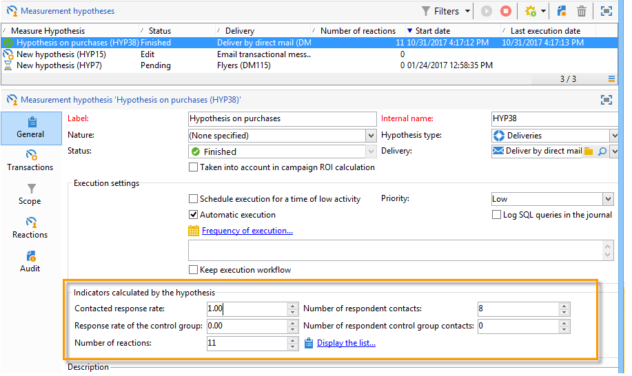
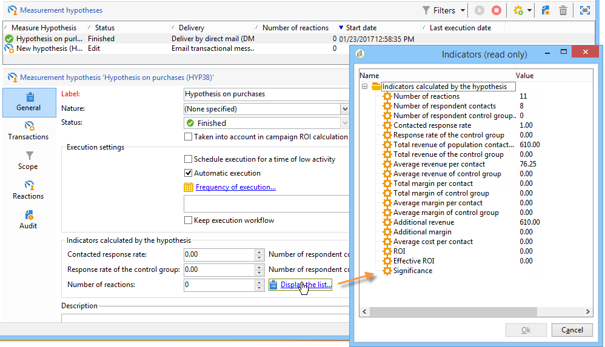
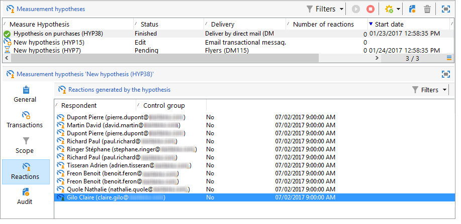
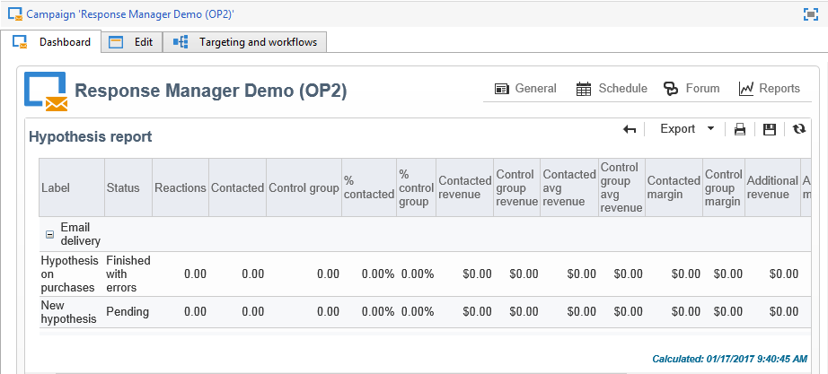
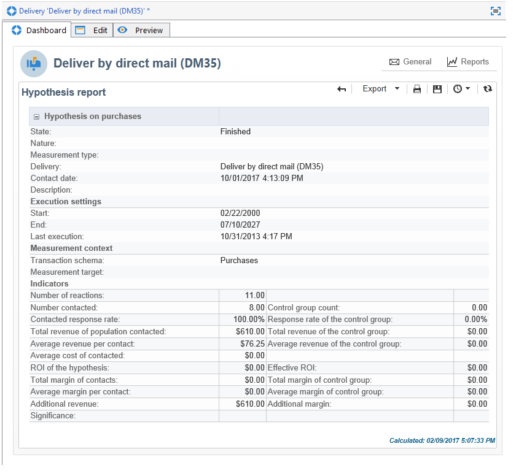

# 가설 추적{#hypothesis-tracking}

가설 계산의 결과는 Adobe Campaign 플랫폼의 다양한 수준에서 사용할 수 있습니다. 가설 및 타겟 모집단 반응에 의해 계산된 지표는 실제 가설을 통해 볼 수 있을 뿐만 아니라 캠페인 및 게재를 통해 사용할 수 있는 가설 보고서에서도 볼 수 있습니다.

## 가설 결과 {#hypothesis-results}

### 지표 {#indicators}

가설이 계산되면 몇 가지 측정 지표가 자동으로 업데이트됩니다. 가설의 **[!UICONTROL General]** 탭에서 사용할 수 있습니다.

이러한 지표는 다음과 같습니다.

* **응답자 연락처 수**: 가설과 일치하는 연락된 개인 수.
* **연락한 응답률**: 받는 사람 연락처 수/배달하는 동안 연락한 총 사람 수입니다.
* **응답자 컨트롤 그룹 연락처 수**: 가설과 일치하는 컨트롤 그룹 수.
* **컨트롤 그룹의 응답률**: 응답자 컨트롤 그룹 수/총 게재 컨트롤 그룹 수
* **반응 수**: 개인, 가설 및 트랜잭션 테이블 간의 관계를 포함하는 테이블의 레코드 수입니다.

전체 지표 목록을 보려면 **[!UICONTROL Display the list]** 링크를 클릭하십시오.

다음 정보는 표시기에서 제공됩니다.

* **연락한 모집단의 총 매출액**: 연락한 개인 수를 초과하는 총액입니다.
* **컨트롤 그룹의 총 매출액**: 컨트롤 그룹 수에 대한 총액입니다.
* **연락처당 평균 수익**: 총 금액/연락
* **컨트롤 그룹의 평균 수익**: 총 금액/컨트롤 그룹.
* **연락처당 총 이익**: 연락처당 총 이익
* **컨트롤 그룹의 총 이익**: 컨트롤 그룹의 총 이익
* **연락처당 평균 이익**: 총 이익/연락됨.
* **컨트롤 그룹의 평균 여백**: 총 여백/컨트롤 그룹
* **추가 수익**: (연락한 평균 수익-컨트롤 그룹의 평균 수익)&#42;연락한 수
* **추가 이익**: (연락처의 평균 이익-컨트롤 그룹의 평균 이익)/연락한 수
* **연락처당 평균 비용**: 계산된 배달 비용/연락처 수
* **ROI**: 게재 비용 계산/연락처당 총 이익
* **유효 ROI**: 계산된 배달 비용/추가 이익.
* **중요도**: 캠페인 중요도에 따라 0~3 값이 포함됩니다.

### 반응 {#reactions}

**[!UICONTROL Reactions]** 탭을 통해 가설에 대한 수신자의 반응을 볼 수 있습니다.

1. 가설 계산이 완료되면 Adobe Campaign 트리의 **[!UICONTROL Campaign management > Measurement hypotheses]** 노드로 이동합니다.
1. 원하는 가설을 선택하고 **[!UICONTROL Reactions]** 탭을 클릭하여 마케팅 캠페인 후에 구매할 가능성이 있는 수신자 목록을 확인합니다.

   

## 보고서 {#reports}

**[!UICONTROL Hypothesis report]**&#x200B;을(를) 사용하면 캠페인 및 게재에 대해 수행된 가설 결과를 볼 수 있습니다. 이 보고서에는 가설에 의해 계산된 지표가 포함되어 있습니다. 자세한 내용은 [지표](#indicators)를 참조하십시오.

* **캠페인 수준에서**: 관련 캠페인의 **[!UICONTROL Reports]** 링크를 클릭하고 **[!UICONTROL Hypothesis report]**&#x200B;을(를) 선택합니다. 이 보고서에는 캠페인 게재 목록과 각 게재에 대해 계산된 가설이 포함되어 있습니다.

  

* **게재 수준에서**: 보고서에 액세스하려면 관련 게재를 열고 **[!UICONTROL Summary]** 탭에서 **[!UICONTROL Reports]**&#x200B;을(를) 클릭하고 **[!UICONTROL Hypothesis report]**&#x200B;을(를) 선택하십시오. 동일한 게재에 대해 여러 가설이 계산되었다면 보고서에는 모든 가설이 포함될 것이다.

  
