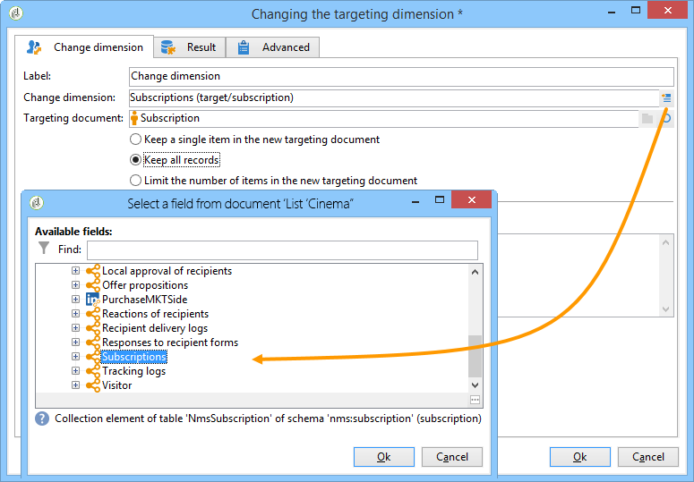
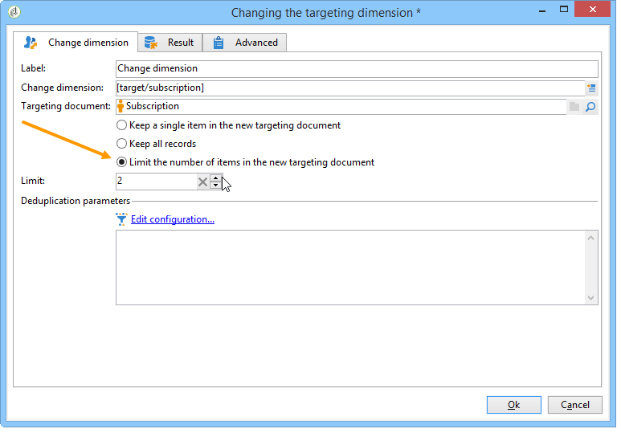
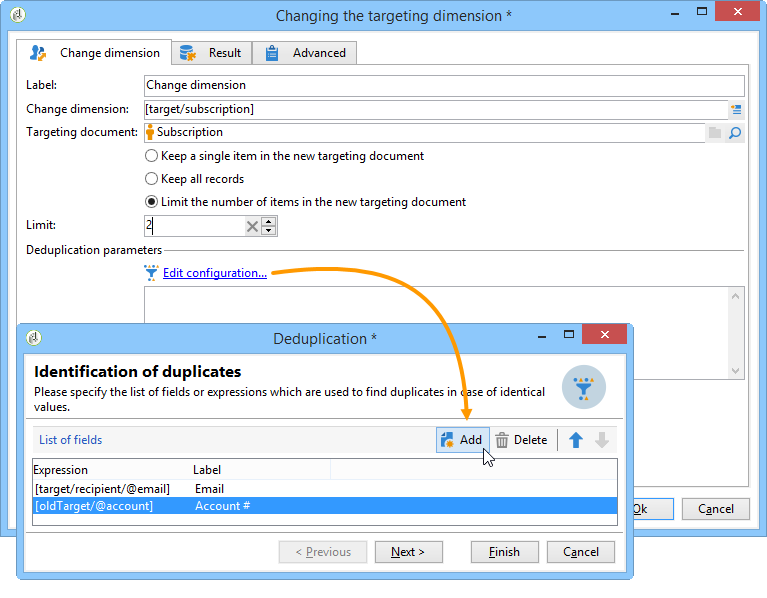
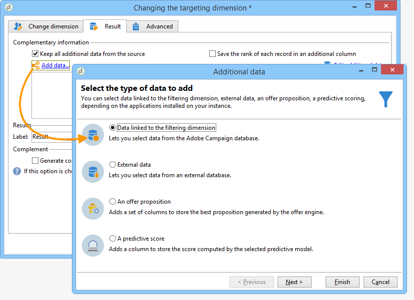
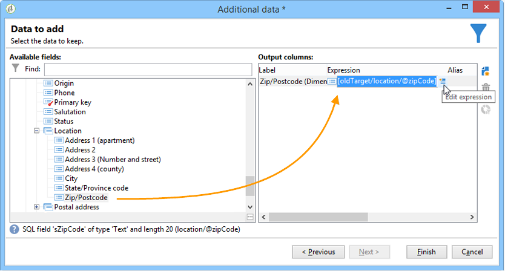
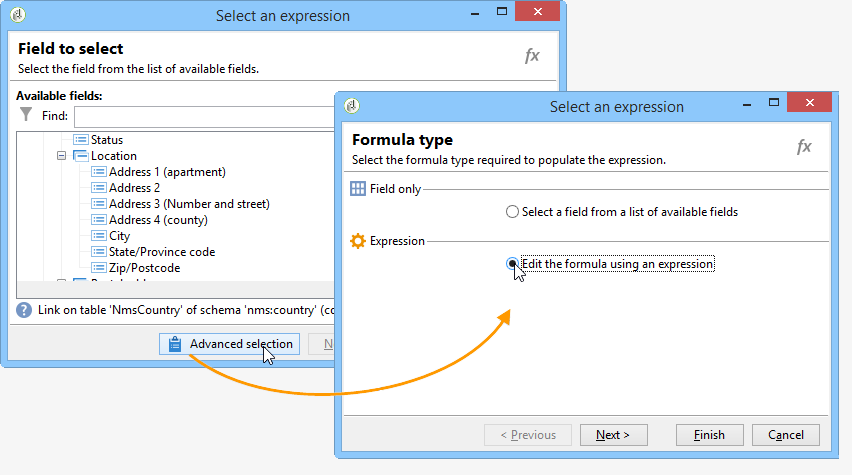
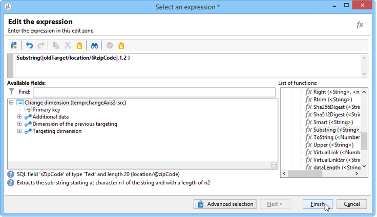
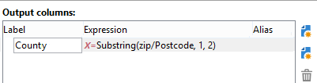
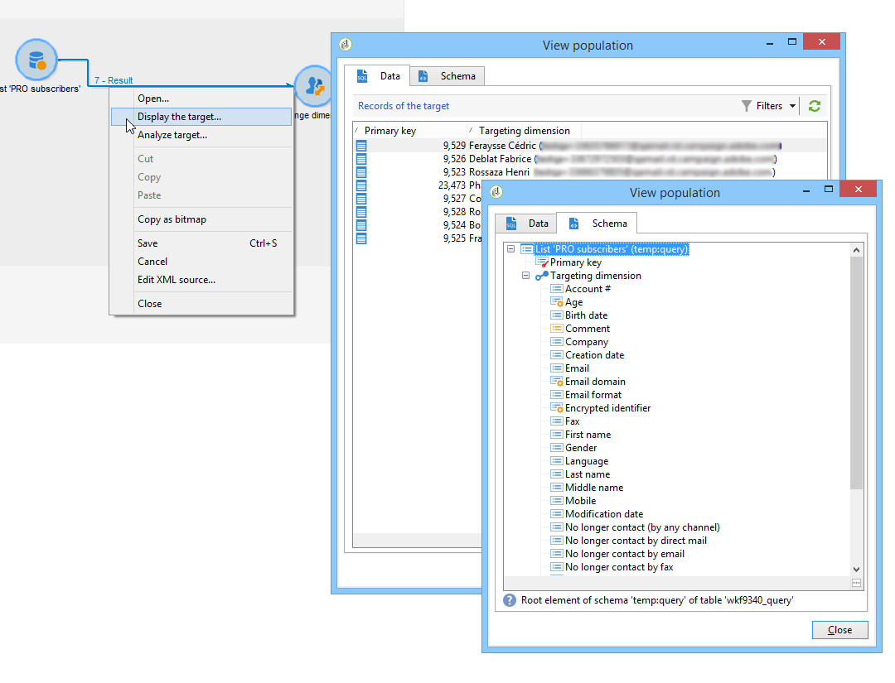
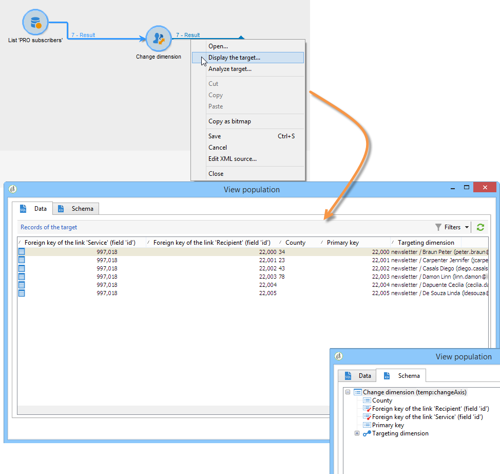

# 차원 변경{#change-dimension}

대상을 만드는 동안 **[!UICONTROL Change dimension]** 활동을 사용하여 타깃팅 차원을 변경합니다. 이 활동은 데이터 템플릿과 입력 차원에 따라 축을 전환합니다. 예를 들어 &quot;계약&quot; 차원에서 &quot;클라이언트&quot; 차원으로 전환합니다.

또한 이 활동을 사용하여 새 타겟의 추가 열을 정의하고 데이터 중복 제거 기준을 정의할 수 있습니다.

>[!IMPORTANT]
>
>**[!UICONTROL Change Dimension]** 및 **[!UICONTROL Change Data source]** 활동을 한 행에 추가해서는 안 됩니다. 두 활동을 연속해서 사용해야 하는 경우 두 활동 사이에 **[!UICONTROL Enrichement]** 활동을 포함해야 합니다. 이렇게 하면 적절한 실행이 보장되며 잠재적인 충돌 또는 오류가 방지됩니다.

**[!UICONTROL Change dimension]** 활동을 구성하려면 다음 단계를 적용합니다.

1. **[!UICONTROL Change dimension]** 필드를 통해 새 타겟팅 차원을 선택합니다.

   

1. 차원을 변경하는 동안 모든 요소를 유지하거나 출력에 유지할 요소를 선택할 수 있습니다. 다음 예에서 최대값은 입니다. 중복 항목 수는 2로 설정됩니다.

   (으)로 설정된 새 타깃팅 문서의 항목 수 제한

   하나의 레코드만 유지하도록 선택하면 컬렉션이 작업 스키마에 표시됩니다. 이 컬렉션은 하나의 레코드만 유지되므로 최종 결과에서 타겟팅되지 않을 모든 레코드를 나타냅니다. 다른 모든 컬렉션과 마찬가지로 이 컬렉션을 사용하여 열의 집계나 정보를 복구할 수 있습니다.

   예를 들어 **[!UICONTROL Customers]** 차원을 **[!UICONTROL Recipients]** 차원으로 변경하면 구매 횟수를 추가하는 동안 특정 상점의 고객을 타깃팅할 수 있습니다.

1. 이 모든 정보를 유지하지 않도록 선택하는 경우 중복 관리 모드를 구성할 수 있습니다.

   

   파란색 화살표를 사용하여 중복 처리 우선 순위를 정의할 수 있습니다.

   위의 예에서 수신자는 먼저 이메일 주소에서 중복이 제거되고 필요한 경우 계정 번호에서 중복이 제거됩니다.

1. **[!UICONTROL Result]** 탭에서는 추가 정보를 추가할 수 있습니다.

   예를 들어 **Substring** 형식 함수를 사용하여 우편 번호를 기반으로 군을 복구할 수 있습니다. 방법은 다음과 같습니다.

   * **[!UICONTROL Add data...]** 링크를 클릭하고 **[!UICONTROL Data linked to the filtering dimension]**&#x200B;을(를) 선택합니다.

     

     >[!NOTE]
     >
     >추가 열을 만들고 관리하는 방법에 대한 자세한 내용은 [데이터 추가](query.md#adding-data)를 참조하세요.

   * 이전 타겟팅 차원(축 전환 전)을 선택하고 받는 사람의 **[!UICONTROL Location]** 하위 트리에서 **[!UICONTROL Zip Code]**&#x200B;을(를) 선택한 다음 **[!UICONTROL Edit expression]**&#x200B;을(를) 클릭합니다.

     

   * **[!UICONTROL Advanced selection]**&#x200B;을(를) 클릭하고 **[!UICONTROL Edit the formula using an expression]**&#x200B;을(를) 선택합니다.

     

   * 목록에서 제공되는 함수를 사용하고 수행할 계산을 지정합니다.

     

   * 마지막으로 방금 만든 열의 레이블을 입력합니다.

     

1. 워크플로우를 실행하여 이 구성의 결과를 확인합니다. 차원 변경 활동 전후의 테이블에서 데이터를 비교하고 다음 예와 같이 워크플로 테이블의 구조를 비교합니다.

   

   
