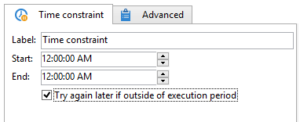

# 시간 제한{#time-constraint}

**시간 제한** 활동을 사용하면 작업 실행을 연기하거나 취소할 수 있습니다.

활동에 대한 레이블을 입력하고 워크플로우 작업 실행이 허용되는 기간을 지정합니다. 워크플로우는 이 정의된 실행 창 동안에만 실행되며 그 밖에서 일시 중지된 상태로 유지됩니다.

**[!UICONTROL Try again later if outside of execution period]** 옵션을 선택하면 실행 시간대를 벗어나서 작업을 다시 시작할 수 있습니다. 일시 중단 후 워크플로우 작업을 중단하려면 이 옵션을 선택 취소합니다.

