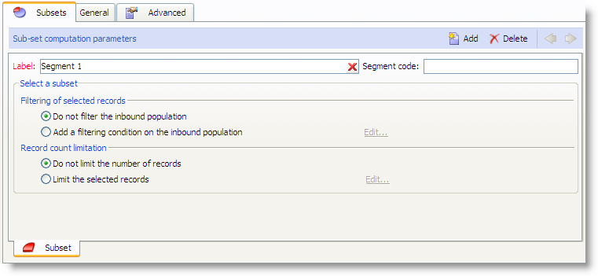

# 전자 필기장 목록

탭 형식으로 컬렉션을 표시하고 편집합니다.

## 속성

**backColor - string** 배경색(btnshadow, white).

**이름 - 문자열** 컨테이너 ID.

**noToolbar - 부울** 도구 모음을 숨깁니다.

**padding-left - integer** 컨테이너의 왼쪽에 있는 픽셀 단위 공간입니다.

**패딩 오른쪽 - 정수** 컨테이너의 오른쪽에 있는 픽셀 단위 공간입니다.

**위쪽 패딩 - 정수** 컨테이너 위의 픽셀 단위 공간입니다.

**padding-bottom - integer** 컨테이너 아래 픽셀 단위 공간입니다.

**패딩 - 정수** 컨테이너 주위의 픽셀 단위 공간입니다.

**읽기 전용 - 부울** 제어와 모든 하위 항목을 읽기 전용으로 강제 적용합니다.

**toobarAlign - 문자열** 가로 \| 세로

**toobarCaption - string** 레이블이 도구 모음에 표시됩니다.

**xpath-label - 문자열** 탭의 텍스트를 제공하는 경로입니다.
