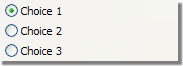

# 라디오 단추

라디오 버튼을 사용하면 여러 옵션 중에서 선택할 수 있습니다. &lt;input> 태그는 가능한 옵션을 열거하는 데 사용됩니다.



## 속성

**backColor - string** 배경색(btnshadow, white).

**border - string** 컨트롤의 테두리 스타일을 변경합니다(단색, 이중, 삽입, 시작, 없음).

**checkedValue - 문자열** 선택 항목에 연결된 값입니다.

**font-size - integer** 글꼴 크기를 변경합니다.

**레이블 - 문자열** 관련 레이블입니다.

**nolabel - 부울** 연결된 레이블을 숨깁니다.

**읽기 전용 - 부울** 컨트롤을 읽기 전용으로 강제 실행합니다.

## 비고

예:

```xml
      <input type="RadioButton" xpath="@gender" checkedValue="0" label="Choice 1"/>
<input type="RadioButton" xpath="@gender" checkedValue="1" label="Choice 2"/>
<input type="RadioButton" xpath="@gender" checkedValue="2" label="Choice 3"/>
```
