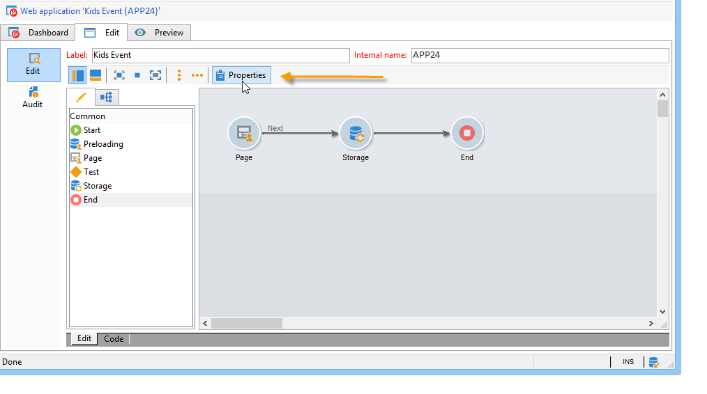

# 온라인 설문 조사 구성{#configuring-surveys}

>[!AVAILABILITY]
>
>[Campaign FFDA 배포](../../architecture/enterprise-deployment.md)에 대한 설문 조사를 사용할 수 없습니다.

## 설문 조사 속성 {#survey-properties}

온라인 설문 조사는 고객의 요구 사항을 충족하도록 완벽하게 구성 및 사용자 정의할 수 있습니다. 등록 정보 창에 매개변수를 입력해야 합니다.

사용 가능한 매개 변수는 [이 문서](https://experienceleague.adobe.com/en/docs/campaign-classic/using/designing-content/web-forms/defining-web-forms-properties){target="_blank"}에 자세히 설명되어 있습니다.

## 설문 조사 데이터 저장소 {#survey-data-storage}

기본적으로 웹 양식 필드는 수신자 표에 저장됩니다. 다른 테이블을 사용하려면 **[!UICONTROL Document type]** 필드에서 테이블을 선택합니다. **[!UICONTROL Zoom]** 아이콘을 사용하면 선택한 테이블의 내용을 볼 수 있습니다.

필드(로컬 변수)에 저장되지 않은 사용자가 제공한 설문 조사에 대한 답변은 **설문 조사에 대한 답변** 표에 저장됩니다. **[!UICONTROL Library]** 필드를 기반으로 사용하는 스키마를 변경할 수 있습니다. 이 필드는 **설문 조사**&#x200B;에만 사용할 수 있습니다.
