# 설문 조사 만들기의 주요 단계{#getting-started-with-surveys}

>[!AVAILABILITY]
>
>[Campaign FFDA 배포](../../architecture/enterprise-deployment.md)에 대한 설문 조사를 사용할 수 없습니다.

다음은 기본 제공 템플릿을 사용하여 간단한 설문 조사를 만드는 주요 단계에 대한 간략한 개요입니다.

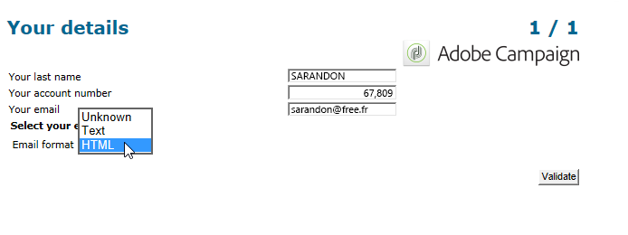

다음 단계는 다음과 같습니다.

1. [1단계 - 설문 조사 만들기](#step-1---creating-a-survey),
1. [2단계 - 템플릿 선택](#step-2---selecting-the-template),
1. [3단계 - 설문 조사 빌드](#step-3---building-the-survey),
1. [4단계 - 페이지 콘텐츠 만들기](#step-4---creating-the-page-content),
1. [5단계 - 설문 조사 데이터 저장](#step-5---storing-the-survey-data-),
1. [6단계 - 페이지 게시](#step-6---publishing-the-pages),
1. [7단계 - 온라인 설문 조사 공유](#step-7---sharing-your-online-survey).

## 1단계 - 설문 조사 만들기 {#step-1---creating-a-survey}

새 설문 조사를 만들려면 **[!UICONTROL Campaigns]** 또는 **[!UICONTROL Profiles and targets]** 탭으로 이동하여 **[!UICONTROL Web Applications]** 메뉴를 클릭합니다. 양식 목록 위에 있는 **[!UICONTROL Create]** 단추를 클릭합니다.

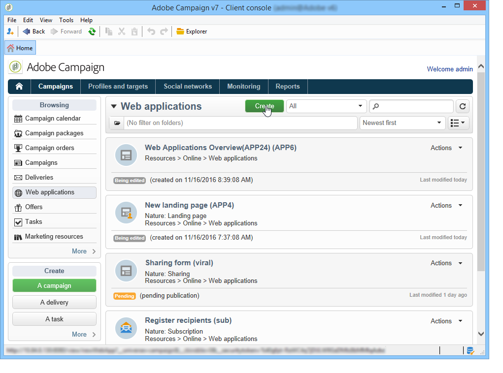

## 2단계 - 템플릿 선택 {#step-2---selecting-the-template}

설문 조사 템플릿을 선택한 다음 설문 조사 이름을 지정합니다. 최종 사용자는 이 이름을 볼 수 없지만 Adobe Campaign 내에서 설문 조사를 식별할 수 있습니다. 웹 응용 프로그램 목록에 설문 조사를 추가하려면 **[!UICONTROL Save]**&#x200B;을(를) 클릭하십시오.

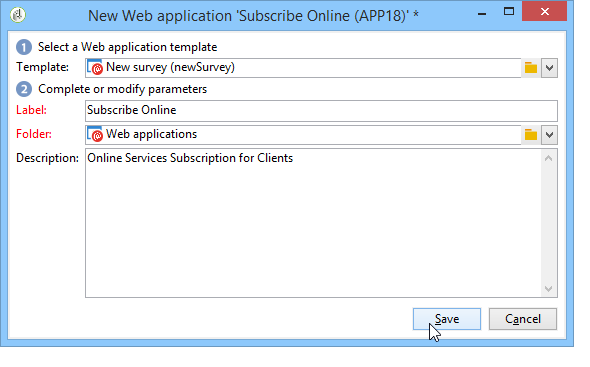

## 3단계 - 설문 조사 빌드 {#step-3---building-the-survey}

설문 조사는 콘텐츠가 만들어질 페이지, 데이터 미리 로드 및 저장 단계, 테스트 단계 등의 요소가 있는 다이어그램에서 빌드됩니다. 스크립트 및 쿼리를 삽입할 수도 있습니다.

차트를 만들려면 설문 조사의 **[!UICONTROL Edit]** 양식을 클릭하십시오.

설문 조사에는 페이지, 저장소 상자 및 끝 페이지의 세 가지 구성 요소 **최소**&#x200B;이(가) 포함되어야 합니다.

* 페이지를 만들려면 아래와 같이 편집기의 왼쪽 섹션에서 **[!UICONTROL Page]** 개체를 선택한 다음 가운데 섹션에 추가합니다.

  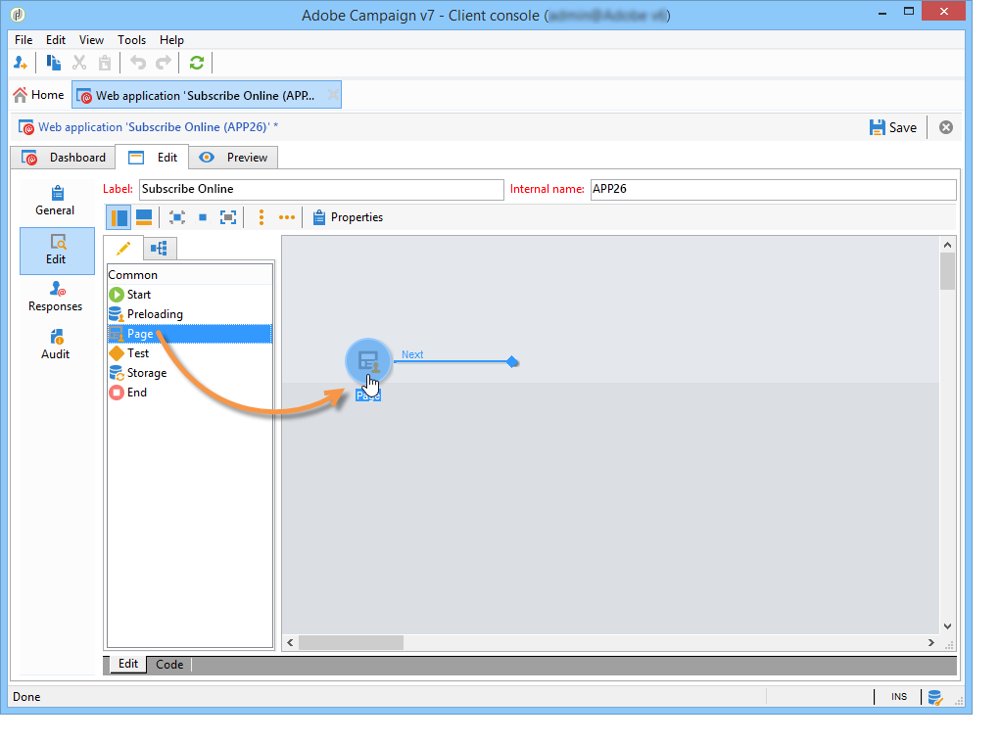

* 그런 다음 **[!UICONTROL Storage]** 개체를 선택하여 페이지의 출력 전환에 배치합니다.
* 마지막으로 **[!UICONTROL End]** 개체를 선택하고 저장소 상자의 출력 전환 끝에 배치하여 다음 다이어그램을 가져옵니다.

  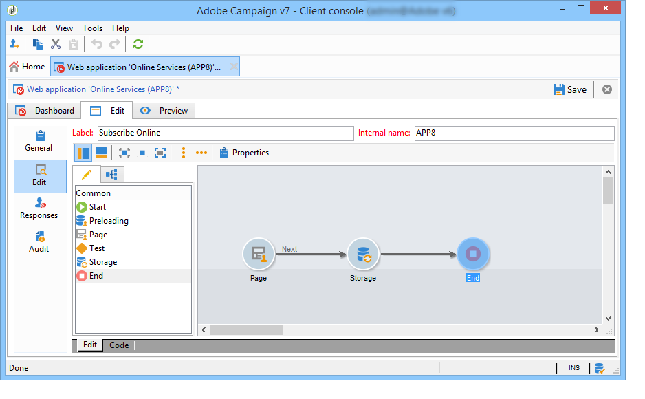

## 4단계 - 페이지 컨텐츠 만들기 {#step-4---creating-the-page-content}

다음 예제에서는 **[!UICONTROL Page (v5 compatibility)]** 형식 페이지를 사용하고 있습니다. 이 유형의 페이지는 **[!UICONTROL Edit]** 탭의 고급 메뉴를 통해 액세스할 수 있습니다.

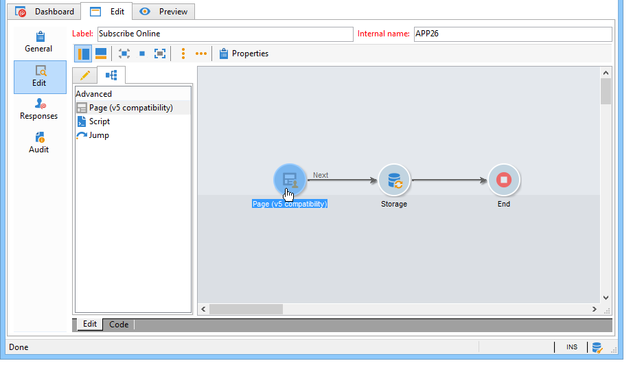

* **입력 필드 추가**

  페이지의 콘텐츠를 만들려면 편집해야 합니다. 이렇게 하려면 **[!UICONTROL Page]** 개체를 두 번 클릭하십시오. 도구 모음에서 첫 번째 아이콘을 클릭하여 필드 만들기 도우미를 엽니다. 받는 사람 프로필의 일치하는 필드에 저장할 사용자 이름에 대한 입력 필드를 만들려면 **[!UICONTROL Edit a recipient]**&#x200B;을(를) 선택합니다.

  

  **[!UICONTROL Next]** 단추를 클릭하여 데이터베이스의 데이터 저장소에 대한 필드를 선택합니다. 이 경우 &#39;성&#39; 필드.

  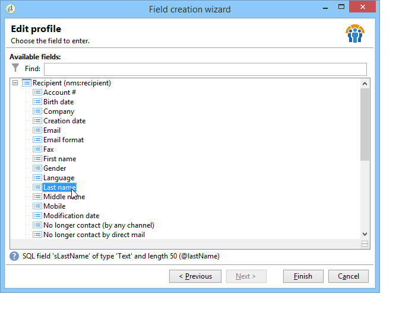

  필드 만들기를 확인하려면 **[!UICONTROL Finish]**&#x200B;을(를) 클릭합니다.

  기본적으로 정보가 데이터베이스에 이미 있는 필드에 저장될 때 필드는 선택한 필드의 이름, 즉 이 예에서 &#39;성&#39;을 취합니다. 아래와 같이 이 레이블을 수정할 수 있습니다.

  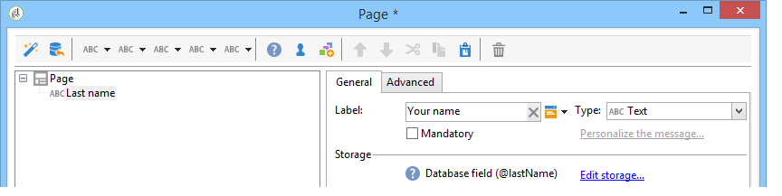

  이제 사용자 계정 번호에 대한 입력 필드를 만듭니다. 작업을 반복하고 &#39;계정 번호&#39; 필드를 선택합니다.

  동일한 절차를 적용하여 사용자가 이메일 주소를 입력할 수 있는 필드를 추가합니다.

* **질문 만들기**

  질문을 만들려면 트리의 마지막 요소를 마우스 오른쪽 단추로 클릭하고 **[!UICONTROL Containers > Question]**&#x200B;을(를) 선택하거나 **[!UICONTROL Containers]** 아이콘을 클릭하고 **[!UICONTROL Question]**&#x200B;을(를) 선택합니다.

  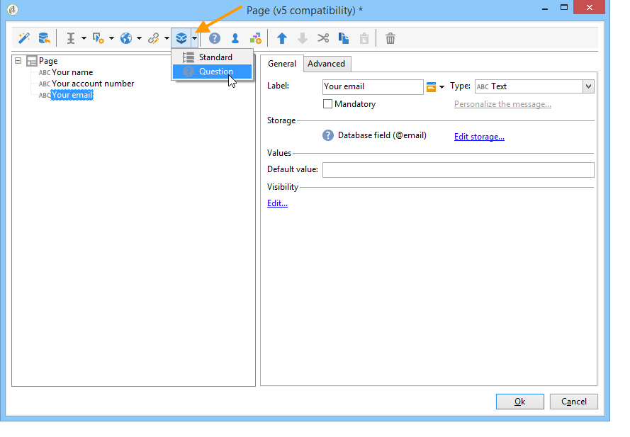

  질문의 레이블을 입력하고 답변 필드를 질문의 하위 분기로 삽입합니다. 이렇게 하려면 답변 필드를 만들 때 질문에 연결된 노드를 선택해야 합니다. 아래와 같이 **[!UICONTROL Selection controls]** 아이콘을 사용하거나 마우스 오른쪽 단추를 클릭하여 **[!UICONTROL drop-down listx]**&#x200B;을(를) 추가합니다.

  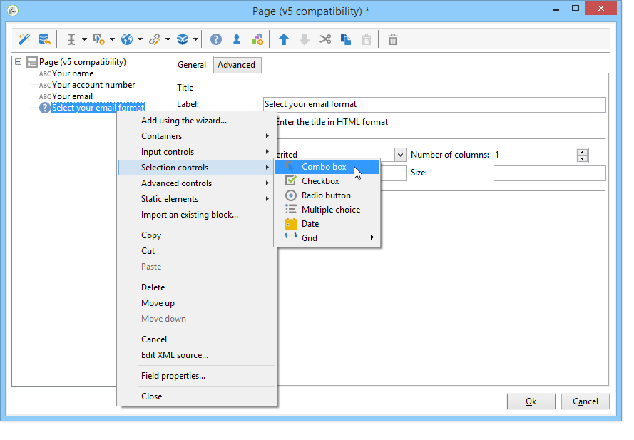

  저장소 공간 선택: 값을 자동으로 검색할 열거 필드를 선택합니다(이 경우 이메일 형식).

  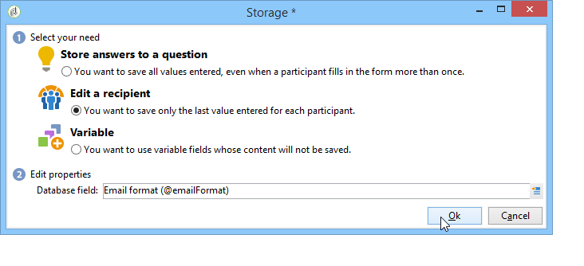

  **[!UICONTROL General]** 탭에서 **[!UICONTROL Initialize the list of values from the database]** 링크를 클릭합니다. 값 테이블이 자동으로 입력됩니다.

  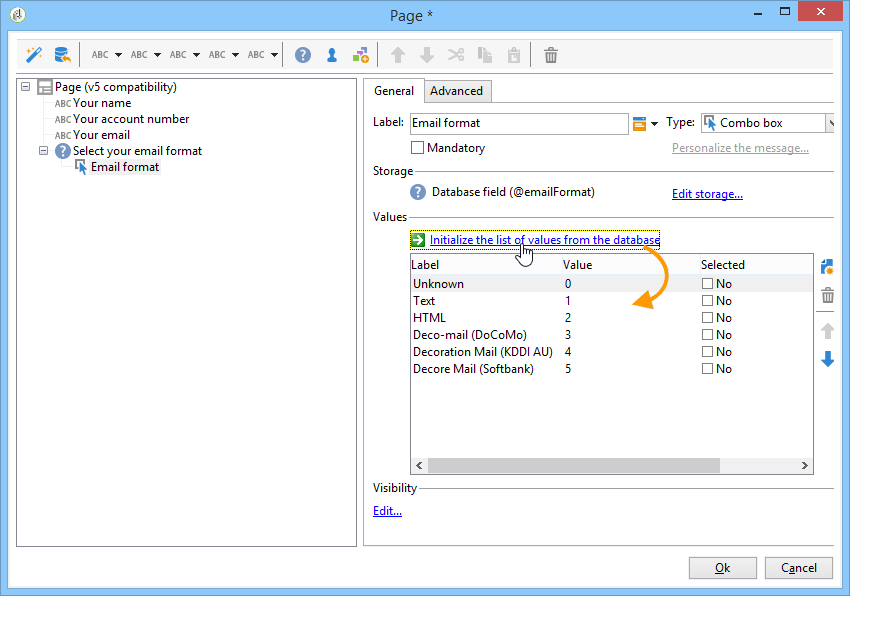

  편집기를 닫으려면 **[!UICONTROL OK]**&#x200B;을(를) 클릭하고 변경 내용을 저장하려면 **[!UICONTROL Save]**&#x200B;을(를) 클릭합니다.

  >[!NOTE]
  >
  >**[!UICONTROL Advanced]** 탭의 옵션을 통해 각 필드 또는 질문에 대해 필요에 맞게 페이지 레이아웃을 조정할 수 있습니다. 설문 조사 화면의 레이아웃은 [이 섹션](https://experienceleague.adobe.com/en/docs/campaign-classic/using/designing-content/web-forms/about-web-forms){target="_blank"}에 자세히 설명되어 있습니다.

  세부 정보 화면에서 **[!UICONTROL Preview]** 탭을 클릭하여 방금 만든 설문 조사의 렌더링을 확인합니다.

  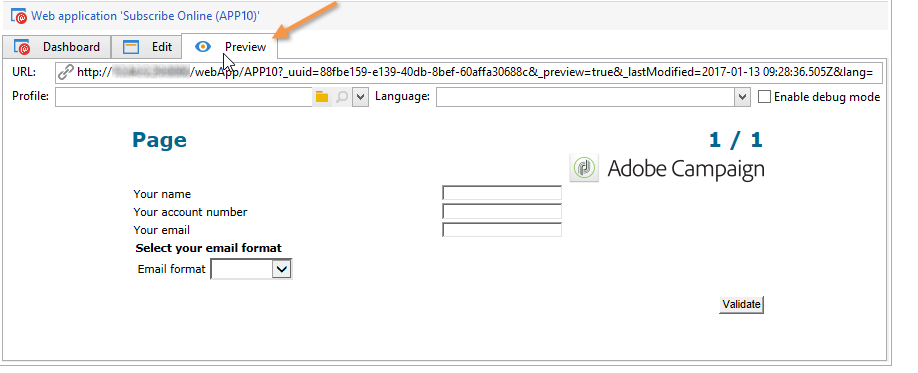

## 5단계 - 설문 조사 데이터 저장 {#step-5---storing-the-survey-data-}

저장소 상자를 사용하면 사용자 응답을 데이터베이스에 저장할 수 있습니다. 데이터베이스에 이미 있는 프로필을 식별하려면 조정 키를 선택해야 합니다.

이렇게 하려면 상자를 편집하고 데이터가 저장될 때 조정 키로 사용할 필드를 선택합니다.

아래 예에서 저장(확인)이 발생할 때 프로필이 양식에 입력한 것과 동일한 계정 번호로 데이터베이스에 저장되면 프로필이 업데이트됩니다. 프로필이 존재하지 않으면 생성됩니다.

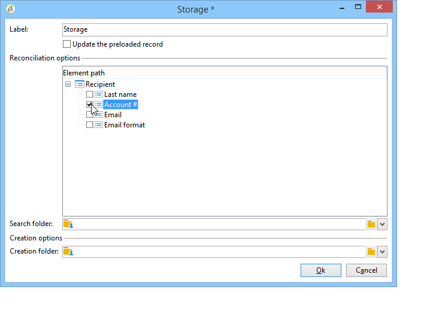

**[!UICONTROL OK]**&#x200B;을(를) 클릭하여 확인한 다음 **[!UICONTROL Save]**&#x200B;을(를) 클릭하여 설문 조사를 저장합니다.

## 6단계 - 페이지 게시 {#step-6---publishing-the-pages}

사용자가 HTML 페이지에 액세스할 수 있으려면 애플리케이션을 사용할 수 있어야 합니다. 더 이상 편집 단계가 아닌 프로덕션 단계여야 합니다. 프로덕션에 설문 조사를 넣으려면 설문 조사를 게시해야 합니다. 방법은 다음과 같습니다.

* 설문 조사 대시보드 위에 있는 **[!UICONTROL Publish]** 단추를 클릭합니다.
* 게시를 시작하고 도우미를 닫으려면 **[!UICONTROL Start]**&#x200B;을(를) 클릭하십시오.

  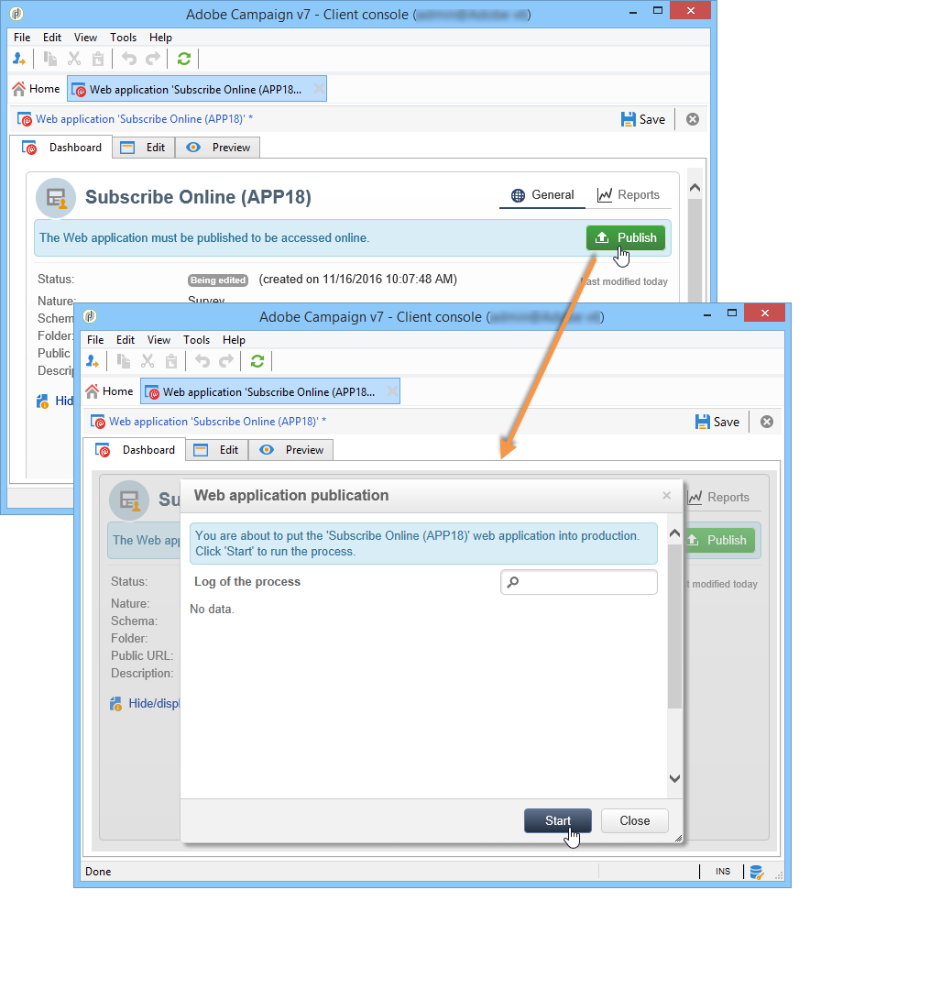

  설문 조사 상태가 **온라인**(으)로 변경됩니다.

  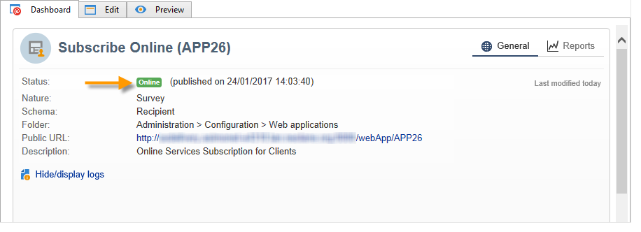

## 7단계 - 온라인 설문 조사 공유 {#step-7---sharing-your-online-survey}

프로덕션에 들어가면 서버에서 설문 조사에 액세스할 수 있으며 설문 조사를 게재할 수 있습니다. 설문 조사에 액세스하기 위한 URL이 대시보드에 표시됩니다.

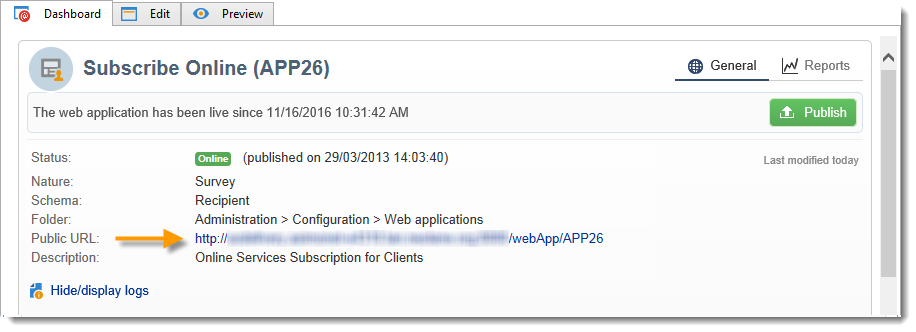

예를 들어 설문 조사를 게재하기 위해 대상 모집단에 대한 액세스 링크가 포함된 메시지를 보내거나 웹 페이지에 설문 조사 액세스 URL을 배치할 수 있습니다.

그런 다음 보고서와 로그를 통해 사용자 응답을 모니터링할 수 있습니다. [응답 추적](publish-track-and-use-collected-data.md#response-tracking)을 참조하세요.

>[!CAUTION]
>
>공개 URL에는 설문 조사의 내부 이름이 포함되어 있습니다. 내부 이름이 수정되면 URL이 자동으로 업데이트됩니다. 설문 조사에 대한 모든 링크도 업데이트해야 합니다.
>
>양식에 대한 링크가 포함된 게재를 이미 보낸 경우 이 링크가 더 이상 작동하지 않습니다.
