# 수집된 데이터 게시, 추적 및 사용{#publish-track-and-use-collected-data}

>[!AVAILABILITY]
>
>[Campaign FFDA 배포](../../architecture/enterprise-deployment.md)에 대한 설문 조사를 사용할 수 없습니다.


양식이 생성, 구성 및 게시되면 대상자와 링크를 공유하고 응답을 추적할 수 있습니다.

>[!NOTE]
>
>Adobe Campaign의 설문 조사 수명 주기와 게시 및 게재 모드는 웹 양식의 수명 주기와 유사합니다. 자세한 내용은 [이 섹션](https://experienceleague.adobe.com/en/docs/campaign-classic/using/designing-content/web-forms/about-web-forms){target="_blank"}을 참조하세요.

## 설문 조사 대시보드 {#survey-dashboard}

각 설문 조사에는 상태, 설명, 공개 URL 및 가용성 일정을 볼 수 있는 자체 대시보드가 있습니다. 사용 가능한 보고서를 볼 수도 있습니다. [자세히 알아보기](#reports-on-surveys).

설문 조사의 공개 URL이 대시보드에 표시됩니다.

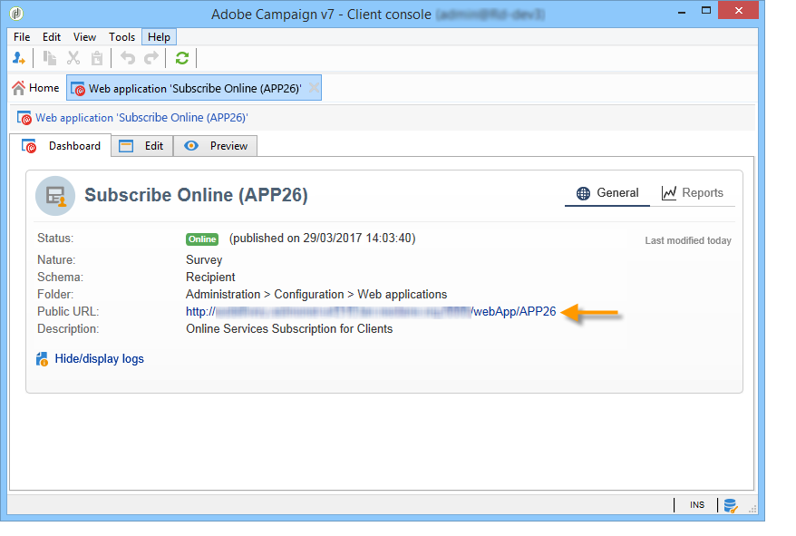

## 응답 추적 {#response-tracking}

로그 및 보고서에서 설문 조사에 대한 응답을 추적할 수 있습니다.

### 설문 로그 {#survey-logs}

제공된 각 설문 조사에 대해 **[!UICONTROL Logs]** 탭에서 응답을 추적할 수 있습니다. 이 탭에는 설문 조사를 완료한 사용자 목록과 해당 출처가 표시됩니다.

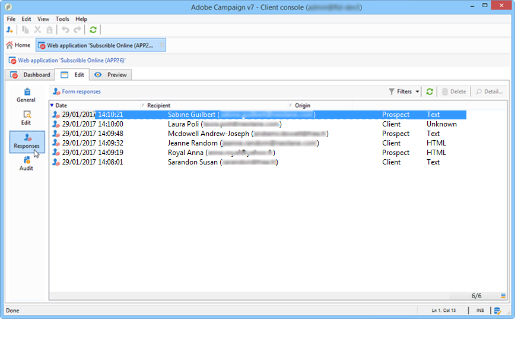

줄을 두 번 클릭하여 응답자가 입력한 대로 설문 조사 양식을 표시합니다. 설문 조사를 전체 탐색하고 전체 답변을 액세스할 수 있습니다. 외부 파일로 내보낼 수 있습니다. 자세한 내용은 [답변 내보내기](#exporting-answers)를 참조하세요.

다음 문자를 추가하여 설문 조사 URL에 출처가 표시됩니다.

```
?origin=xxx
```

설문 조사를 편집하는 동안 설문 조사의 URL에 테스트 단계이며 아직 온라인 상태가 아님을 나타내는 **[!UICONTROL __uuid]** 매개 변수가 포함되어 있습니다. 이 URL을 통해 설문 조사에 액세스하면 생성된 레코드는 추적(보고서)에서 고려되지 않습니다. 원본이 **[!UICONTROL Adobe Campaign]** 값으로 강제 적용됩니다.

URL 매개 변수에 대한 자세한 정보는 [이 페이지](https://experienceleague.adobe.com/en/docs/campaign-classic/using/designing-content/web-forms/defining-web-forms-properties#form-url-parameters){target="_blank"}를 참조하세요.

### 설문 조사 보고서 {#reports-on-surveys}

대시보드 탭에서는 설문 조사 보고서에 액세스할 수 있습니다. 보고서 이름을 클릭하여 확인합니다.

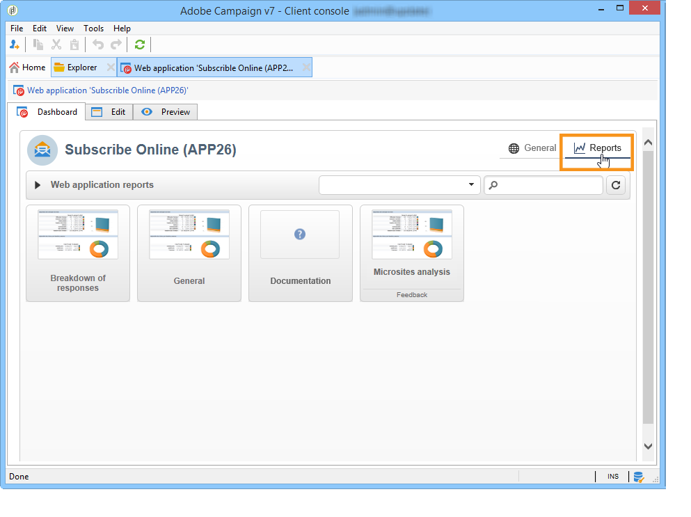

설문 조사 구조는 **[!UICONTROL Documentation]** 보고서에 표시됩니다.

웹 설문 조사에 대한 다른 두 보고서는 설문 조사의 **[!UICONTROL Reports]** 탭에서 사용할 수 있습니다. **[!UICONTROL General]** 및 **[!UICONTROL Breakdown of responses]**.

* 일반

  이 보고서에는 설문 조사에 대한 일반적인 정보, 즉 시간이 지남에 따라 응답 수가 변경되는 방식과 출처 및 언어별 분포가 포함되어 있습니다.

  일반 보고서의 예:

  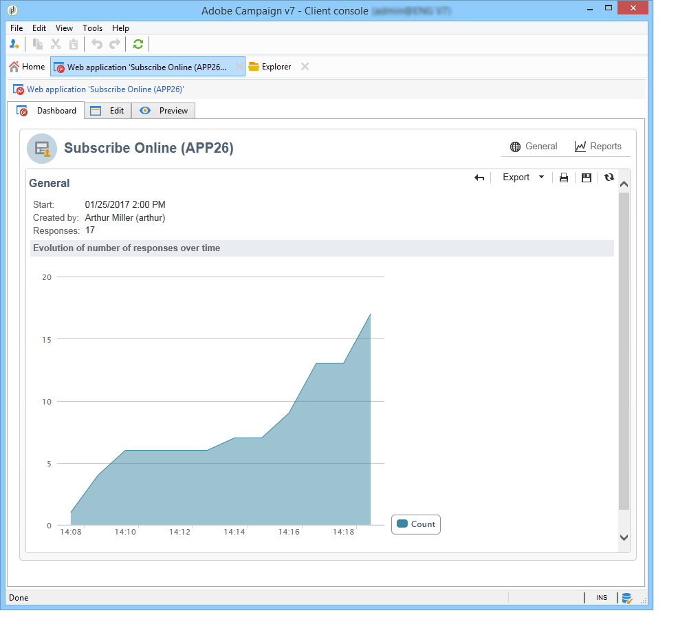

* 응답 분류

  이 보고서에는 각 질문에 대한 응답 분류가 표시됩니다. 이 분류는 **[!UICONTROL Question]** 형식 컨테이너에 저장된 필드에 제공된 응답에만 사용할 수 있습니다. 선택 컨트롤에만 유효합니다(예: 텍스트 필드에 대한 분류 없음).

  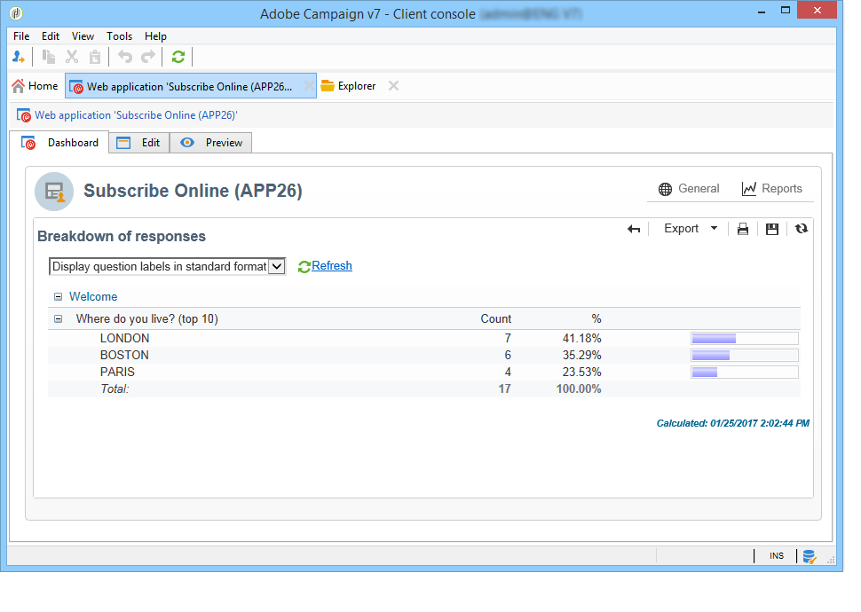

## 답변 내보내기 {#exporting-answers}

설문 조사에 대한 답변을 나중에 처리할 수 있도록 외부 파일로 내보낼 수 있습니다. 두 가지 방법으로 이 작업을 수행할 수 있습니다.

1. 보고서 데이터 내보내기

   보고서 데이터를 내보내려면 **[!UICONTROL Export]** 단추를 클릭하고 내보내기 형식을 선택합니다.

   보고서 데이터 내보내기에 대한 자세한 내용은 [이 섹션](https://experienceleague.adobe.com/en/docs/campaign-classic/using/reporting/creating-new-reports/about-reports-creation-in-campaign){target="_blank"}을 참조하세요.

1. 답변 내보내기

   답변을 내보내려면 설문 조사의 **[!UICONTROL Responses]** 탭을 클릭하고 마우스 오른쪽 단추를 클릭합니다. **[!UICONTROL Export...]**&#x200B;을(를) 선택합니다.

   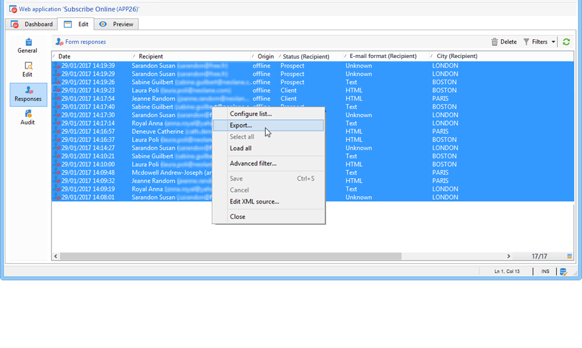

   그런 다음 내보낼 정보와 저장소 파일을 입력합니다.

   내보내기 도우미에서 출력 파일의 내용과 형식을 구성할 수 있습니다.

   이렇게 하면 다음 작업을 수행할 수 있습니다.

   * 출력 파일에 열을 추가하고 데이터베이스에 저장된 수신자의 정보를 복구합니다.
   * 내보낸 데이터의 형식 지정,
   * 파일의 정보에 대한 인코딩 형식을 선택합니다.

   내보낼 설문 조사에 여러 개의 **[!UICONTROL Multi-line text]** 또는 **[!UICONTROL HTML text]** 필드가 포함된 경우 **[!UICONTROL XML]** 형식으로 내보내야 합니다. 이렇게 하려면 아래와 같이 **[!UICONTROL Output format]** 필드의 드롭다운 목록에서 이 형식을 선택합니다.

   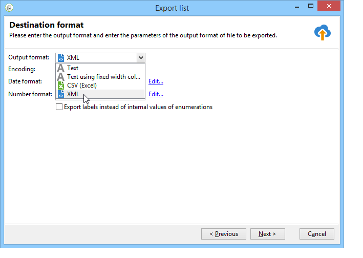

   내보내기를 실행하려면 **[!UICONTROL Start]**&#x200B;을(를) 클릭합니다.

   >[!NOTE]
   >
   >데이터 내보내기 및 구성 단계는 [이 섹션](https://experienceleague.adobe.com/ko/docs/campaign/campaign-v8/data/import){target="_blank"}에 자세히 설명되어 있습니다(Campaign v8 설명서).

## 수집된 데이터 사용 {#using-the-collected-data}

온라인 설문 조사를 통해 수집된 정보는 타겟팅 워크플로우의 프레임워크 내에서 복구할 수 있습니다. 이렇게 하려면 **[!UICONTROL Survey responses]** 상자를 사용합니다.

다음 예제에서는 온라인 설문 조사에서 점수가 가장 높은 두 자녀 이상의 수신자 5명을 위해 특별히 웹 오퍼를 만들려고 합니다. 이 설문 조사에 대한 답변은 다음과 같습니다.

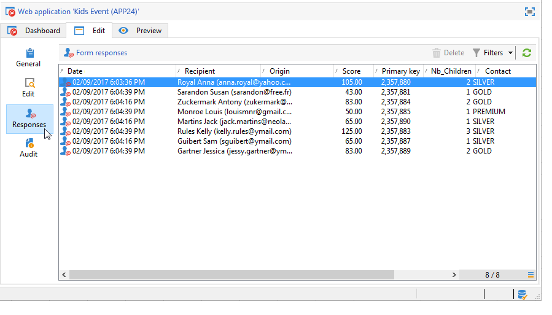

타깃팅 워크플로에서 **[!UICONTROL Survey responses]**&#x200B;은(는) 다음과 같이 구성됩니다.

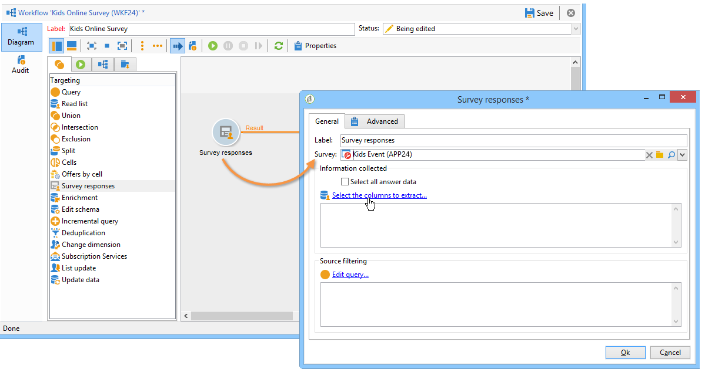

먼저 관련 설문 조사를 선택한 다음 창의 중앙 섹션에서 추출할 데이터를 선택합니다. 이 경우 다섯 개의 가장 높은 점수를 복구하기 위해 분할 상자에 사용되므로 최소한 점수 열을 추출해야 합니다.

**[!UICONTROL Edit query...]** 링크를 클릭하여 답변에 대한 필터링 조건을 나타냅니다.

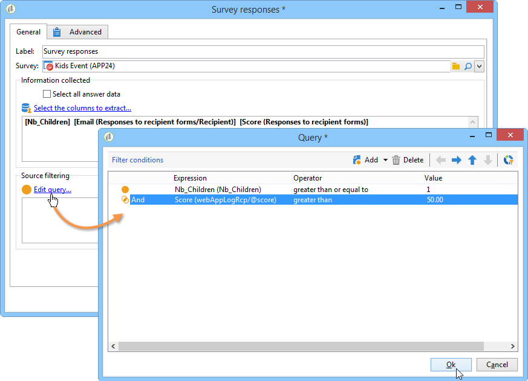

타겟팅 워크플로우를 시작합니다. 쿼리는 8명의 수신자를 복구합니다.

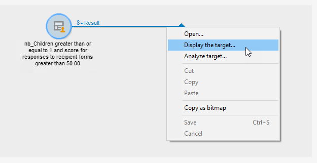

컬렉션 상자의 출력 전환을 마우스 오른쪽 단추로 클릭하여 표시합니다.

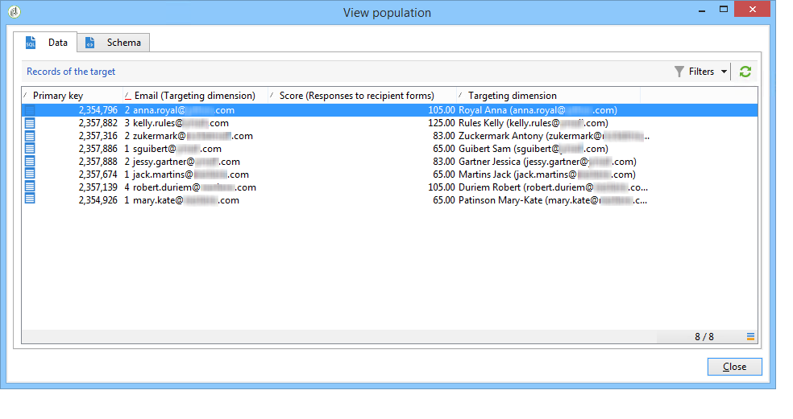

그런 다음 워크플로우에 분할 상자를 배치하여 점수가 가장 높은 수신자 5명을 복구합니다.

분할 상자를 편집하여 구성합니다.

* **[!UICONTROL General]** 탭에서 적절한 스키마를 선택한 다음 하위 집합을 구성하십시오.

  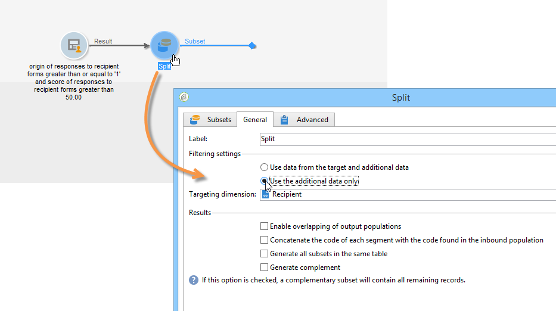

* **[!UICONTROL Sub-sets]** 탭으로 이동하여 **[!UICONTROL Limit the selected records]** 옵션을 선택한 다음 **[!UICONTROL Edit...]** 링크를 클릭합니다.

  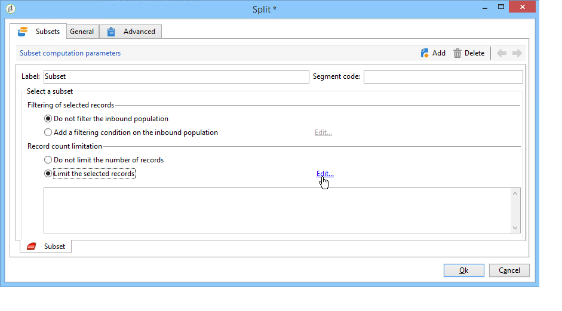

* **[!UICONTROL Keep only the first records after sorting]** 옵션을 선택하고 정렬 열을 선택합니다. **[!UICONTROL Descending sort]** 옵션을 선택합니다.

  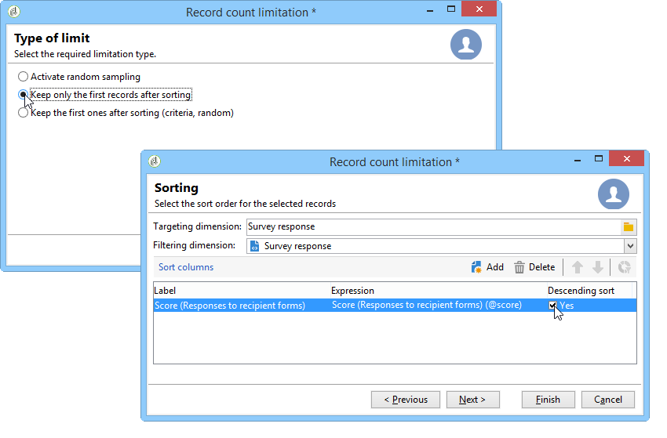

* **[!UICONTROL Next]** 단추를 클릭하고 레코드 수를 5개로 제한합니다.

  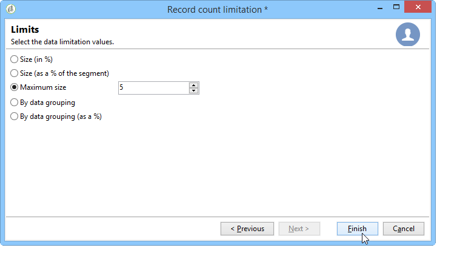

* **[!UICONTROL Finish]**&#x200B;을(를) 클릭한 다음 워크플로우를 다시 시작하여 타깃팅을 승인합니다.

## 데이터 표준화 {#standardizing-data}

별칭을 사용하여 수집된 데이터에 대해 Adobe Campaign에서 표준화 프로세스를 설정할 수 있습니다. 이렇게 하면 데이터베이스에 저장된 데이터를 표준화할 수 있습니다. 이렇게 하려면 관련 정보가 포함된 항목별 목록에 별칭을 정의하십시오. [Adobe Campaign v8(콘솔) 설명서](https://experienceleague.adobe.com/en/docs/campaign/campaign-v8/config/settings/enumerations){target=_blank}에서 **열거형으로 작업**&#x200B;하는 방법에 대해 자세히 알아보세요.