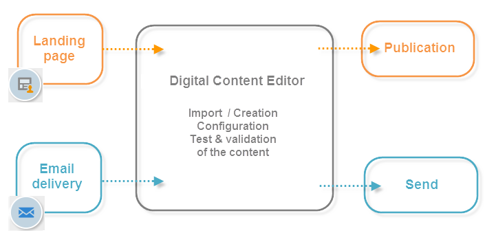

# Campaign HTML 편집기 시작{#about-campaign-html-editor}

>[!NOTE]
>
>가장 일반적인 사용 사례의 경우, Campaign 웹 사용자 인터페이스에서 랜딩 페이지를 만들어 손쉽게 디자인하고 게시할 수 있습니다. 이 섹션에 설명된 대로 클라이언트 콘솔에서 만든 랜딩 페이지는 더 많은 설정을 제공하고 더 많은 고급 사용 사례를 다룹니다.
>
>[Campaign 웹 사용자 인터페이스의 랜딩 페이지에 대해 자세히 알아보기](https://experienceleague.adobe.com/en/docs/campaign-web/v8/landing-pages/get-started-lp){target="_blank"}

**DCE(디지털 콘텐츠 편집기)**&#x200B;은(는) Adobe Campaign 내에서 HTML 형식으로 콘텐츠와 템플릿을 쉽게 만들 수 있는 HTML 콘텐츠 편집기입니다.

디지털 콘텐츠 편집기를 사용하면 페이지 요소를 삽입하고 형식을 지정하며, 데이터베이스 필드를 HTML 페이지의 요소와 매핑할 수 있습니다. 이 편집기는 웹 애플리케이션용 페이지를 만들거나 DCE 템플릿을 기반으로 게재를 만들 때 사용할 수 있습니다.

>[!NOTE]
>
>서버측 JavaScript 코드를 추가해야 하는 경우 개인화 블록을 사용합니다. [Campaign v8 설명서](https://experienceleague.adobe.com/docs/campaign/campaign-v8/send/personalize/personalization-blocks.html){target="_blank"}를 참조하세요.

>[!CAUTION]
>
>모든 외부 리소스는 HTTPS URL을 사용하여 참조해야 합니다.

## 디지털 콘텐츠 편집기 사용의 주요 단계 {#content-editor-general-operation}

이 섹션에서는 웹 애플리케이션 및 게재 디자인의 컨텍스트에서 DCE로 편집된 콘텐츠를 편집하고 업로드하는 주요 단계를 제공합니다.

일반적인 작업은 다음과 같습니다.

간단한 **웹 응용 프로그램**&#x200B;을 만들려면 다음을 수행해야 합니다.

1. 웹 응용 프로그램 만들기 - [자세히 알아보기](creating-a-landing-page.md)
1. 기존 콘텐츠를 선택하거나 표준 템플릿에서 콘텐츠를 만듭니다. [자세히 알아보기](template-management.md)
1. 콘텐츠 편집 및 구성 - [자세히 알아보기](editing-content.md)
1. 웹 응용 프로그램 게시 - [자세히 알아보기](creating-a-landing-page.md#step-3---publishing-content)

>[!NOTE]
>
>웹 응용 프로그램의 컨텍스트에서 전체 구현 샘플을 [이 섹션](creating-a-landing-page.md)에서 사용할 수 있습니다.

**전자 메일 게재**&#x200B;를 만들려면 다음을 수행해야 합니다.

1. DCE 템플릿에서 게재 만들기 - [자세히 알아보기](use-case-creating-an-email-delivery.md)
1. 기존 콘텐츠를 선택하거나 [표준 템플릿](template-management.md)에서 콘텐츠를 만드십시오.
1. 온라인 콘텐츠 편집 및 구성
1. 게재 보내기 - [Campaign v8 설명서에서 자세히 알아보기](https://experienceleague.adobe.com/docs/campaign/campaign-v8/send/create-message.html?lang=ko){target="_blank"}

>[!NOTE]
>
>전자 메일 게재 컨텍스트의 전체 구현 샘플은 [이 사용 사례](use-case-creating-an-email-delivery.md)에서 사용할 수 있습니다.
