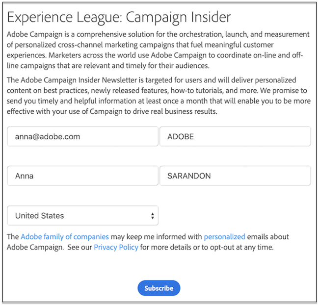
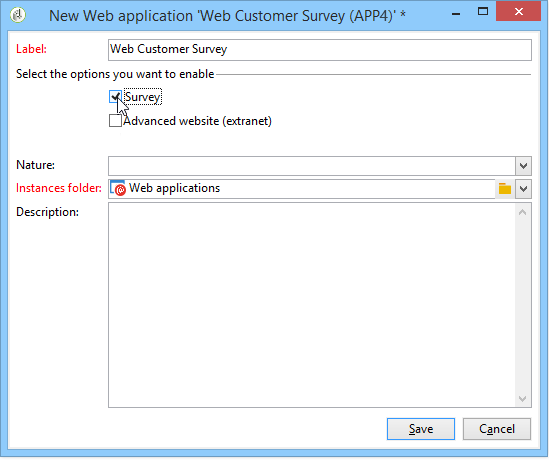

# 웹 애플리케이션 시작{#about-web-applications}

>[!NOTE]
>
>가장 일반적인 사용 사례의 경우, Campaign 웹 사용자 인터페이스에서 랜딩 페이지를 만들어 손쉽게 디자인하고 게시할 수 있습니다. 이 섹션에 설명된 대로 클라이언트 콘솔에서 만든 랜딩 페이지는 더 많은 설정을 제공하고 더 많은 고급 사용 사례를 다룹니다.
>
>[Campaign 웹 사용자 인터페이스의 랜딩 페이지에 대해 자세히 알아보기](https://experienceleague.adobe.com/en/docs/campaign-web/v8/landing-pages/get-started-lp){target="_blank"}

Adobe Campaign을 사용하면 데이터베이스의 데이터와 연결된 사용자의 권한에 맞는 콘텐츠를 사용하여 동적 및 대화형 웹 애플리케이션을 만들고 게시할 수 있습니다.

엑스트라넷의 편집 양식과 같은 페이지 또는 테이블, 차트, 입력 양식 등이 있는 데이터베이스의 데이터를 포함하는 알림 양식을 만들 수 있습니다. 이 기능을 사용하면 사용자가 정보를 조회하거나 입력할 수 있는 웹 페이지를 디자인하고 게시할 수 있습니다.

이는 아래와 같이 Adobe Campaign 데이터베이스에 포함된 정보가 미리 로드된 데이터가 포함된 구독 양식일 수 있습니다.

이 장에서는 웹 응용 프로그램을 관리하는 방법에 대한 개요를 제공합니다.

>[!NOTE]
>
>웹 응용 프로그램에 대한 보안을 최적화하는 방법은 [보안 및 개인 정보 확인 목록](https://helpx.adobe.com/kr/campaign/kb/acc-security.html)을 참조하세요.

>[!CAUTION]
>
>개인정보 보호를 위해 모든 외부 리소스에 HTTPS를 사용하는 것이 좋습니다.

## 웹 애플리케이션 범위 {#web-application-scope}

Adobe Campaign의 웹 애플리케이션은 다음 기능에 액세스할 수 있습니다.

* 여러 페이지로 된 양식 만들기. 자세한 정보는 이 [페이지](about-web-forms.md)를 참조하십시오.
* 통합 번역 툴을 사용한 다국어 설문 조사 관리 자세한 정보는 이 [페이지](translating-a-web-application.md)를 참조하십시오.
* 그래픽 페이지 관리 인터페이스, 다중 열 페이지 레이아웃. 자세한 정보는 이 [페이지](designing-a-web-application.md)를 참조하십시오.
* 개인화 및 필드 위치를 렌더링하고 있습니다. 자세한 정보는 이 [페이지](editing-content.md#adding-personalization-content)를 참조하십시오.
* 응답에 따른 설문 필드의 조건부 표시. 자세한 정보는 이 [페이지](form-rendering.md#defining-fields-conditional-display)를 참조하십시오.
* 무작위로 질문 표시. 자세한 내용은 이 [페이지](https://experienceleague.adobe.com/en/docs/campaign/campaign-v8/content/surveys/building-a-survey#adding-questions){target="_blank"}(Campaign v8 설명서)를 참조하세요.
* 조건부 페이지 표시. 자세한 정보는 이 [페이지](defining-web-forms-page-sequencing.md#conditional-page-display)를 참조하십시오.
* 예상 데이터 유형(번호, 이메일 주소, 날짜 등)에 따라 유효성 검사 전 정보 확인 및 필수 필드. 자세한 정보는 이 [페이지](form-rendering.md#defining-control-settings)를 참조하십시오.
* 이메일 초대 또는 알림. 자세한 정보는 이 [페이지](publishing-a-web-form.md#delivering-a-form-via-email)를 참조하십시오.
* 오류 및 종료 메시지의 Personalization. 자세한 정보는 이 [페이지](defining-web-forms-properties.md#setting-up-an-error-page)를 참조하십시오.
* 이미지, 비디오, 하이퍼텍스트 링크, captcha 등의 사용 자세한 정보는 이 [페이지](editing-content.md)를 참조하세요.
* 실시간 응답 모니터링. 자세한 내용은 이 [페이지](https://experienceleague.adobe.com/en/docs/campaign/campaign-v8/content/surveys/publish-track-and-use-collected-data#response-tracking){target="_blank"}(Campaign v8 설명서)를 참조하세요.

선택적 **설문 조사** 생성 모듈은 다음과 같은 추가 기능을 제공합니다.

* 데이터베이스의 동적 확장: 초기 데이터 템플릿에 포함되지 않은 응답 만들기. 자세한 내용은 이 [페이지](https://experienceleague.adobe.com/en/docs/campaign/campaign-v8/content/surveys/managing-answers#storing-collected-answers){target="_blank"}(Campaign v8 설명서)를 참조하세요.
* 전용 보고서를 생성하고 있습니다. 자세한 내용은 이 [페이지](https://experienceleague.adobe.com/en/docs/campaign/campaign-v8/content/surveys/publish-track-and-use-collected-data#reports-on-surveys){target="_blank"}(Campaign v8 설명서)를 참조하세요.

웹 응용 프로그램에 비해 설문 조사는 편집 컨트롤 수가 줄어든 간단한 그래픽 인터페이스를 제공합니다.

>[!NOTE]
>
>설문 조사는 [이 섹션](https://experienceleague.adobe.com/en/docs/campaign/campaign-v8/content/surveys/about-surveys){target="_blank"}에 자세히 설명되어 있습니다(Campaign v8 설명서).
>
>Adobe Campaign에서 웹 양식의 전체 기능은 [이 섹션](about-web-forms.md)에 자세히 설명되어 있습니다.

## 웹 애플리케이션 구현 {#web-application-implementation}

웹 응용 프로그램을 만들고 게시하려면 다음을 수행해야 합니다.

1. 콘텐츠(필드, 목록, 표, 그래프 등)를 만듭니다.

   양식의 사용 가능한 필드를 자세히 설명하는 섹션을 볼 수도 있습니다. 이러한 모든 필드는 웹 애플리케이션에서도 사용할 수 있습니다. 이 정보는 [이 페이지](adding-fields-to-a-web-form.md)에서 사용할 수 있습니다.

1. 필요에 따라 미리 로드, 테스트 및 저장 단계를 추가하고 액세스 제어 시스템(주로 엑스트라넷 게시의 프레임워크 내에서)을 구성할 수 있습니다.
1. 엑스트라넷 또는 Adobe Campaign에서 사용할 수 있도록 웹 애플리케이션을 게시합니다.

## 웹 애플리케이션 초기 구성 {#web-application-initial-configuration}

웹 응용 프로그램은 **[!UICONTROL Campaigns]** 및 **[!UICONTROL Profiles and targets]** 탭의 **[!UICONTROL Web Applications]** 링크를 통해 만들어집니다.

웹 응용 프로그램은 Adobe Campaign 트리의 **[!UICONTROL Resources > Online > Web Applications]** 노드에 저장됩니다. 구성은 다음 폴더에서 분류됩니다.

* **[!UICONTROL Administration > Configuration > Form renderings]**: 웹 폼 프레젠테이션(응용 프로그램 및 설문 조사)용 렌더링 서식 파일을 포함합니다. 템플릿을 사용하면 양식을 생성할 수 있습니다. 또한 CSS 스타일 시트를 사용합니다. 이 스타일 시트는 템플릿 수준에서 오버로드될 수 있습니다. 자세한 정보는 이 [페이지](form-rendering.md#selecting-the-form-rendering-template)를 참조하십시오.
* **[!UICONTROL Resources > Templates > Web application templates]**: 양식 서식 파일을 포함합니다. 폼이나 웹 응용 프로그램을 만들려면 템플릿에서 시작해야 합니다.

## 웹 애플리케이션 템플릿 {#web-application-templates}

기본적으로 Adobe Campaign은 사용 가능한 웹 애플리케이션당 하나의 템플릿을 제공합니다.

>[!NOTE]
>
>기존 웹 응용 프로그램을 템플릿으로 변환할 수 있습니다. 이렇게 하려면 양식을 선택하고 마우스 오른쪽 단추를 누릅니다. **[!UICONTROL Actions > Save as template...]**&#x200B;을(를) 선택합니다.

Adobe Campaign 트리의 **[!UICONTROL Resources > Templates > Web Application templates]** 노드를 통해 새 템플릿을 만들 수 있습니다.

만들기 도우미에서 아래와 같이 활성화할 옵션을 선택할 수 있습니다.

>[!CAUTION]
>
>사용 가능한 응용 프로그램은 옵션 및 모듈에 따라 다릅니다. 사용권 계약을 확인하십시오.
