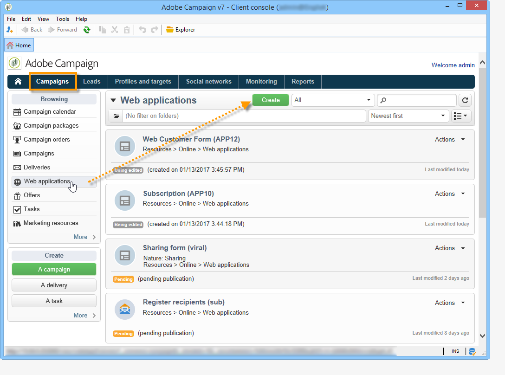
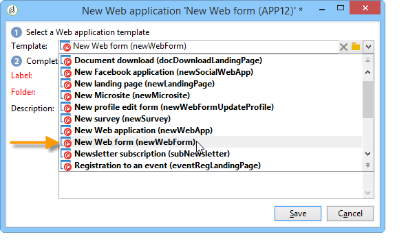
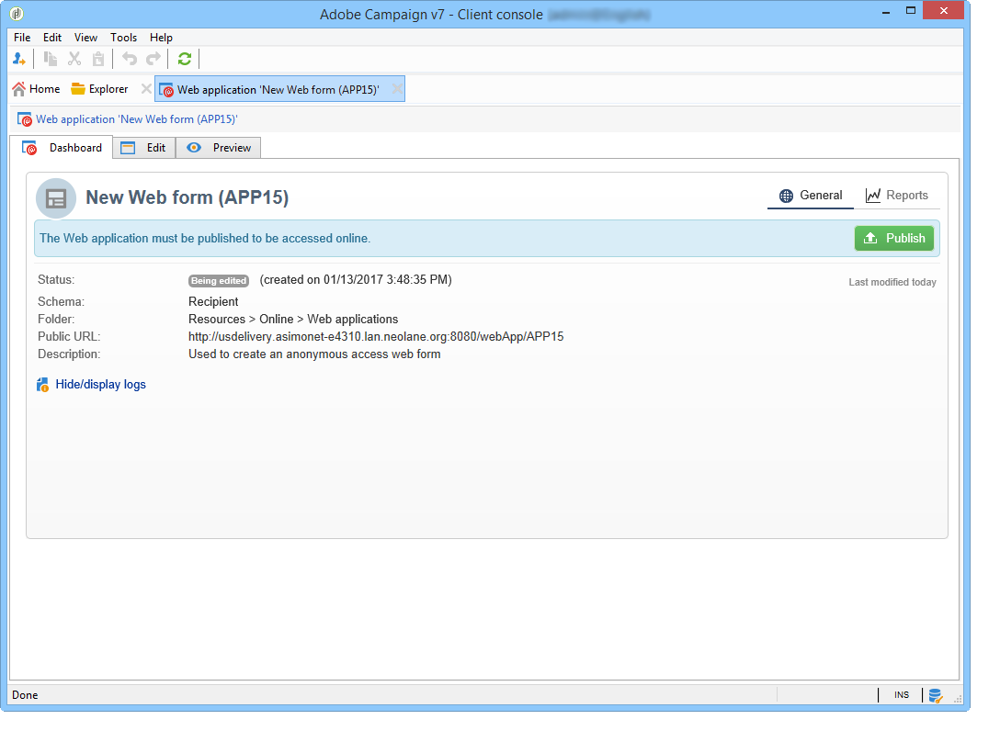
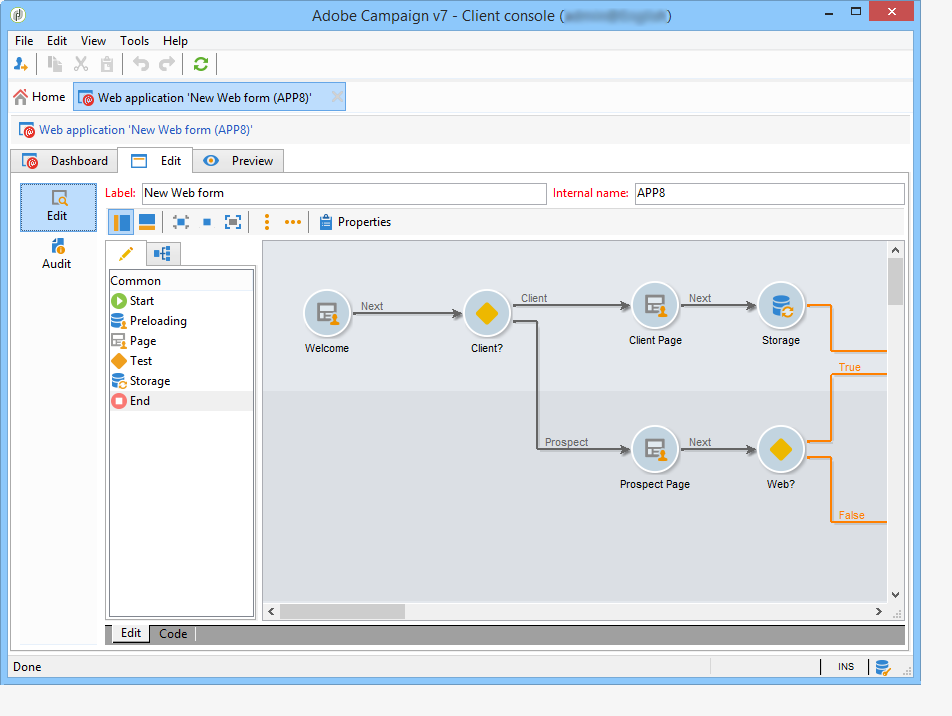
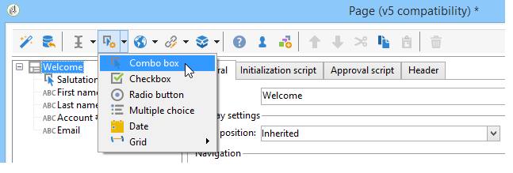
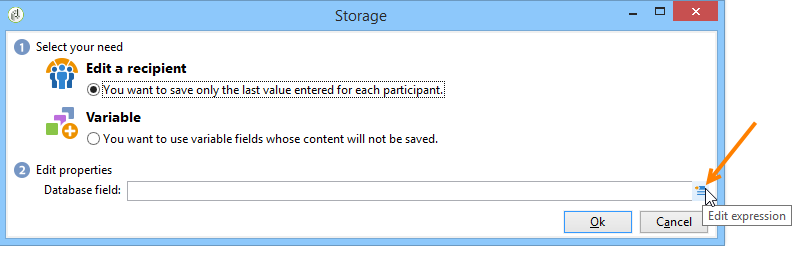
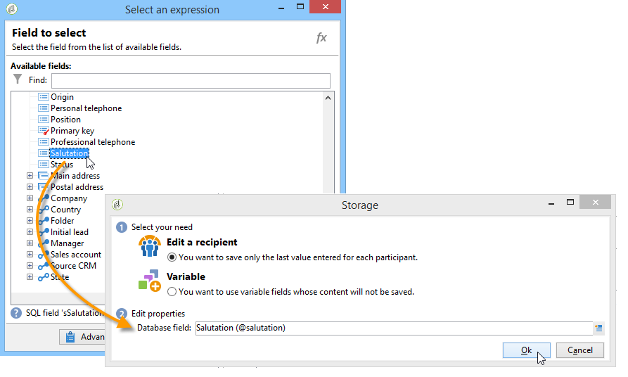

# 웹 양식 시작{#about-web-forms}

Adobe Campaign은 웹 양식을 정의하고 게시하기 위한 그래픽 모듈을 통합하여 입력 및 선택 필드가 포함된 페이지를 만들고 데이터베이스에 데이터를 포함할 수 있습니다. 이를 통해 사용자가 액세스하여 정보를 보거나 입력할 수 있는 웹 페이지를 디자인하고 게시할 수 있습니다.

이 장에서는 웹 양식의 작성 및 관리, 필드 및 페이지 관리 방법, 저장 및 저장 모드에 대해 자세히 설명합니다.

>[!CAUTION]
>
>개인정보 보호를 위해 모든 외부 리소스에 HTTPS를 사용하는 것이 좋습니다.

## 웹 양식을 만드는 단계 {#steps-for-creating-a-web-form}

이 장에서는 Adobe Campaign에서 **webForm** 형식 양식을 디자인하는 데 필요한 단계와 사용 가능한 옵션 및 구성에 대해 자세히 설명합니다. Adobe Campaign을 사용하면 이 웹 양식을 사용자가 사용할 수 있을 뿐만 아니라 데이터베이스에서 답변을 수집하고 보관할 수 있습니다.

>[!CAUTION]
>
>웹 애플리케이션 및 웹 양식을 구성할 때는 최소 900픽셀의 수직 해상도(예: 1600x900)가 필요합니다.

**캠페인** 탭의 웹 응용 프로그램 메뉴를 통해 웹 양식에 액세스할 수 있습니다. Adobe Campaign 트리에서는 **[!UICONTROL Resources > Online > Web Applications]** 노드 아래에 그룹화됩니다.

웹 양식을 만들려면 웹 응용 프로그램 목록 위에 있는 **[!UICONTROL Create]** 단추를 클릭합니다.

웹 양식 서식 파일(기본적으로 **[!UICONTROL newWebForm]**)을 선택하십시오.

이렇게 하면 양식의 대시보드로 이동합니다.

**[!UICONTROL Edit]** 탭에서는 콘텐츠를 만들 수 있습니다.

웹 양식의 구성 및 콘텐츠를 정의하려면 다음 단계를 적용합니다.

* 먼저 필수 페이지 및 컨트롤(입력 필드, 드롭다운 목록, HTML 컨텐츠 등)을 만듭니다.

  이 단계는 아래에 자세히 설명되어 있습니다.

* 페이지 시퀀싱 및 표시 조건을 정의합니다.

  이 단계는 [웹 양식 페이지 순서 정의](defining-web-forms-page-sequencing.md)에 자세히 설명되어 있습니다.

* 필요한 경우 콘텐츠를 번역합니다.

  이 단계는 [웹 양식 번역](translating-a-web-form.md)에 자세히 설명되어 있습니다.

## 웹 양식 디자인 기본 정보 {#about-web-forms-designing}

양식의 페이지는 입력 영역(텍스트), 선택 필드(목록, 확인란 등)를 정의하고 구성할 수 있는 특정 편집기를 통해 만들어집니다 및 정적 요소(이미지, HTLM 콘텐츠 등)가 포함되어 있습니다. 컨테이너를 컨테이너로 그룹화하고 필요에 맞게 레이아웃을 변경할 수 있습니다. 자세한 내용은 [컨테이너 만들기](defining-web-forms-layout.md#creating-containers)를 참조하십시오.

다음 섹션에서는 양식 화면의 컨텐츠 및 레이아웃을 정의하는 방법에 대해 자세히 설명합니다.

* [웹 양식에 필드 추가](adding-fields-to-a-web-form.md),
* [HTML 콘텐츠 삽입](static-elements-in-a-web-form.md#inserting-html-content),
* [웹 양식의 정적 요소](static-elements-in-a-web-form.md),
* [웹 양식 레이아웃 정의](defining-web-forms-layout.md).

>[!NOTE]
>
>* 페이지를 디자인하는 동안 **[!UICONTROL Preview]** 탭에서 최종 렌더링을 볼 수 있습니다. 변경 사항을 보려면 먼저 양식을 저장하십시오. **[!UICONTROL Log]** 탭에 오류가 표시됩니다.
>* 페이지 표시와 정보 저장이 적절한 순서로 이루어지도록 하려면 웹 양식에서 디버그 모드를 활성화합니다. 이렇게 하려면 **[!UICONTROL Preview]** 하위 탭으로 이동하여 **[!UICONTROL Enable debug mode]** 상자를 선택합니다. 수집된 모든 정보와 가능한 실행 오류가 각 페이지 하단에 표시됩니다.
>

### 도구 모음에서 아이콘 사용 {#using-the-icons-in-the-toolbar}

도구 모음의 아이콘을 사용하거나 마우스 오른쪽 버튼을 클릭하여 입력 영역을 삽입할 수도 있습니다.

이 경우 추가할 필드 유형과 답변 저장 모드를 선택하여 시작합니다.

선택을 승인하려면 **[!UICONTROL Ok]**&#x200B;을(를) 클릭합니다.

