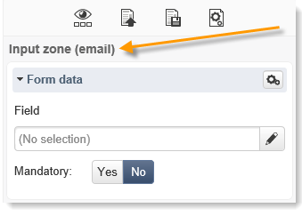
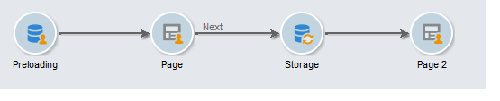

# 콘텐츠 편집 모범 사례{#content-editing-best-practices}


편집기의 최적 작업을 보장하려면 다음 지침을 준수하는 것이 좋습니다.

* Adobe Campaign에서 **HTML 페이지 템플릿을 가져오기** 전에 템플릿이 열려 있고 다양한 브라우저에서 올바르게 표시되는지 확인하십시오.
* HTML 페이지에 **JavaScript 스크립트**&#x200B;가 포함된 경우 편집기 외부에서 **오류 없이**&#x200B;실행해야 합니다.
* 템플릿을 작성할 때 `<input>` 태그에 **&#39;type&#39;** 특성을 추가하는 것이 좋습니다. 이 정보는 편집기에서 처리되며 사용자가 웹 응용 프로그램을 구성할 때 데이터베이스의 필드를 양식의 필드에 연결하는 데 도움이 됩니다.

  템플릿의 HTML 코드 예제:

  ```
  <input id="email" type="email" name="email"/>
  ```

  **&#39;type&#39;** 특성은 다음 형식의 인터페이스에 표시됩니다.

  

  &#39;type&#39; 특성의 공식 목록은 [이 웹 사이트](https://www.w3schools.com/tags/att_input_type.asp)에서 사용할 수 있습니다.

* DCE를 사용하여 종료 페이지를 시뮬레이션하는 단계:

  

* 페이지에 `<body> </body>`이(가) 하나만 있는지 확인하십시오.
* CSS 또는 JS 파일이 업로드되면 .zip 파일 내에 포함된 이미지가 업로드되지 않습니다. 따라서 CSS에 있는 이러한 이미지에 대한 참조는 업데이트되지 않습니다.

## 콘텐츠 편집기 지원 형식 {#content-editor-supported-formats}

디지털 콘텐츠 편집기는 HTML 형식을 지원합니다. 언제든지 **소스** 모드로 전환할 수 있습니다.

디지털 콘텐츠 편집기의 가져오기 기능은 다음과 같이 지원되는 형식으로 작동합니다.

* CSS: .zip 파일에 있는 이미지를 가져오지 않습니다. CSS에서 이러한 이미지에 대한 참조는 업데이트되지 않습니다.
* JS: .zip 파일에 있는 이미지는 가져오지 않습니다. JS에서 이러한 이미지에 대한 참조는 업데이트되지 않습니다.
* Iframe: 링크된 페이지를 가져오지 않습니다.
* 랜딩 페이지 및 웹 앱: **form** 태그가 누락된 경우 경고가 표시됩니다. `<form> </form>`은(는) 항상 메시지 본문에 있어야 합니다.

디지털 콘텐츠 편집기는 다음과 같은 지원되는 코드 페이지에서도 작동합니다.

* iso-8859-1
* iso-8859-2
* utf-7
* utf-8(BOM 사용 시 권장)
* iso-8859-15
* us-ascii
* shift jis
* iso-2022-jp
* big-
* euc-kr
* utf-16

>[!NOTE]
>
>HTML 코드 페이지는 메타 태그(HTML 4 또는 HTML 5) 또는 BOM에서 정의해야 합니다. 사용 가능한 코드 페이지가 없으면 latin1에서 파일을 엽니다.

## HTML 컨텐츠 상태 {#html-content-statuses}

편집기의 상단 섹션에는 콘텐츠의 상태와 관련된 메시지가 표시됩니다. 메시지의 색상 코드는 다음과 같습니다.

* **회색 메시지**: 정보 메시지이므로 편집기에서 작업을 수행할 필요가 없습니다.
* **파란색 메시지**: 편집 중인 콘텐츠와 관련된 정보 메시지입니다.
* **노란색 메시지**: 사용자 대신 작업을 요구하는 경고 또는 오류 메시지.

### 웹 응용 프로그램 편집 시 메시지 목록 {#list-of-messages-when-editing-a-web-application}

* HTML 콘텐츠가 작동합니다.
* 웹 응용 프로그램이 게시되지 않았으므로 온라인으로 액세스할 수 없습니다.
* 웹 응용 프로그램이 온라인 상태입니다. 변경 사항을 적용하려면 다시 게시하십시오.
* 페이지 콘텐츠가 작동하지 않습니다. HTML 양식(`<form>`)을 포함해야 합니다.
* 구성할 입력 영역 또는 버튼이 없습니다.
* 다음 페이지로의 전환을 활성화하려면 &#39;다음 페이지&#39; 작업을 현재 페이지의 버튼이나 링크에 연결해야 합니다.

### 게재 편집 시 메시지 목록 {#list-of-messages-when-editing-a-delivery}

* 게재 콘텐츠가 작동합니다
* 구성할 필드 또는 개인화 블록이 없습니다.
* 게재 콘텐츠가 준비되었습니다. 분석을 다시 실행하여 변경 사항을 적용하십시오.
* 게재를 보낼 준비가 되었습니다.
