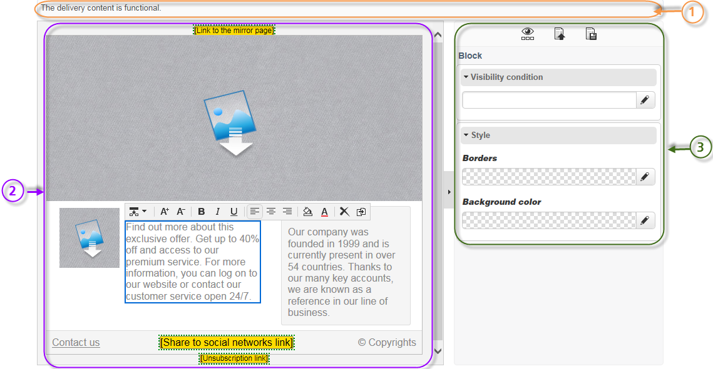
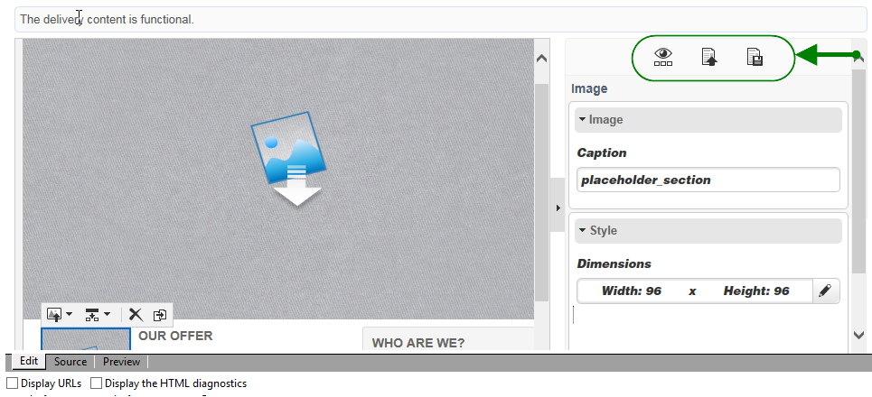
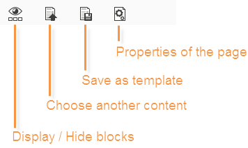
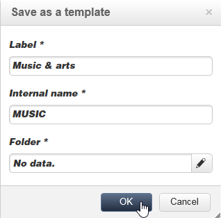
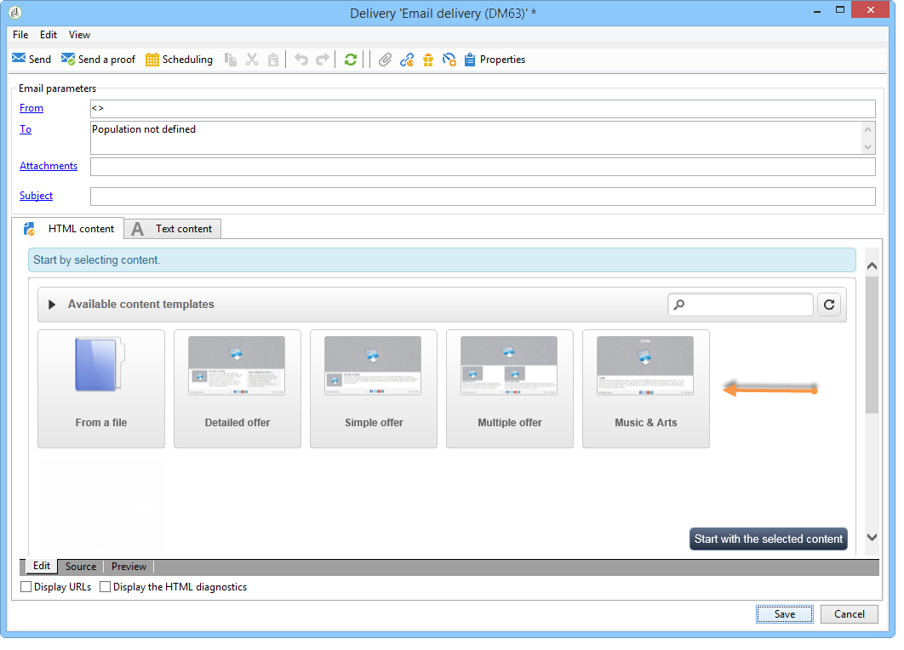
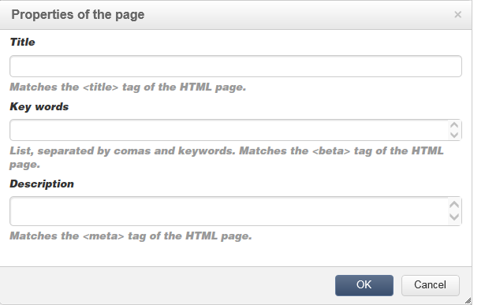
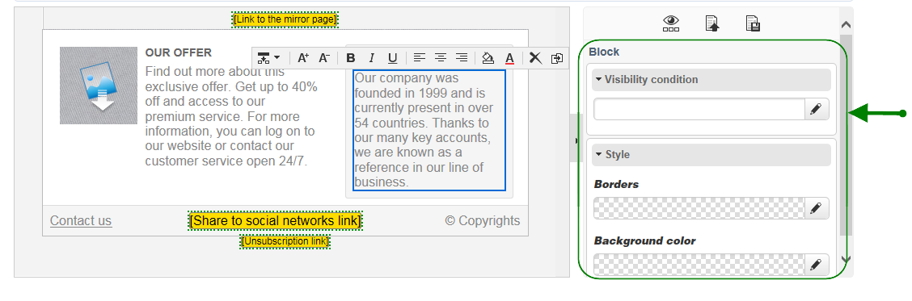

# 콘텐츠 편집기 인터페이스{#content-editor-interface}

## 편집 창 {#editing-window}

DCE 편집 창은 세 개의 서로 다른 섹션으로 분류됩니다. 이를 통해 콘텐츠의 상태를 보고, 수정하고, 확인할 수 있습니다.

1. **top** 섹션은 사용자에게 보내는 메시지를 표시하는 영역입니다. 이러한 메시지는 웹 애플리케이션 상태 또는 작성 중인 게재의 상태와 콘텐츠와 관련된 경고 및 오류 메시지를 나타냅니다. 자세한 내용은 [HTML 콘텐츠 상태](content-editing-best-practices.md#html-content-statuses)를 참조하세요.
1. 창의 **left** 섹션은 콘텐츠를 편집하는 영역입니다. 이 영역에서 사용자는 팝업 도구 모음을 사용하여 콘텐츠와 직접 상호 작용할 수 있습니다. 이미지에 링크 삽입, 글꼴 변경, 필드 삭제 등 자세한 내용은 [양식 편집](editing-content.md#editing-forms)을 참조하세요.
1. 창의 **오른쪽** 섹션은 컨트롤 패널 영역입니다. 이 영역에는 편집기에 대한 다양한 옵션, 특히 블록 페이지 머리글과 일반 옵션 구성과 관련된 옵션(테두리 추가, 데이터베이스 필드를 입력 영역에 연결, 웹 페이지 속성에 액세스 등)이 그룹화됩니다. 자세한 내용은 [전역 옵션](#global-options) 및 [콘텐츠 편집](editing-content.md) 섹션을 참조하십시오.

## 글로벌 옵션 {#global-options}

편집기의 오른쪽 상단 섹션에서는 현재 만들어지는 콘텐츠를 제어할 수 있는 글로벌 옵션에 액세스할 수 있습니다.

여기에는 네 개의 아이콘이 있습니다.

* **블록 표시/숨기기** 아이콘을 사용하면 콘텐츠 블록 주위에 파란색 프레임을 표시할 수 있습니다(`
` HTML 태그에 해당됨).

* **다른 콘텐츠 선택** 아이콘을 사용하면 템플릿(기존 템플릿 또는 기본 제공 템플릿)에서 새 콘텐츠를 로드할 수 있습니다.

  

  >[!CAUTION]
  >
  >선택한 콘텐츠가 현재 콘텐츠를 대체합니다.

* **템플릿으로 저장** 아이콘을 사용하면 현재 콘텐츠를 템플릿으로 저장할 수 있습니다. 템플릿의 레이블과 내부 이름을 입력해야 합니다. 템플릿이 **[!UICONTROL Resources > Templates > Content templates]** 노드에 저장됩니다.

  

  저장하면 템플릿을 사용할 수 있으며, 새 콘텐츠를 만들 때 선택할 수 있습니다.

  

* **페이지 속성** 아이콘을 사용하면 HTML 페이지 맨 위에서 콘텐츠 정보를 선택할 수 있습니다.

  

  >[!NOTE]
  >
  >이 정보는 페이지의 **`<title>`** 및 **`<meta>`** HTML 태그에 해당합니다.
  >
  >주요어는 쉼표로 구분해야 한다.

## 블록 옵션 {#block-options}

편집기 오른쪽에 있는 섹션에는 콘텐츠에 따라 작업을 수행할 수 있는 기본 옵션이 그룹화되어 있습니다. 이러한 옵션을 표시하려면 블록을 선택해야 합니다. 이러한 옵션의 특성은 선택한 블록에 따라 다릅니다.

다음을 수행할 수 있습니다.

* 하나 이상의 블록에 대한 표시를 확인합니다. [표시 조건 정의](editing-content.md#defining-a-visibility-condition)를 참조하세요.
* 테두리와 프레임을 정의합니다. [테두리 및 배경 추가](editing-content.md#adding-a-border-and-background)를 참조하세요.
* 이미지 특성(크기, 캡션)을 정의합니다. [이미지 속성 편집](editing-content.md#editing-image-properties)을 참조하세요.
* 데이터베이스를 양식 요소(입력 영역, 확인란)에 연결합니다. [양식의 데이터 속성 변경](editing-content.md#changing-the-data-properties-for-a-form)을 참조하세요.
* 양식의 일부를 필수 항목으로 만들려면 [양식의 데이터 속성 변경](editing-content.md#changing-the-data-properties-for-a-form)을 참조하세요.
* 단추에 대한 동작을 정의합니다. [단추에 동작 추가](editing-content.md#adding-an-action-to-a-button)를 참조하세요.

## 콘텐츠 도구 모음 {#content-toolbar}

도구 모음은 선택한 블록에 따라 다른 기능을 제공하는 DCE 인터페이스의 **팝업 요소**&#x200B;입니다.

>[!CAUTION]
>
>특정 도구 모음 기능을 사용하면 HTML 콘텐츠를 포맷할 수 있습니다. 그러나 페이지에 CSS 스타일 시트가 포함되어 있는 경우, 스타일 시트의 **지침**&#x200B;은(는) 도구 모음에 지정된 지침보다 **우선 순위**&#x200B;가 더 필요한 것으로 입증될 수 있습니다.
