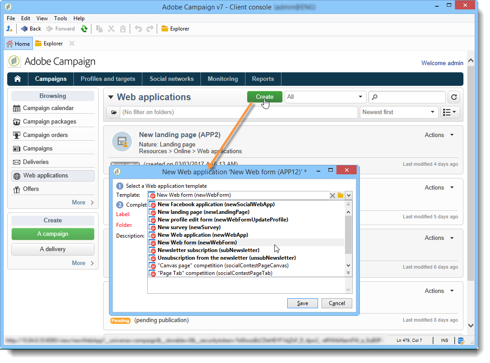

# 새 웹 애플리케이션 만들기{#creating-a-new-web-application}

만드는 동안 웹 응용 프로그램 유형을 선택합니다.

**캠페인** 탭으로 이동하여 **[!UICONTROL Web Applications]** 메뉴를 선택하십시오. **[!UICONTROL Create]** 버튼을 클릭합니다. 사용할 웹 응용 프로그램 템플릿을 선택합니다.

>[!NOTE]
>
>개인 정보가 포함될 수 있는 페이지는 항상 보호하십시오. [보안 및 개인 정보 확인 목록](https://helpx.adobe.com/kr/campaign/kb/acc-security.html#privacy)을 참조하세요.

이 템플릿은 웹 응용 프로그램의 유형을 결정합니다. 다음을 만들 수 있습니다.

1. 웹 양식(+ 프로필 수정)

   웹 양식을 사용하면 입력 또는 선택 필드가 있는 웹 페이지를 제공할 수 있습니다. 사용자가 입력한 정보는 Adobe Campaign 데이터베이스에 저장할 수 있습니다. 자세한 내용은 [웹 양식](about-web-forms.md)을 참조하세요.

1. 웹 애플리케이션

   Adobe Campaign을 사용하면 웹 플랫폼 또는 엑스트라넷에 표시되는 웹 애플리케이션을 만들 수 있습니다. 이렇게 하면 Adobe Campaign에서 데이터를 편집하고 정보를 기록할 수 있습니다. 이 경우 액세스 제어를 통해 인증된 사용자에 대한 액세스를 제한하고 다양한 기준을 기반으로 데이터 사전 로드를 설정할 수 있습니다. 이 작업에 대한 자세한 정보는 [이 섹션](about-web-applications.md)을 참조하십시오.

1. 랜딩 페이지

   랜딩 페이지는 웹 사이트에서 콘텐츠를 사용할 수 있고 사용자가 Adobe Campaign 데이터베이스 프로필에 저장할 정보를 입력할 수 있는 HTML 페이지입니다. 이 유형의 페이지 콘텐츠는 일반적으로 게시, 관리 및 후속 작업을 위해 Adobe Campaign으로 가져오기 전에 전문 웹 에이전시에서 만듭니다. 자세한 정보는 이 [페이지](creating-a-landing-page.md)를 참조하십시오.

1. 설문 조사

   Adobe Campaign을 사용하면 **설문 조사 관리자** 옵션을 통해 온라인 설문 조사를 디자인하고 관리하며 동적 필드 만들기, 점수 관리, 답변 내보내기 및 전용 보고서 등의 결과를 처리할 수 있습니다. 자세한 내용은 [이 섹션](https://experienceleague.adobe.com/ko/docs/campaign/campaign-v8/content/surveys/about-surveys){target="_blank"}(Campaign v8 설명서)을 참조하세요.

   >[!CAUTION]
   >
   >**설문 조사 관리자**&#x200B;는 선택적 Adobe Campaign 모듈입니다. 사용권 계약을 확인하십시오.

1. Facebook 애플리케이션

   **소셜 마케팅** 옵션 덕분에 Adobe Campaign에서 Facebook 애플리케이션에 개인화된 콘텐츠를 게시할 수 있습니다. 이 작업에 대한 자세한 정보는 [이 섹션](https://experienceleague.adobe.com/ko/docs/campaign-classic/using/integrating-with-social-media/about-social-marketing){target="_blank"}을 참조하십시오.

   >[!CAUTION]
   >
   >**소셜 마케팅**&#x200B;은(는) 선택적 Adobe Campaign 모듈입니다. 사용권 계약을 확인하십시오.

페이지 구성 모드 및 사용 가능한 구성은 여러 웹 애플리케이션 유형에 대해 동일할 수 있습니다. 이 작업에 대한 자세한 정보는 [이 섹션](about-web-forms.md)을 참조하십시오.
