# 웹 양식 페이지 순서 정의{#defining-web-forms-page-sequencing}


양식은 하나 이상의 페이지를 포함할 수 있습니다. 페이지, 테스트, 스크립트 실행, 페이지 이동 및 기록 단계의 순서를 지정할 수 있는 다이어그램을 통해 작성됩니다. 전역 다이어그램 디자인 모드는 Campaign 워크플로우의 경우와 동일합니다.

## 이전 페이지 및 다음 페이지 정보 {#about-previous-page-and-next-page}

각 페이지에 대해 **[!UICONTROL Next]** 또는 **[!UICONTROL Previous]** 단추를 삭제할 수 있습니다. 이렇게 하려면 관련 페이지를 선택하고 옵션 **[!UICONTROL Disable next page]** 또는 **[!UICONTROL Disallow returning to the previous page]** 을(를) 선택합니다.

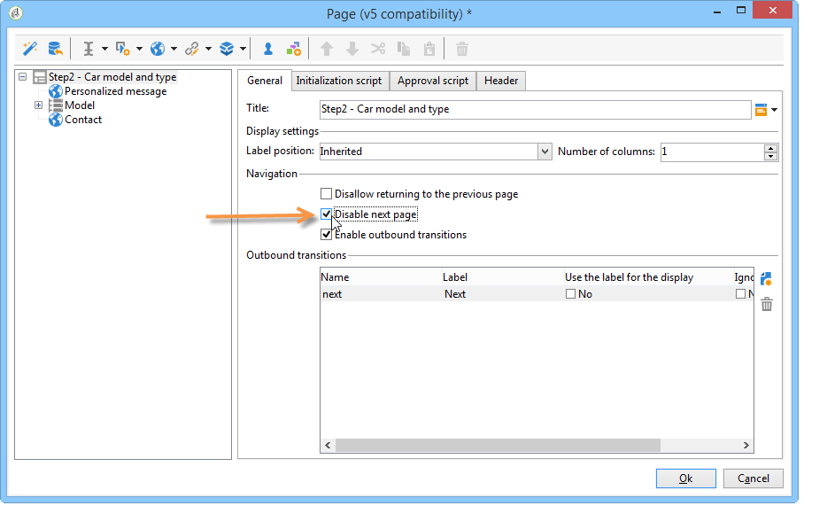

이러한 단추를 링크로 바꿀 수 있습니다. [HTML 콘텐츠 삽입](static-elements-in-a-web-form.md#inserting-html-content)을 참조하세요.

## 점프 삽입 {#inserting-a-jump}

**[!UICONTROL Jump]** 개체는 사용자가 **[!UICONTROL Next]**&#x200B;을(를) 클릭할 때 다른 페이지 또는 다른 양식에 액세스할 수 있도록 합니다.

대상은 다음과 같을 수 있습니다.

* 양식의 다른 페이지입니다. 이렇게 하려면 **[!UICONTROL Internal activity]**&#x200B;을(를) 선택한 다음 아래와 같이 원하는 페이지를 지정합니다.

  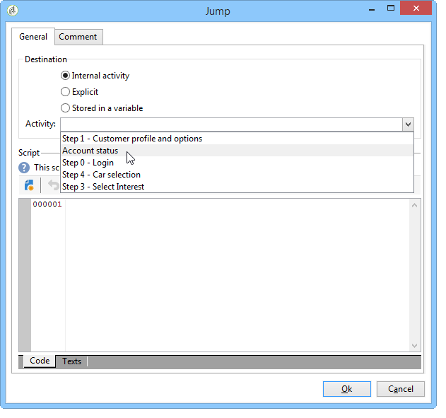

* 다른 양식입니다. 이렇게 하려면 **[!UICONTROL Explicit]** 옵션을 선택하고 대상 양식을 지정하십시오.

  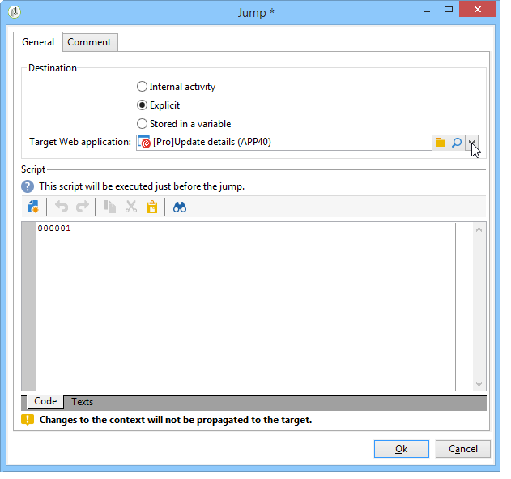

* 대상은 변수에 저장할 수 있습니다. 이 경우 아래와 같이 드롭다운 목록에서 선택합니다.

  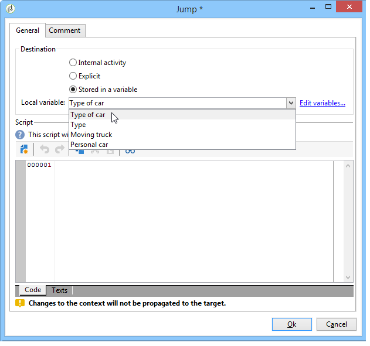

* **[!UICONTROL Comment]** 탭에서는 연산자가 다이어그램에서 개체를 클릭할 때 표시되는 정보를 입력할 수 있습니다.

  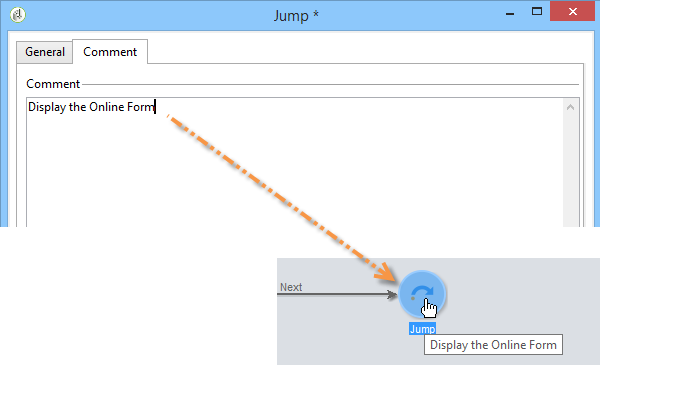

## 예: URL의 매개 변수에 따라 다른 양식에 액세스 {#example--accessing-another-form-according-to-a-parameter-of-the-url}

다음 예제에서는 웹 양식을 구성하려고 합니다. 이 양식을 승인하면 URL의 매개 변수로 지정된 다른 양식이 표시됩니다. 그렇게 하려면 다음 단계를 적용합니다.

1. 폼의 끝에 이동 삽입: **[!UICONTROL End]** 상자를 대체합니다.

   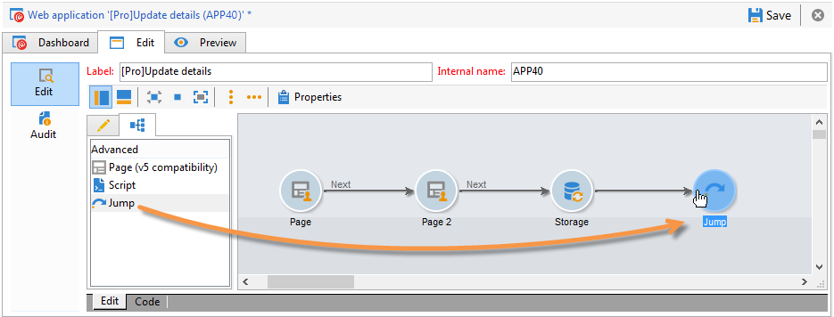

1. 양식 속성에서 로컬 변수(**next**)에 저장된 매개 변수(**next**)를 추가합니다. 로컬 변수는 [로컬 변수에 데이터 저장](web-forms-answers.md#storing-data-in-a-local-variable)에 자세히 설명되어 있습니다.

   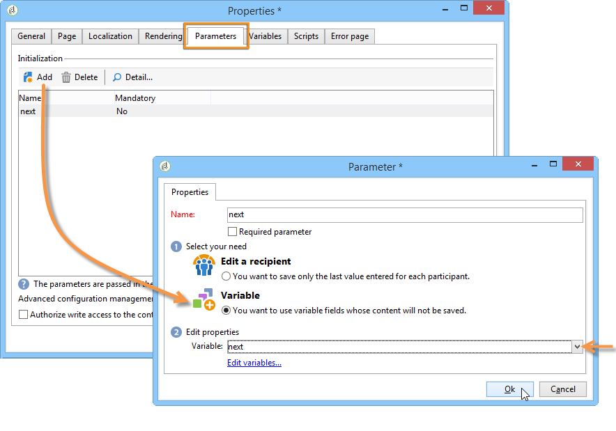

1. **[!UICONTROL Jump]** 개체를 편집하고 **[!UICONTROL Stored in a variable]** 옵션을 선택한 다음 드롭다운 상자에서 **next** 변수를 선택합니다.

   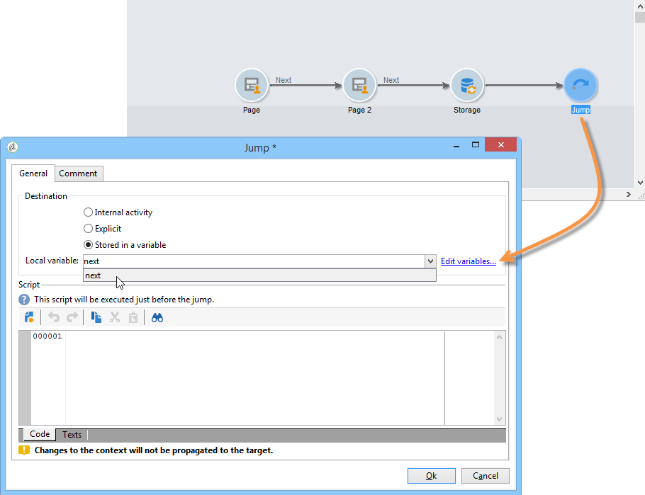

1. 게재 URL에는 다음과 같은 대상 양식의 내부 이름이 포함되어야 합니다.

   ```
   https://[myserver]/webForm/APP62?&next=APP22
   ```

   사용자가 **[!UICONTROL Approve]** 단추를 클릭하면 **APP22** 양식이 표시됩니다.

## 양식의 다른 페이지에 링크 삽입 {#inserting-a-link-to-another-page-of-the-form}

양식의 다른 페이지에 대한 링크를 삽입할 수 있습니다. 이렇게 하려면 **[!UICONTROL Link]** 형식의 정적 요소를 페이지에 추가하십시오. 자세한 내용은 [링크 삽입](static-elements-in-a-web-form.md#inserting-a-link)을 참조하세요.

## 조건부 페이지 표시 {#conditional-page-display}

### 응답을 기반으로 표시 {#display-based-on-responses}

**[!UICONTROL Test]** 상자를 사용하면 양식의 페이지 순서를 지정할 수 있습니다. 테스트 결과에 따라 다양한 분기 라인을 정의할 수 있습니다. 이렇게 하면 사용자가 제공한 응답에 따라 서로 다른 페이지를 표시할 수 있습니다.

예를 들어 이미 온라인으로 주문한 고객에 대해서는 다른 페이지를 표시하고 10개 이상의 주문을 한 고객에 대해서는 다른 페이지를 표시할 수 있습니다. 이렇게 하려면 폼의 첫 페이지에 사용자가 주문한 주문의 수를 나타내는 **[!UICONTROL Number]** 유형 입력 필드를 삽입합니다.

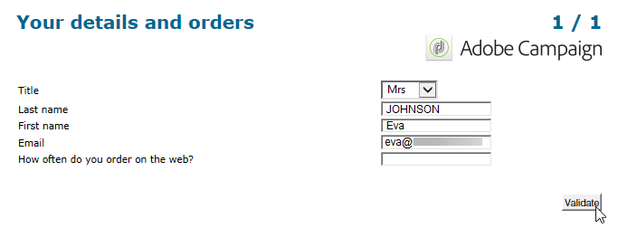

이 정보를 데이터베이스의 필드에 저장하거나 로컬 변수를 사용할 수 있습니다.

>[!NOTE]
>
>저장소 모드는 [응답 저장소 필드](web-forms-answers.md#response-storage-fields)에 자세히 설명되어 있습니다.

이 예제에서는 변수를 사용하려고 합니다.

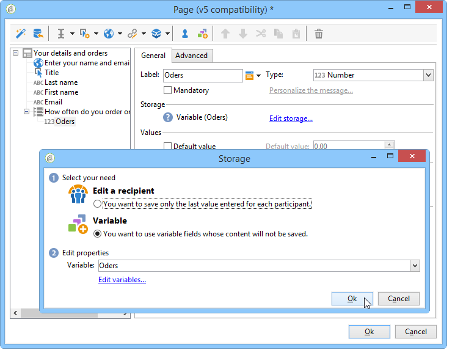

양식 다이어그램에서 조건을 정의할 테스트 상자를 삽입합니다. 각 조건에 대해 테스트 상자의 출력에 새 분기가 추가됩니다.

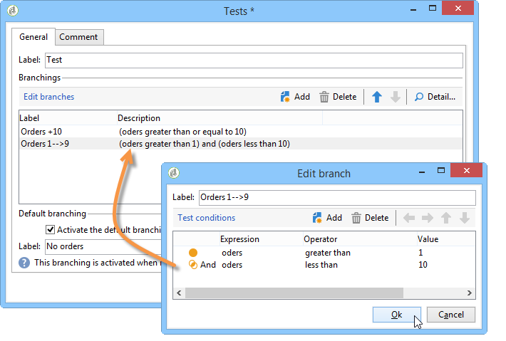

조건이 true가 아닌 경우 전환을 추가하려면 **[!UICONTROL Activate the default branching]** 옵션을 선택하십시오. 가능한 모든 경우가 정의된 조건에 해당되는 경우에는 이 옵션은 필요하지 않습니다.

그런 다음 조건 중 하나 이상이 참인 경우 페이지 시퀀싱을 정의합니다. 예:

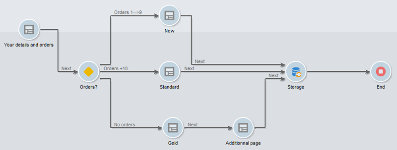

### 매개 변수를 기반으로 표시 {#display-based-on-parameters}

웹 양식의 초기화 매개 변수 또는 데이터베이스에 저장된 값에 따라 페이지 순서를 개인화할 수도 있습니다. [양식 URL 매개 변수](defining-web-forms-properties.md#form-url-parameters)을(를) 참조하십시오.

## 스크립트 추가 {#adding-scripts}

**[!UICONTROL Script]** 개체를 사용하면 필드 값을 수정하거나 데이터베이스에서 데이터를 검색하거나 Adobe Campaign API를 호출하는 등의 작업을 위해 JavaScript 스크립트를 직접 입력할 수 있습니다.

## 종료 페이지 개인화 {#personalizing-the-end-page}

다이어그램의 끝에 종료 페이지를 배치해야 합니다. 사용자가 웹 양식에서 **[!UICONTROL Approve]** 단추를 클릭하면 최종 페이지가 표시됩니다.

이 페이지를 개인화하려면 **[!UICONTROL End]**&#x200B;을(를) 두 번 클릭하고 중앙 편집기에 페이지 콘텐츠를 입력하십시오.

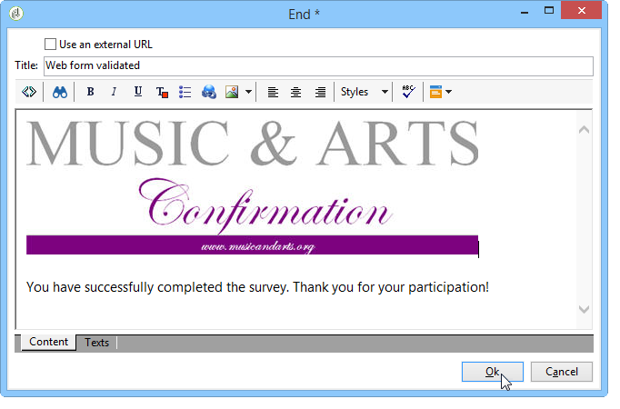

* 기존 HTML 콘텐츠를 복사하여 붙여넣을 수 있습니다. 이렇게 하려면 **[!UICONTROL Display source code]**&#x200B;을(를) 클릭하고 HTML 코드를 삽입합니다.
* 외부 URL을 사용할 수 있습니다. 이렇게 하려면 해당 옵션을 선택하고 표시할 페이지의 URL을 입력합니다.
