# 웹 양식 속성 정의{#defining-web-forms-properties}

요구 사항을 충족하도록 웹 양식을 완벽하게 구성하고 개인화할 수 있습니다. 등록 정보 창에 매개변수를 입력해야 합니다.

속성 창은 웹 양식의 도구 모음에서 **[!UICONTROL Properties]** 단추를 통해 액세스할 수 있습니다. 이 창에서는 웹 양식과 관련된 다양한 설정에 액세스할 수 있습니다. 일부 설정은 템플릿 구성에서 비롯될 수 있습니다.

## 전체 양식 속성 {#overall-form-properties}

속성 창의 **[!UICONTROL General]** 탭에서 양식의 **레이블**&#x200B;을(를) 수정할 수 있습니다. **내부 이름**&#x200B;을 변경하지 않는 것이 좋습니다.

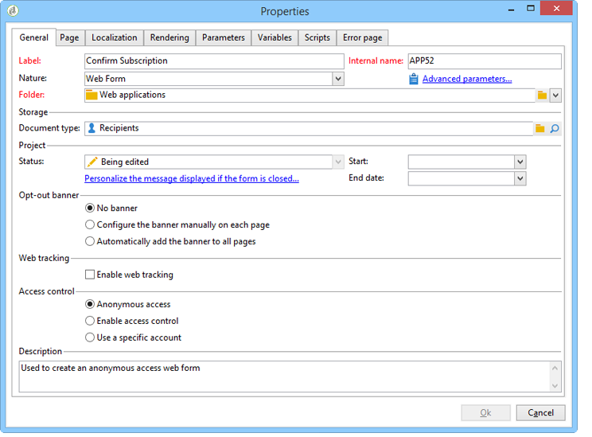

양식 템플릿은 양식을 작성하는 동안 선택됩니다. 나중에 변경할 수 없습니다. 양식 서식 파일 만들기 및 관리에 대한 자세한 내용은 [웹 양식 서식 파일 사용](using-a-web-form-template.md)을 참조하세요.

## 양식 데이터 저장소 {#form-data-storage}

웹 양식의 필드는 기본적으로 수신자 표에 저장됩니다. **[!UICONTROL Document type]** 필드에서 새 테이블을 선택하여 사용할 테이블을 변경할 수 있습니다. **[!UICONTROL Zoom]** 아이콘을 사용하면 선택한 테이블의 내용을 볼 수 있습니다.

기본적으로 답변은 **받는 사람 양식에 대한 답변** 테이블에 저장됩니다.

## 오류 페이지 설정 {#setting-up-an-error-page}

오류 페이지를 구성할 수 있습니다. 양식 실행 중에 오류가 발생한 경우 이 페이지가 표시됩니다.

오류 페이지는 양식 속성 창의 해당 탭에 정의됩니다.

기본적으로 다음 정보가 표시됩니다.

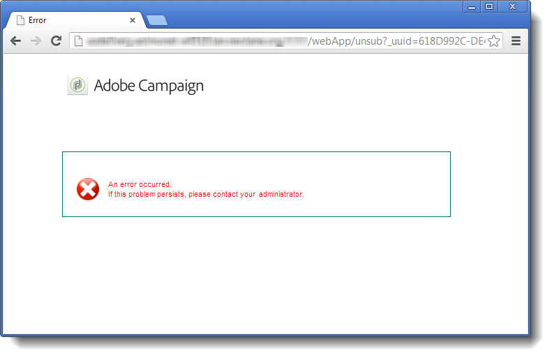

표시되는 문자열의 내용은 속성 창의 **[!UICONTROL Error page]** 탭에 정의됩니다. **[!UICONTROL HTML]** 탭에는 렌더링이 표시되고 **[!UICONTROL Texts]** 탭에서는 텍스트 문자열을 수정하고 필요한 경우 일부 텍스트를 추가할 수 있습니다.

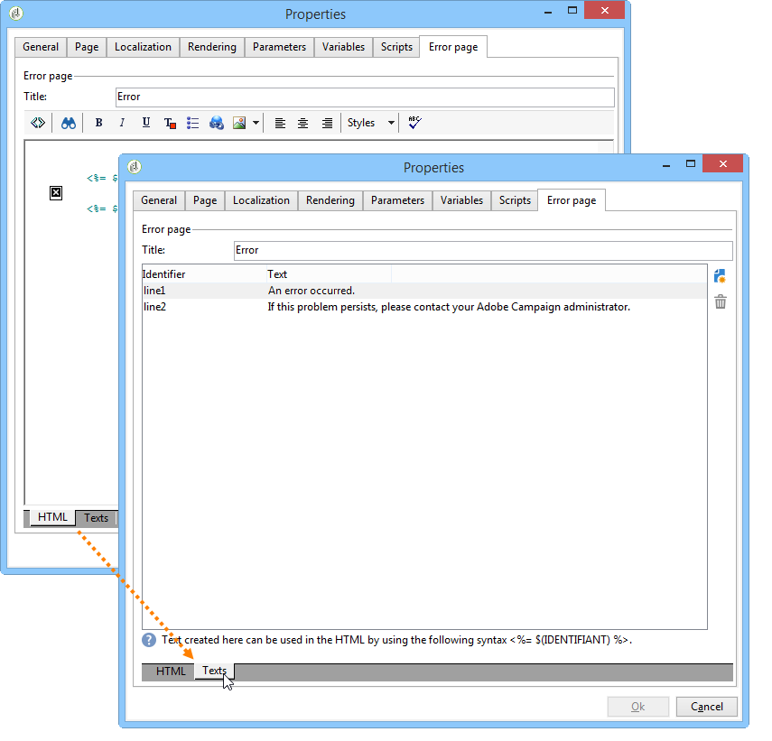

## 양식 현지화 {#form-localization}

**[!UICONTROL Localization]** 탭에서는 웹 양식의 디자인 및 표시 언어를 선택할 수 있습니다.

[웹 양식 번역](translating-a-web-form.md)을 참조하세요.

## 양식 검색 및 렌더링 {#form-browsing-and-rendering}

**[!UICONTROL Rendering]** 탭에서는 웹 폼의 페이지와 사용된 렌더링 템플릿 사이의 탐색 유형을 정의할 수 있습니다.

링크 또는 버튼을 통해 탐색하도록 선택할 수 있습니다.

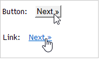

단추는 기본적으로 탐색 요소입니다. 이를 통해 다음 작업을 수행할 수 있습니다.

* **[!UICONTROL Next]**&#x200B;을(를) 클릭하여 현재 페이지를 승인하고 다음 페이지를 표시합니다. 이 단추는 마지막 페이지를 제외한 모든 페이지에 표시됩니다.
* **[!UICONTROL Previous]**&#x200B;을(를) 클릭하여 이전 페이지를 표시합니다. 이 단추는 첫 번째 페이지를 제외한 모든 페이지에 표시됩니다.
* **[!UICONTROL Approve]** 단추를 클릭하여 양식 응답을 저장합니다. 이 단추는 마지막 페이지에만 표시됩니다.

이러한 요소는 각 페이지의 맨 아래에 표시됩니다. 그들의 위치는 바뀔 수 있습니다. 이렇게 하려면 스타일시트를 수정해야 합니다.

>[!NOTE]
>
>일부 페이지에서 **[!UICONTROL Previous]** 단추를 숨길 수 있습니다. 이렇게 하려면 관련 페이지로 이동하여 **[!UICONTROL Disallow returning to the previous page]** 옵션을 선택하십시오. 이 옵션은 페이지 트리의 루트를 선택한 경우 액세스할 수 있습니다.

**[!UICONTROL Rendering]** 탭의 **[!UICONTROL Template]** 필드를 사용하면 사용 가능한 테마 중에서 테마를 선택할 수 있습니다.

테마는 트리의 **[!UICONTROL Administration>Configuration>Form rendering]** 노드에 저장됩니다. [양식 렌더링 템플릿 선택](form-rendering.md#selecting-the-form-rendering-template)을 참조하십시오.

샘플 렌더링은 속성 창의 아래쪽에 표시됩니다. **[!UICONTROL Edit link]** 아이콘을 사용하면 선택한 테마의 구성을 볼 수 있습니다.

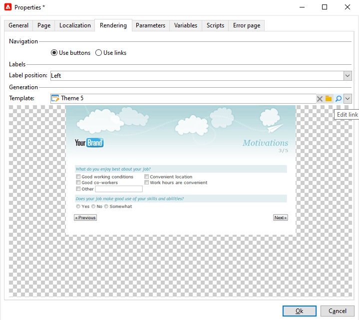

## 양식의 로고 {#logo-in-the-form}

양식에 사용된 로고는 자체 로고로 변경할 수 있습니다.

웹 앱의 **[!UICONTROL Properties]** 내부의 **[!UICONTROL Rendering]** 탭에서 템플릿의 유리 아이콘 을 클릭합니다.

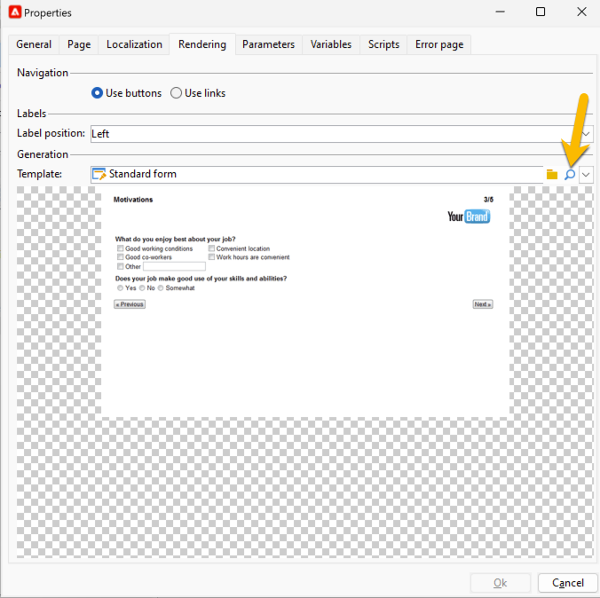

새 창에서 **[!UICONTROL Page layout]** 링크 를 클릭합니다.

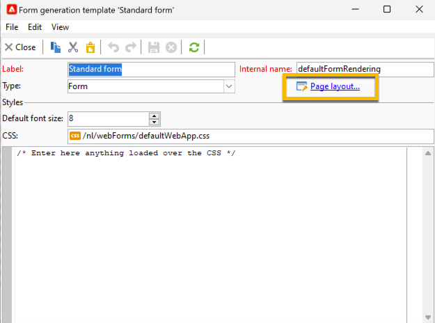

여기에서 로고 이미지의 경로를 변경할 수 있습니다.

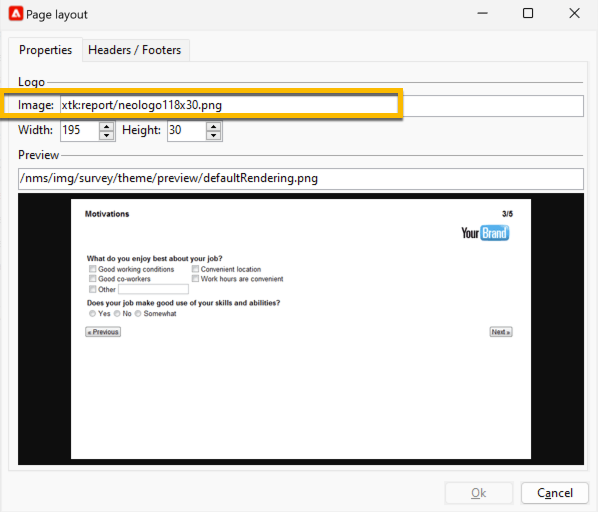

사용 가능한 이미지는 **[!UICONTROL Administration]** > **[!UICONTROL Configuration]** > **[!UICONTROL Images]**&#x200B;에 있습니다. 여기에 로고를 추가할 수 있습니다.

이러한 이미지는 인스턴스 *datakit\nms\fra\img\activities* 또는 *datakit\nms\eng\img\activities*&#x200B;의 백 엔드 디렉터리에 배치됩니다(인스턴스의 언어에 따라 eng 또는 fra).

이 디렉터리(및 이미지)에서 새 이미지를 사용할 수 있도록 하려면 Adobe 지원에 문의하여 백엔드 디렉터리를 변경합니다.

온-프레미스 인스턴스의 경우 직접 데이터 키트에 이미지를 추가할 수 있습니다.

업로드된 이미지가 Campaign 클라이언트에서 표시되지 않아도 됩니다. 올바른 경로는 새 로고로 사용하기에 충분합니다.

## 양식 텍스트 {#texts-in-the-form}

**[!UICONTROL Page]** 탭에서는 양식 머리글과 바닥글의 내용을 정의할 수 있습니다. [머리글 및 바닥글 정의](form-rendering.md#defining-headers-and-footers)를 참조하십시오.

번역을 관리할 수도 있습니다. [웹 양식 번역](translating-a-web-form.md)을 참조하세요.

## 양식의 접근성 {#accessibility-of-the-form}

웹 양식이 **[!UICONTROL Online]**&#x200B;이고 현재 날짜가 유효 기간 내에 있는 경우 사용자가 액세스할 수 있습니다. 게시 단계에서 양식의 상태가 수정됩니다([양식 게시](publishing-a-web-form.md#publishing-a-form) 참조). 상태는 속성 창의 **[!UICONTROL General]** 탭에 있는 **프로젝트** 섹션에 표시됩니다.

유효 기간은 **[!UICONTROL Start]** 날짜부터 **[!UICONTROL End date]**&#x200B;까지 실행됩니다. 이 필드에 날짜를 지정하지 않으면 양식에 영구 유효성이 생깁니다.

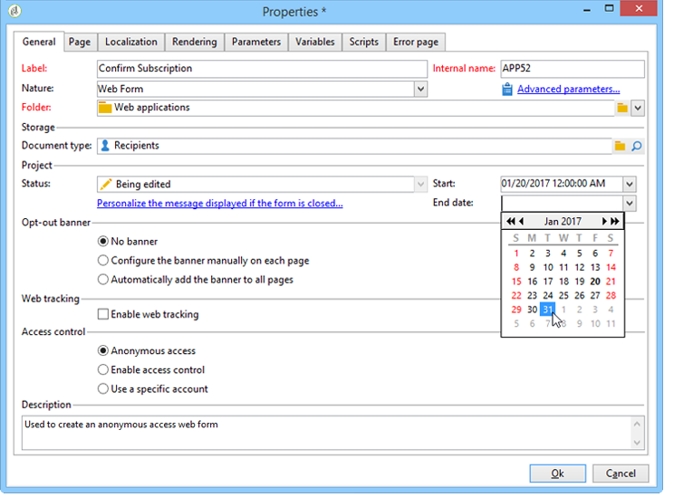

>[!NOTE]
>
>양식이 닫혀 있어 그 유효 기간에 도달하지 않았거나 만료된 경우 또는 Adobe Campaign 운영자가 닫은 경우, 사용자가 해당 양식에 액세스하려고 하면 메시지가 표시됩니다. **[!UICONTROL Personalize the message displayed if the form is closed...]**&#x200B;을(를) 클릭하여 이 메시지를 개인화할 수 있습니다.

## 양식 액세스 제어 {#form-access-control}

기본적으로 웹 양식에 대한 액세스는 익명 모드로 수행됩니다. 양식에 액세스하는 모든 연산자에게는 WebApp 연산자 권한이 할당됩니다.

예를 들어 인트라넷 사이트에서 양식을 전달할 때 사용자를 인증하기 위해 양식 표시에 대한 액세스 제어를 활성화할 수 있습니다. 이렇게 하려면 관련 양식의 **[!UICONTROL Properties]** 창을 표시하고 아래와 같이 **[!UICONTROL Enable access control]** 옵션을 클릭합니다.

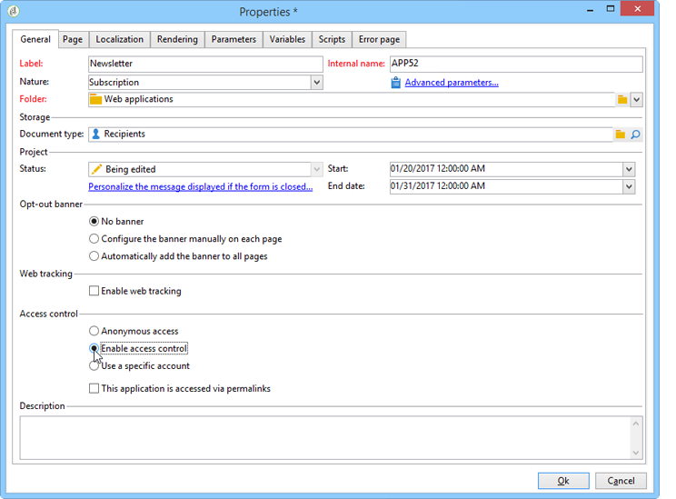

페이지에 액세스하면 다음 인증 양식이 표시됩니다.

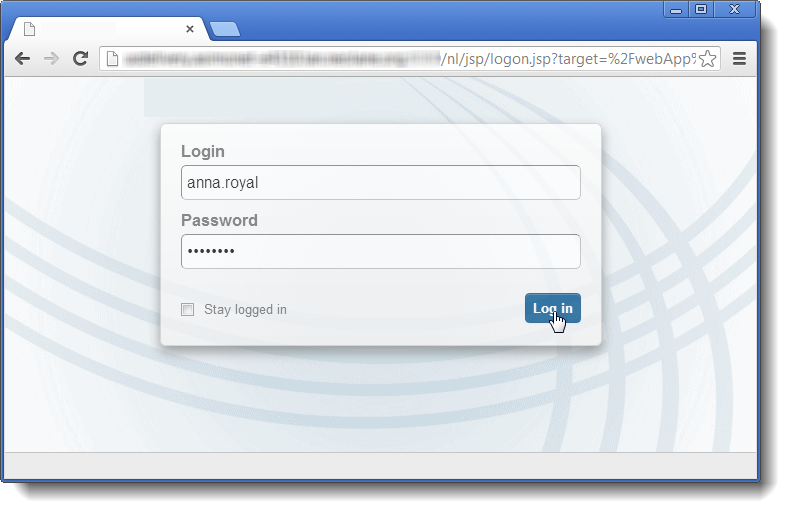

로그인 및 암호는 Adobe Campaign 운영자가 사용하는 암호입니다. 이 작업에 대한 자세한 정보는 [이 섹션](https://experienceleague.adobe.com/en/docs/campaign-classic/using/getting-started/permissions/access-management){target="_blank"}을 참조하십시오.

**[!UICONTROL Use a specific account]** 옵션을 사용하면 양식에 액세스하는 연산자의 읽기 또는 쓰기 권한을 제한할 수 있습니다. 드롭다운 상자를 사용하여 이러한 권한 부여를 담당할 운영자 또는 운영자 그룹을 선택합니다.

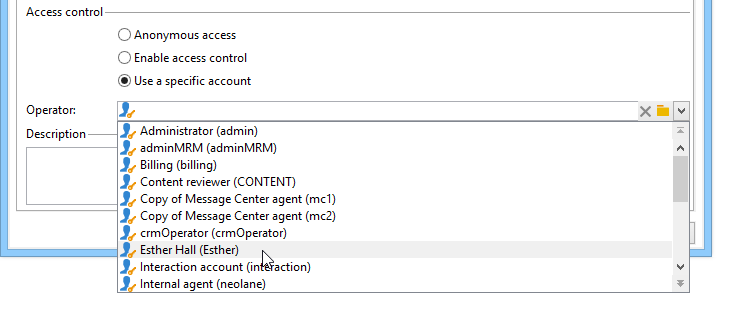

## 양식 URL 매개 변수 {#form-url-parameters}

양식의 URL에서 매개 변수를 추가하여 콘텐츠를 개인화하고 컨텍스트(언어, 암호화된 수신자 ID, 회사, 변수에 저장된 계산된 공식 등)를 초기화할 수 있습니다. 이렇게 하면 여러 다른 URL을 통해 한 양식에 액세스할 수 있고 URL에 표시된 매개 변수의 값을 기반으로 페이지 콘텐츠를 개인화할 수 있습니다.

기본적으로 Adobe Campaign에서는 양식 미리 보기 및 오류 검사에 대한 매개 변수를 제공합니다. 양식에 연결된 새 설정을 만들 수 있으며, 이 설정은 데이터베이스의 필드 또는 로컬 변수의 값을 사용할 수 있습니다.

## 표준 매개 변수 {#standard-parameters}

기본적으로 다음 매개 변수를 사용할 수 있습니다.

* 암호화된 식별자를 나타내는 **id**.
* 표시 언어를 변경하려면 **lang**.
* 응답자의 출처를 지정하려면 **origin**&#x200B;을(를) 사용하십시오.
* **_uuid**&#x200B;을(를) 사용하면 게시 및 오류 추적 전에 양식을 볼 수 있습니다. 이 매개 변수는 내부용(만들기 및 디버그)입니다. 이 URL을 통해 웹 양식에 액세스하면 만들어진 레코드가 추적(보고서)에서 고려되지 않습니다. 원본이 **[!UICONTROL Adobe Campaign]** 값으로 강제 적용됩니다.

  **_preview** 매개 변수 및/또는 **_debug**&#x200B;과(와) 함께 사용됩니다.

  마지막으로 저장된 버전을 표시하려면 **_preview**&#x200B;을(를) 선택하십시오. 이 매개 변수는 테스트 단계에서만 사용해야 합니다.

  **_debug**&#x200B;을(를) 사용하여 폼의 페이지에 입력되거나 계산된 데이터 추적을 표시합니다. 양식이 게시된 후 등 오류에 대한 자세한 정보를 얻는 데 사용됩니다.

  >[!CAUTION]
  >
  >**_uuid** 매개 변수가 있는 URL을 통해 양식이 표시되면 **[!UICONTROL origin]** 매개 변수의 값이 **Adobe Campaign**(으)로 강제 설정됩니다.

## 매개 변수 추가 {#adding-parameters}

폼의 속성 창에서 **[!UICONTROL Parameters...]** 탭을 통해 매개 변수를 추가할 수 있습니다. 아래와 같이 필수로 지정할 수 있습니다.

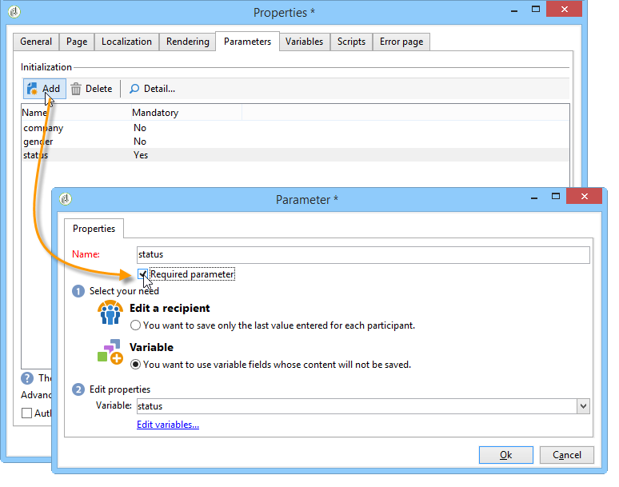

매개변수 값을 검색할 저장소 위치를 지정해야 합니다. 이렇게 하려면 저장소 옵션 중 하나를 선택한 다음 **[!UICONTROL Storage]** 탭을 클릭하여 필드 또는 관련 변수를 선택합니다. 저장소 옵션은 [응답 저장소 필드](web-forms-answers.md#response-storage-fields)에 자세히 설명되어 있습니다.

응답자 상태(0, 1 또는 기타 값)를 양식에 액세스하기 위해 URL에 추가할 수 있습니다. 이 정보는 폼의 페이지나 테스트 상자에서 다시 사용할 수 있습니다. 표시되는 페이지는 아래와 같이 컨텍스트의 값을 기준으로 조건을 지정할 수 있습니다.

1. 고객의 홈 페이지(**상태=1**):

   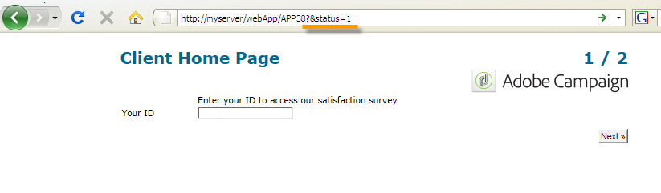

1. 잠재 고객의 홈 페이지(**상태=0**):

   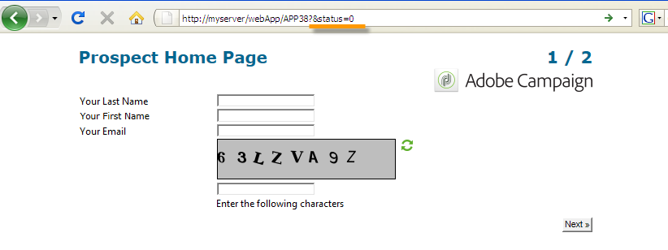

1. 다른 프로필의 홈 페이지(예: **상태=12**):

   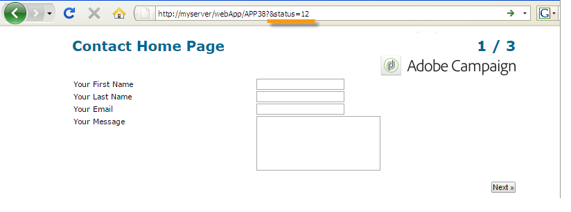

이 양식을 구성하려면 테스트 상자를 만들어 아래 표시된 대로 다이어그램의 시작 부분에 배치합니다.

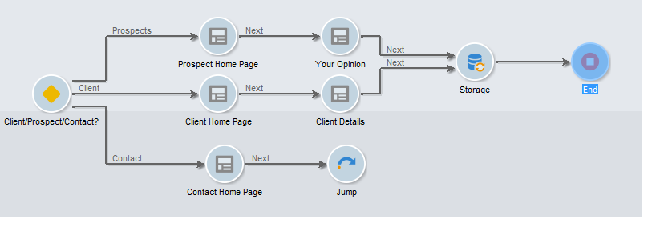

테스트 상자를 사용하여 페이지 시퀀싱 조건을 구성할 수 있습니다.

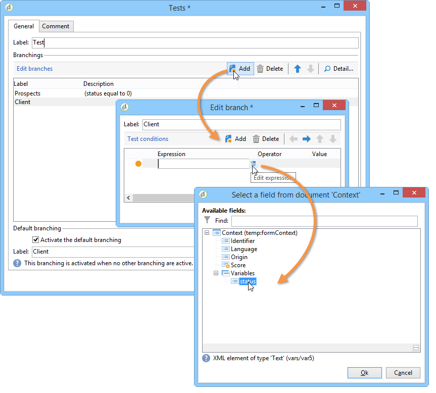
