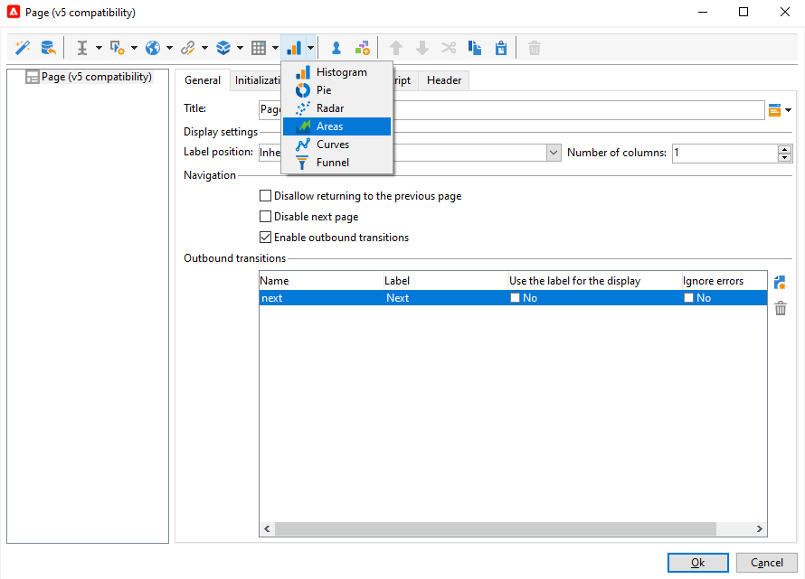
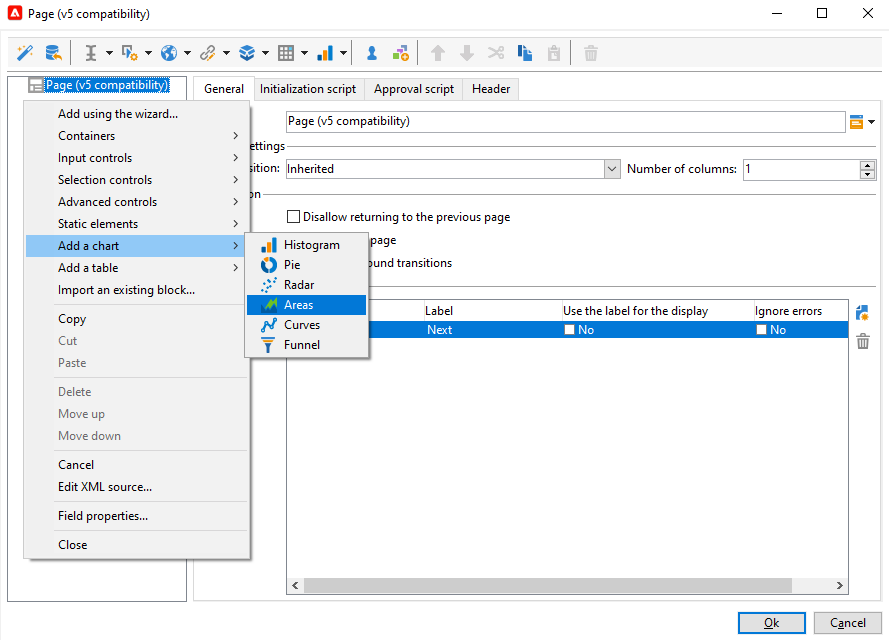
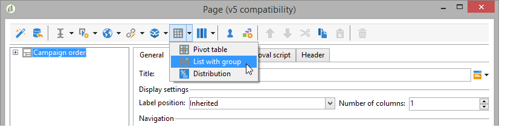
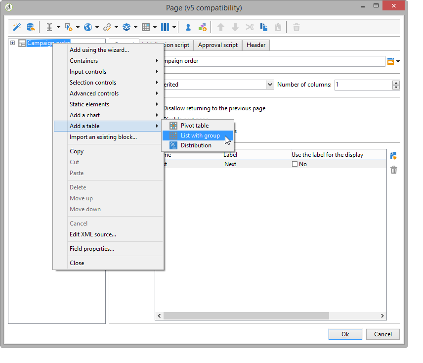

# 웹 애플리케이션 디자인{#designing-a-web-application}

웹 응용 프로그램은 [웹 양식](about-web-forms.md)과 동일한 원칙에 따라 만들고 관리됩니다.

>[!CAUTION]
>
>웹 응용 프로그램을 디자인하는 동안 오류를 확인하려면 **[!UICONTROL Preview]** 하위 탭을 사용하십시오. 웹 응용 프로그램을 미리 보는 데 사용되는 프로필 테스트는 **[!UICONTROL Web application agent]** 연산자의 **[!UICONTROL Access rights]**&#x200B;이(가) 있는 폴더에 있어야 합니다.  웹 응용 프로그램이 게시될 때까지 변경 내용이 최종 사용자에게 노출되지 않습니다.

## 웹 애플리케이션에 차트 삽입 {#inserting-charts-in-a-web-application}

웹 응용 프로그램에 차트를 포함할 수 있습니다. 이렇게 하려면 작업 막대의 차트 드롭다운 목록을 사용하여 삽입할 차트 유형을 선택합니다.

**[!UICONTROL Add a chart]** 메뉴도 선택할 수 있습니다.

## 웹 응용 프로그램에 표 삽입 {#inserting-tables-in-a-web-application}

테이블을 추가하려면 작업 표시줄의 테이블 드롭다운 목록을 사용하여 사용할 테이블 유형을 선택합니다.

드롭다운 메뉴에서 테이블 유형을 선택할 수도 있습니다.

## 개요 유형 웹 애플리케이션 {#overview-type-web-applications}

Adobe Campaign 인터페이스는 많은 웹 애플리케이션을 사용하여 수신자, 게재, 캠페인, 주식 등에 액세스하고 관리하며 상호 작용합니다.

이러한 화면은 페이지가 한 개만 있는 대시보드 형태로 인터페이스에 표시됩니다.

기본 웹 응용 프로그램은 **[!UICONTROL Administration > Configuration > Web applications]** 노드에 저장됩니다.

## 양식 유형 웹 애플리케이션 편집 {#edit-forms-type-web-applications}

엑스트라넷의 양식 웹 응용 프로그램 편집은 다음과 같은 특징을 가지고 있습니다.

* 사전 로드 상자

  대부분의 경우 표시할 데이터가 미리 로드되어 있어야 합니다. 이러한 양식에 액세스하는 사용자는 액세스 제어를 통해 식별되므로 사전 로드가 반드시 암호화되지는 않습니다.

* 저장 상자
* 페이지 추가

  &quot;개요&quot; 유형의 웹 응용 프로그램에는 모두 단일 페이지가 있는 반면, 편집 양식은 특정 기준(테스트, 선택 사항, 연결된 연산자 프로필 등)에 따라 페이지 시퀀스를 제공할 수 있습니다.

