# 웹 양식 게시{#publishing-a-web-form}


## 양식 데이터 미리 로드 {#pre-loading-the-form-data}

웹 양식을 통해 데이터베이스에 저장된 프로필을 업데이트하려면 미리 로드 상자를 사용할 수 있습니다. 미리 로드 상자를 사용하여 데이터베이스에서 업데이트할 레코드를 찾는 방법을 표시할 수 있습니다.

다음과 같은 식별 방법을 사용할 수 있습니다.

* **[!UICONTROL Adobe Campaign Encryption]**

  이 암호화 방법은 암호화된 Adobe Campaign 식별자(ID)를 사용합니다. 이 메서드는 Adobe Campaign 개체에만 적용할 수 있으며 암호화된 ID는 Adobe Campaign 플랫폼에서만 생성할 수 있습니다.

  이 방법을 사용하는 경우 **`<%=escapeUrl(recipient.cryptedId) %>`** 매개 변수를 추가하여 전자 메일 주소로 게재할 양식의 URL을 조정해야 합니다. 자세한 내용은 [전자 메일을 통해 양식 배달](#delivering-a-form-via-email)을 참조하세요.

* **[!UICONTROL DES encryption]**

  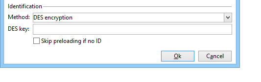

  이 암호화 방법은 외부에서 제공되는 식별자(ID)를 사용하며, Adobe Campaign 및 외부 공급자에 의해 공유되는 키에 연결됩니다. **[!UICONTROL Des key]** 필드를 사용하면 이 암호화 키를 입력할 수 있습니다.

* **[!UICONTROL List of fields]**

  이 옵션을 사용하면 양식의 현재 컨텍스트에 있는 필드 중에서 데이터베이스에서 해당 프로필을 찾는 데 사용할 필드를 선택할 수 있습니다.

  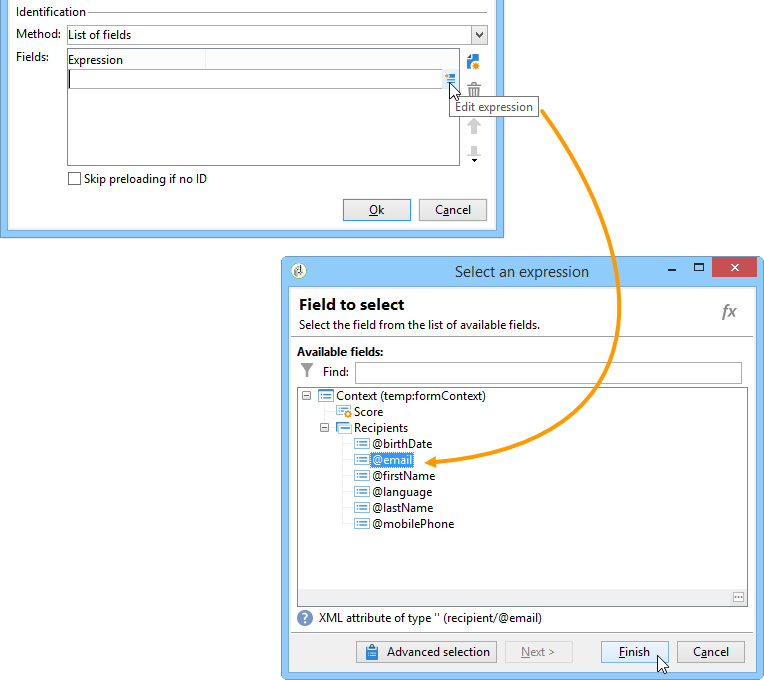

  **[!UICONTROL Parameters]** 탭을 통해 필드를 양식 속성에 추가할 수 있습니다([매개 변수 추가](defining-web-forms-properties.md#adding-parameters) 참조). 양식 URL 또는 입력 영역에 배치됩니다.

  >[!CAUTION]
  >
  >선택한 필드의 데이터가 암호화되지 않습니다. **[!UICONTROL Field list]** 옵션을 선택하면 Adobe Campaign에서 암호를 해독할 수 없으므로 암호화된 양식으로 제공해서는 안 됩니다.

  다음 예에서 프로필 미리 로드는 이메일 주소를 기반으로 합니다.

  URL에는 암호화되지 않은 이메일 주소가 포함될 수 있으며, 이 경우 사용자는 관련된 페이지에 직접 액세스할 수 있습니다.

  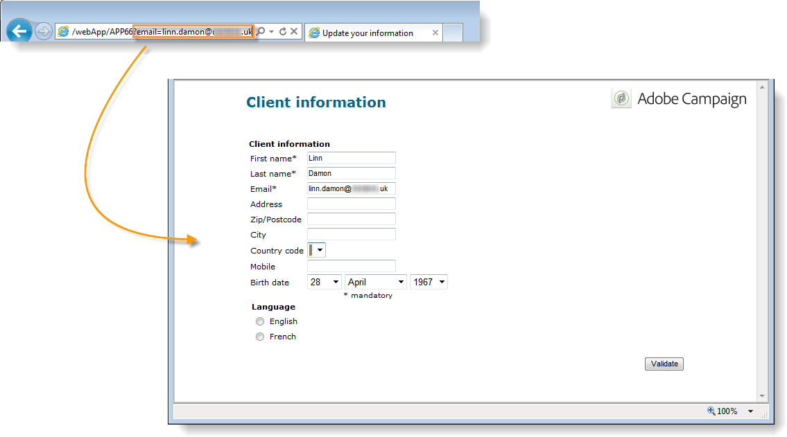

  그렇지 않으면 암호를 입력하라는 메시지가 표시됩니다.

  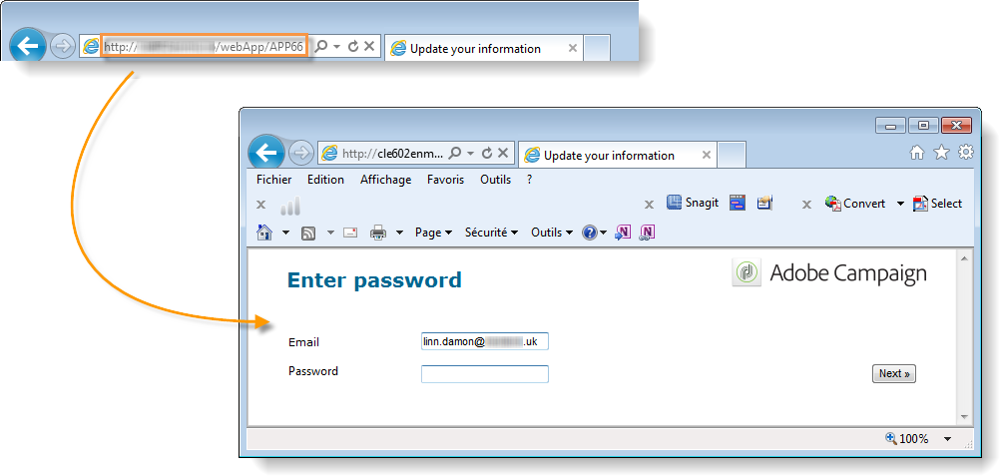

  >[!CAUTION]
  >
  >목록에 여러 필드가 지정된 경우 프로필을 업데이트하려면 **모든 필드**&#x200B;의 데이터가 데이터베이스에 저장된 데이터와 일치해야 합니다. 그렇지 않으면 새 프로필이 만들어집니다.
  > 
  >이 함수는 웹 응용 프로그램에 특히 유용하지만 공용 양식에는 권장되지 않습니다. 선택한 액세스 제어 옵션은 &quot;액세스 제어 활성화&quot;여야 합니다.

프로필을 업데이트하지 않으려면 **[!UICONTROL Skip preloading if no ID]** 옵션을 선택해야 합니다. 이 경우 입력한 각 프로필은 양식 승인 후 데이터베이스에 추가됩니다. 이 옵션은 양식이 웹 사이트에 게시되는 경우 등에 사용됩니다.

**[!UICONTROL Auto-load data referenced in the form]** 옵션을 사용하면 양식의 입력 및 병합 필드와 일치하는 데이터를 자동으로 미리 로드할 수 있습니다. 그러나 **[!UICONTROL Script]** 및 **[!UICONTROL Test]** 활동에서 참조된 데이터는 관련이 없습니다. 이 옵션을 선택하지 않은 경우 **[!UICONTROL Load additional data]** 옵션을 사용하여 필드를 정의해야 합니다.

**[!UICONTROL Load additional data]** 옵션을 사용하면 양식의 페이지에서 사용되지 않지만 미리 로드되는 정보를 추가할 수 있습니다.

예를 들어 수신자의 성별을 미리 로드하고 테스트 상자를 통해 자동으로 해당 페이지로 안내할 수 있습니다.

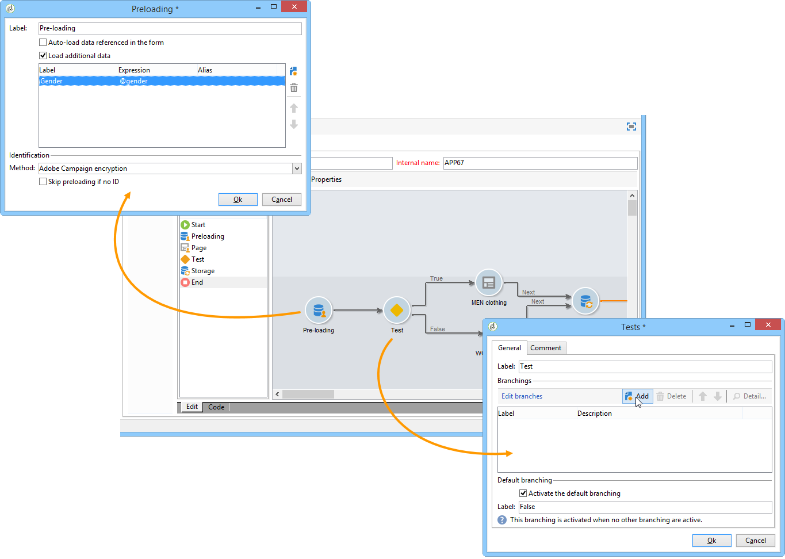

## 웹 양식 게재 및 추적 관리 {#managing-web-forms-delivery-and-tracking}

양식이 생성, 구성 및 게시되면 전달하고 사용자 응답을 추적할 수 있습니다.

### 양식의 수명 주기 {#life-cycle-of-a-form}

양식의 라이프 사이클에는 세 단계가 있습니다.

1. **편집 중**

   초기 설계 단계입니다. 새 양식이 만들어지면 편집 단계에 있습니다. 테스트 목적으로만 양식에 액세스하려면 해당 URL에서 매개 변수 **[!UICONTROL __uuid]**&#x200B;을(를) 사용해야 합니다. 이 URL은 **[!UICONTROL Preview]** 하위 탭에서 액세스할 수 있습니다. [양식 URL 매개 변수](defining-web-forms-properties.md#form-url-parameters)을(를) 참조하십시오.

   >[!CAUTION]
   >
   >양식을 편집하는 한 해당 액세스 URL은 특수 URL입니다.

1. **게시 보류 중**

   경우에 따라(예: [패키지를 통해 양식을 가져오는 중](#import-web-packages)일 때) 웹 양식은 라이브가 될 때까지 **[!UICONTROL Pending publication]** 상태를 가질 수 있습니다.

   >[!NOTE]
   >
   >기술 웹 응용 프로그램(**[!UICONTROL Administration]** > **[!UICONTROL Configuration]** > **[!UICONTROL Web applications]** 메뉴를 통해 사용 가능)의 경우 **[!UICONTROL Pending publication]** 상태의 양식이 자동으로 [게시됨](#publishing-a-form)되고 **[!UICONTROL Online]** 상태를 가져옵니다.

1. **온라인**

   디자인 단계가 완료되면 양식을 전달할 수 있습니다.

   양식의 상태가 **[!UICONTROL Being edited]** 또는 **[!UICONTROL Pending publication]**&#x200B;인 경우 온라인이고 브라우저에서 웹 양식 URL을 통해 액세스할 수 있으려면 [게시됨](#publishing-a-form)이어야 합니다.

   게시되면 양식이 만료될 때까지 활성화됩니다.

   이 양식은 만료되기 전까지 **[!UICONTROL Live]**&#x200B;이(가) 됩니다.

   >[!CAUTION]
   >
   >배달하려면 양식의 URL에 **[!UICONTROL __uuid]** 매개 변수를 포함하면 안 됩니다.

1. **닫힘**

   양식이 닫히면 게재 단계가 끝나고 양식을 사용할 수 없게 됩니다. 사용자는 더 이상 양식에 액세스할 수 없습니다.

   양식 속성 창에서 만료일을 정의할 수 있습니다. 자세한 내용은 [온라인에서 사용 가능한 양식 만들기](#making-a-form-available-online)를 참조하세요.

양식의 게시 상태가 양식 목록에 표시됩니다.

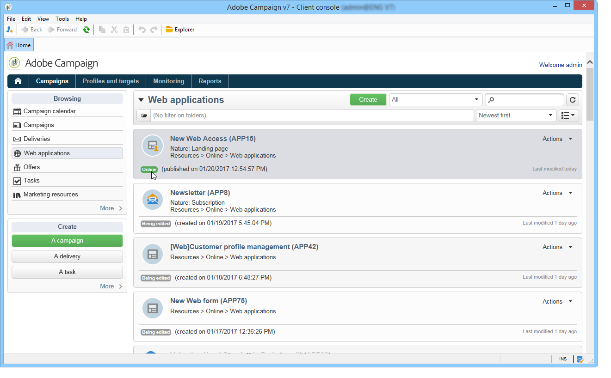

### 양식 게시 {#publishing-a-form}

양식의 상태를 변경하려면 양식을 게시해야 합니다. 이렇게 하려면 웹 양식 목록 위에 있는 **[!UICONTROL Publication]** 단추를 클릭하고 드롭다운 상자에서 상태를 선택합니다.

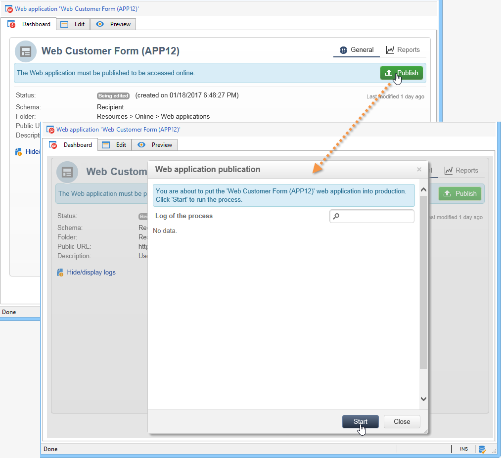

### 온라인에서 양식 사용 가능 {#making-a-form-available-online}

사용자가 액세스할 수 있으려면 양식이 프로덕션 상태여야 하며 유효 기간 내에 양식을 시작해야 합니다. 유효일은 양식의 **[!UICONTROL Properties]** 링크를 통해 입력됩니다.

* **[!UICONTROL Project]** 섹션의 필드를 사용하여 양식의 시작 날짜와 종료 날짜를 입력하십시오.

  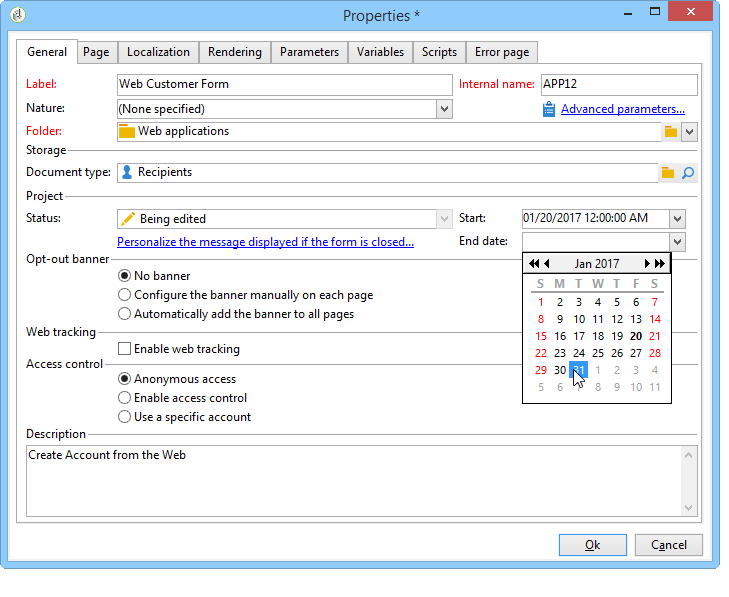

* **[!UICONTROL Personalize the message displayed if the form is closed...]** 링크를 클릭하여 양식이 유효하지 않은 상태에서 사용자가 양식에 액세스하려고 할 경우 표시할 오류 메시지를 정의합니다.

  [양식의 접근성](defining-web-forms-properties.md#accessibility-of-the-form)을 참조하세요.

### 이메일을 통해 양식 게재 {#delivering-a-form-via-email}

전자 메일을 통해 초대를 전달할 때 데이터 조정에 **[!UICONTROL Adobe Campaign Encryption]** 옵션을 사용할 수 있습니다. 이렇게 하려면 게재 도우미로 이동하여 다음 매개 변수를 추가하여 양식에 대한 링크를 조정합니다.

```
<a href="https://server/webApp/APP264?&id=<%=escapeUrl(recipient.cryptedId) %>">
```

이 경우 데이터 저장을 위한 조정 키는 수신자의 암호화된 식별자여야 합니다. 자세한 내용은 [양식 데이터 미리 로드](#pre-loading-the-form-data)를 참조하세요.

이 경우 레코드 상자에서 **[!UICONTROL Update the preloaded record]** 옵션을 선택해야 합니다. 자세한 내용은 [웹 양식 답변 저장](web-forms-answers.md#saving-web-forms-answers)을 참조하세요.

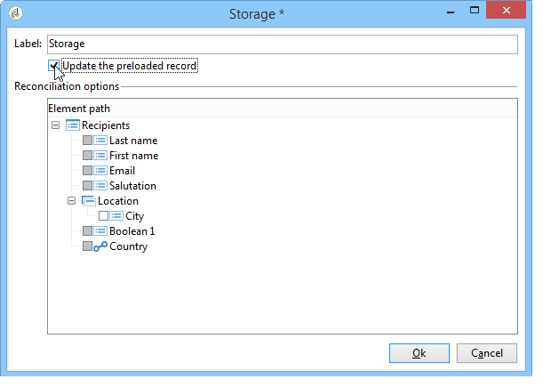

### 로그 응답 {#log-responses}

응답 추적은 전용 탭에서 활성화하여 웹 양식의 영향을 모니터링할 수 있습니다. 이렇게 하려면 양식 속성 창에서 **[!UICONTROL Advanced parameters...]** 링크를 클릭하고 **[!UICONTROL Log responses]** 옵션을 선택합니다.

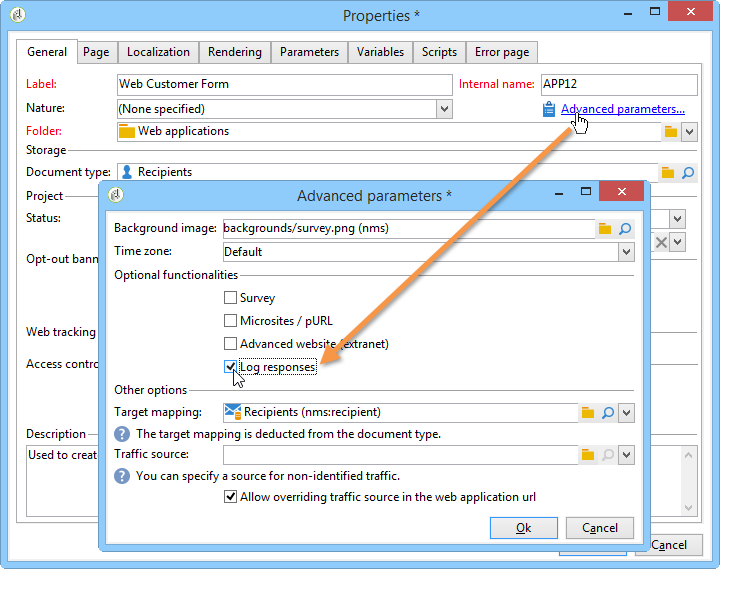

응답자의 ID를 볼 수 있는 **[!UICONTROL Responses]** 탭이 나타납니다.

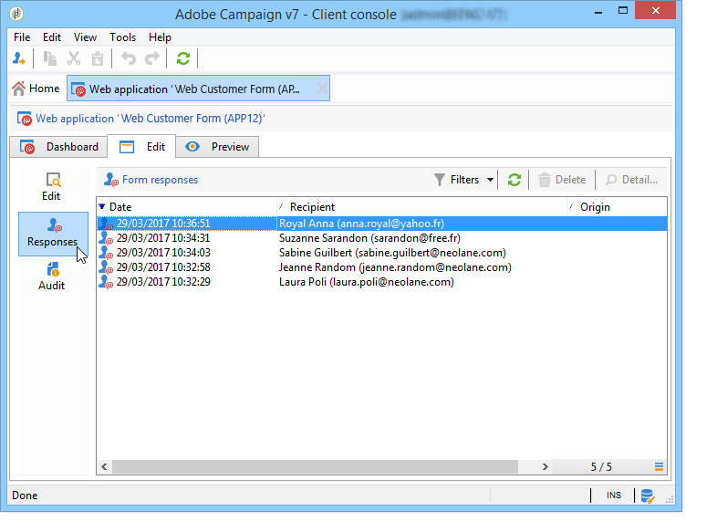

받는 사람을 선택하고 **[!UICONTROL Detail...]** 단추를 클릭하여 제공된 응답을 봅니다.

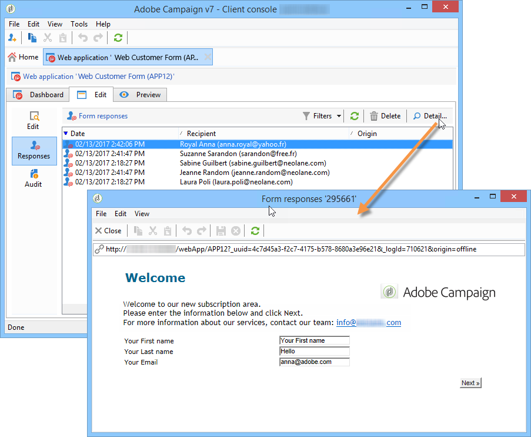

예를 들어, 미리 알림을 전송할 때 응답자가 아닌 사람만 타겟팅하거나 응답자에게만 특정 커뮤니케이션을 제공하기 위해 쿼리에 제공된 응답 로그를 처리할 수 있습니다.

### 웹 양식 패키지 가져오기 {#import-web-packages}

인스턴스에서 다른 인스턴스로(예: 스테이지에서 프로덕션으로) 웹 양식을 포함하는 패키지를 내보내고 가져올 때 새 인스턴스의 웹 양식 상태는 여러 조건에 따라 달라질 수 있습니다. 다른 사례는 아래에 나열되어 있습니다.

[이 섹션](#life-cycle-of-a-form)에서 웹 양식의 다양한 상태에 대해 자세히 알아보세요.

>[!NOTE]
>
>패키지를 통해 웹 양식을 내보낼 때 최종 패키지의 컨텐츠에 양식 상태가 표시됩니다.

* 첫 번째 인스턴스에서 내보낼 때 웹 양식 상태가 **[!UICONTROL Pending publication]** 또는 **[!UICONTROL Online]**&#x200B;인 경우:

  * 새 인스턴스에서 가져올 때 웹 양식을 **[!UICONTROL Pending publication]** 상태로 가져옵니다.

  * 웹 양식이 새 인스턴스에 이미 있으면 새 버전의 양식으로 대체되며 이전 버전의 양식이 **[!UICONTROL Online]**&#x200B;인 경우에도 **[!UICONTROL Pending publication]** 상태를 사용합니다.

  * 양식의 존재 여부에 관계없이 새 인스턴스에서 **[!UICONTROL Online]**&#x200B;이(가) 되고 브라우저에서 웹 양식 URL을 통해 액세스할 수 있도록 하려면 양식이 [게시됨](#publishing-a-form)이어야 합니다.

* 내보낼 때 웹 양식 상태가 **[!UICONTROL Being edited]**&#x200B;인 경우:

  * 패키지를 가져오는 인스턴스에서 웹 양식을 새로 만든 경우 웹 양식은 **[!UICONTROL Being edited]** 상태를 가져옵니다.

  * 새 인스턴스에 웹 양식이 이미 있는 경우 기존 양식을 수정한 것입니다. 이전 버전의 양식이 **[!UICONTROL Online]**&#x200B;인 경우 새 버전의 양식이 새 인스턴스에서 다시 [게시](#publishing-a-form)될 때까지 이전 버전은 온라인 상태로 유지됩니다.

  >[!NOTE]
  >
  >**[!UICONTROL Preview]** 탭을 사용하여 웹 양식의 최신 버전을 확인할 수 있습니다.

<!--
For RN:
* Now, when a web form has the **Pending publication** status, it must be published before it becomes **Online** and accessible through the web form URL in a web browser. [Read more](publishing-a-web-form.md#life-cycle-of-a-form)
-->
