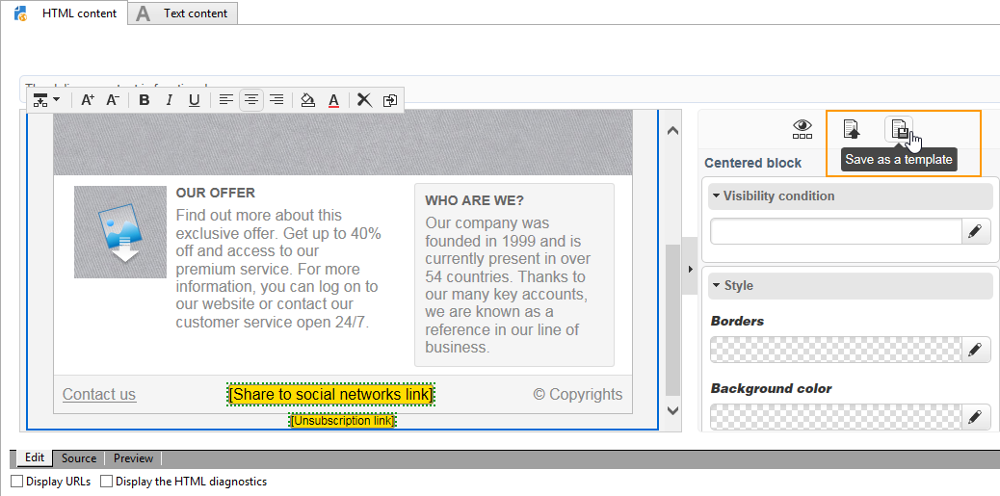

# 템플릿 관리{#template-management}

디지털 콘텐츠 편집기는 웹 응용 프로그램 및 게재용 **표준 템플릿**&#x200B;을 제공합니다.

랜딩 페이지 유형 웹 애플리케이션을 만들 때 사용자는 이러한 템플릿 중 하나를 선택할 수 있습니다. Adobe Campaign 외부에서 만든 HTML 템플릿을 가져올 수도 있습니다.

템플릿을 추가하려면 [전역 옵션](content-editor-interface.md#global-options)을 참조하세요.

## 게재를 템플릿으로 저장 {#saving-a-delivery-as-a-template}

게재를 구성한 후 템플릿으로 저장하여 나중에 게재할 때 다시 사용할 수 있습니다.

**캠페인** 탭에서 선택한 게재를 엽니다. **템플릿으로 저장** 단추를 클릭하고 템플릿 이름을 지정한 다음 저장합니다.

새 템플릿은 탐색기의 **리소스 > 템플릿 > 콘텐츠 템플릿** 노드에 저장됩니다.
