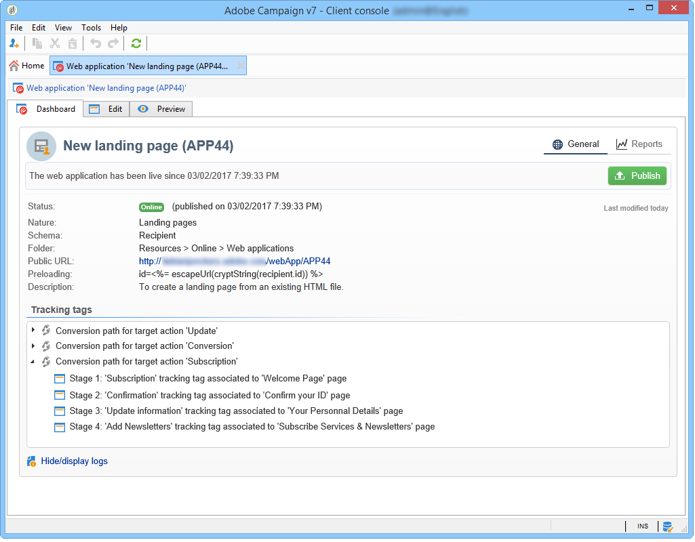
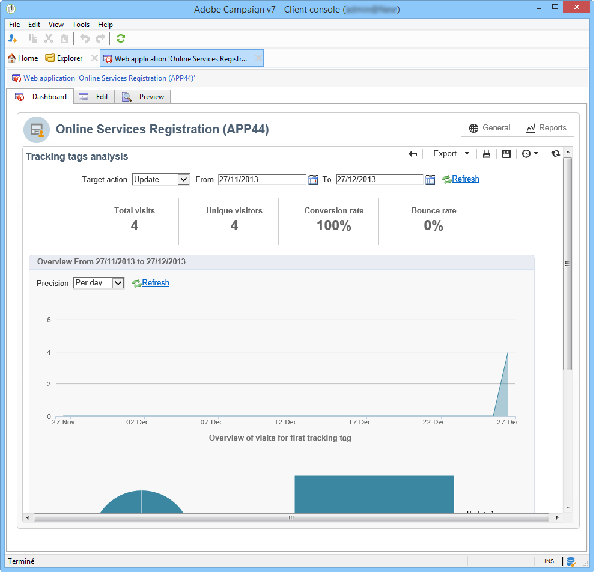
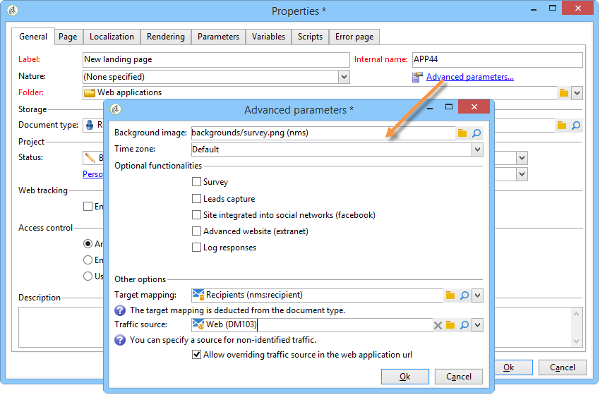
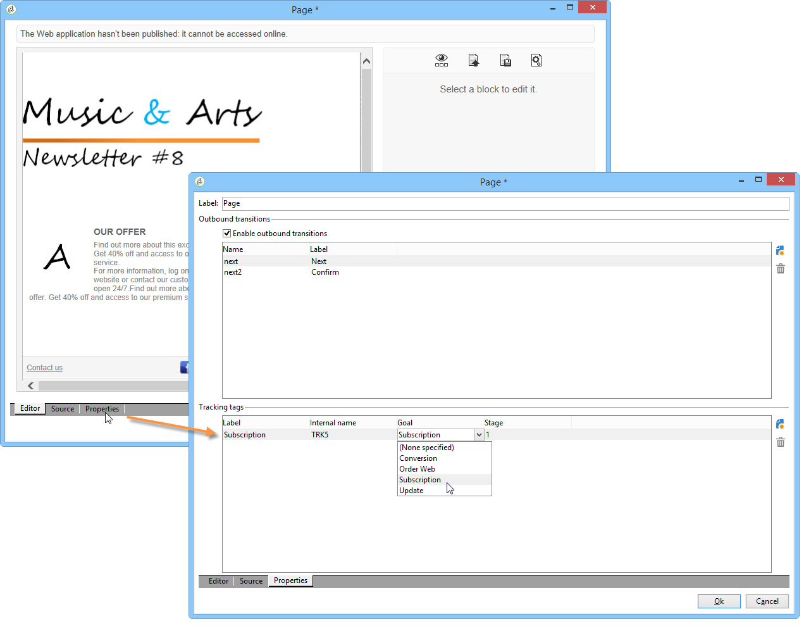
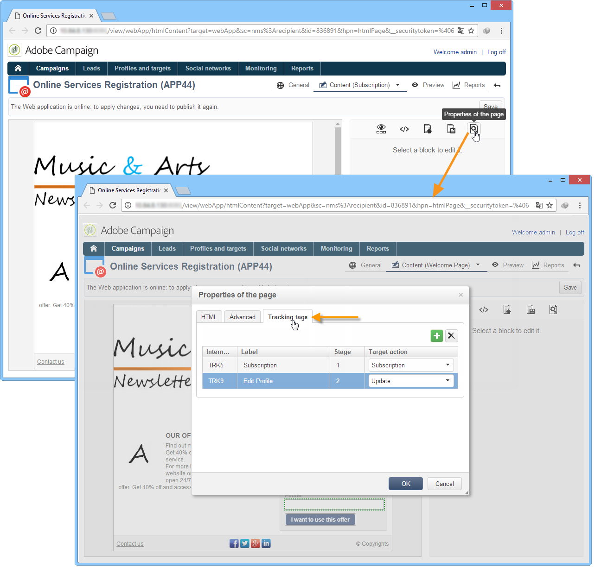
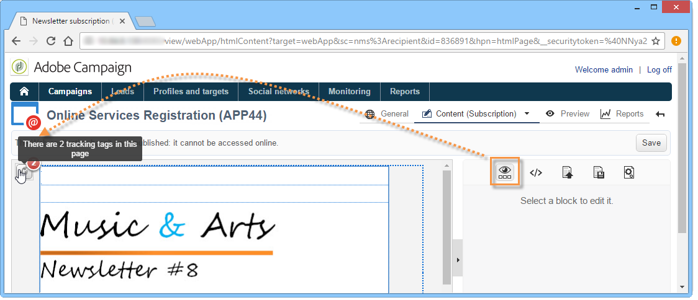

# 웹 애플리케이션에서 방문 수 추적{#tracking-a-web-application}

Adobe Campaign에서는 추적 태그를 삽입하여 웹 애플리케이션 페이지에서 방문을 추적하고 측정할 수 있습니다. 이 기능은 모든 웹 애플리케이션 유형(양식, 웹 페이지 등)에 사용할 수 있습니다.

따라서 여러 탐색 경로를 정의하고 성공을 평가할 수 있습니다. 그런 다음 복구된 데이터를 각 애플리케이션의 보고서에서 사용할 수 있습니다.

이 버전에 포함된 주요 개선 사항은 다음과 같습니다.

* 탐색 경로 정의(예: 구매, 구독, 반환 등)를 간소화하기 위해 여러 추적 태그를 동일한 페이지에 삽입할 수 있습니다.
* 웹 애플리케이션 대시보드에서 여러 페이지의 탐색 경로 및 추적 태그 보기

  

* 전체 추적 보고서를 생성하고 있습니다.

  

  주요 지표는 다음과 같습니다.

  * **전환율**: 탐색 경로의 모든 단계를 표시한 사용자 수입니다.
  * **바운스 비율**: 첫 번째 단계만 표시한 사람 수
  * **전환 funnel**: 각 단계 간 손실률입니다.

  또한 **Sector** 유형 차트는 해당 소스에 따라 모집단을 표시합니다.

## 트래픽 소스 식별 {#identifying-the-traffic-source}

웹 애플리케이션에 액세스할 때 방문자의 출처를 식별하는 데 두 가지 다른 모드를 사용할 수 있습니다.

1. 웹 애플리케이션 페이지에 대한 액세스 권한을 부여하기 위해 특정 게재 보내기: 이 경우 트래픽 소스는 이 게재입니다.
1. 웹 애플리케이션을 전용 트래픽 소스에 연결: 이 경우 외부 &#39;트래픽 소스&#39; 유형 게재여야 합니다. 웹 애플리케이션 속성이나 대상 매핑에서 선택할 수 있습니다.

   

웹 애플리케이션에서 트래픽 소스를 식별하기 위해 Adobe Campaign은 다음 정보를 지속적으로 찾습니다.

1. 소스 게재 식별자(존재하는 경우)(nlId 쿠키),
1. 웹 애플리케이션 속성에 정의된 외부 게재 식별자(있는 경우)
1. 대상 매핑에 정의된 외부 게재 식별자(있는 경우).

>[!NOTE]
>
>Campaign을 설치할 때 배포 마법사에서 옵션을 활성화한 경우에만 익명 추적을 사용할 수 있습니다.

## DCE(디지털 콘텐츠 편집기)로 디자인된 웹 애플리케이션 {#web-applications-designed-with-digital-content-editor--dce-}

HTML 콘텐츠 편집기(**DCE(디지털 콘텐츠 편집기)**)를 사용하여 웹 응용 프로그램을 만들면 추적 태그가 편집기의 **[!UICONTROL Properties]** 탭에서 삽입됩니다. DCE(디지털 콘텐츠 편집기)에 대한 자세한 내용은 [이 섹션](about-campaign-html-editor.md)을 참조하세요.

웹 인터페이스를 사용하는 경우 페이지 속성에서 추적 태그를 삽입해야 합니다.

**[!UICONTROL Display blocks]** 아이콘을 사용하면 페이지에 대해 정의된 추적 태그 수를 볼 수 있습니다.

