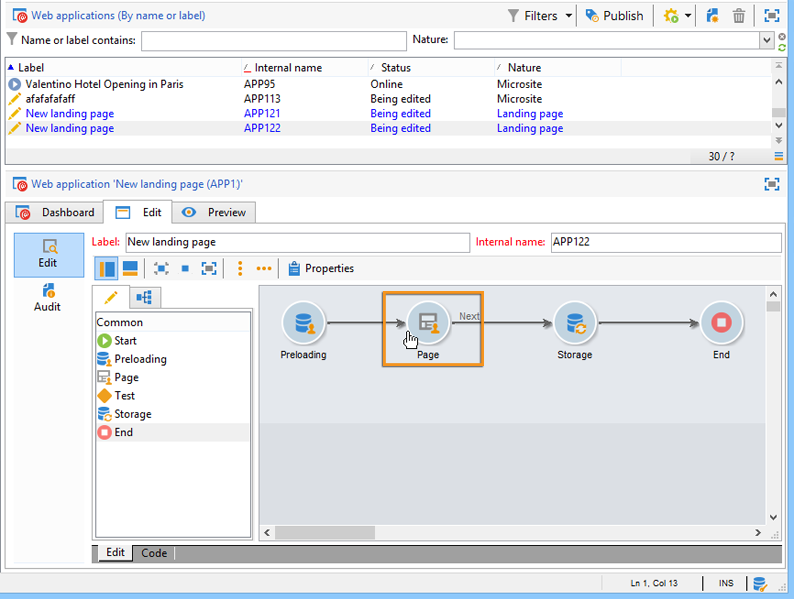
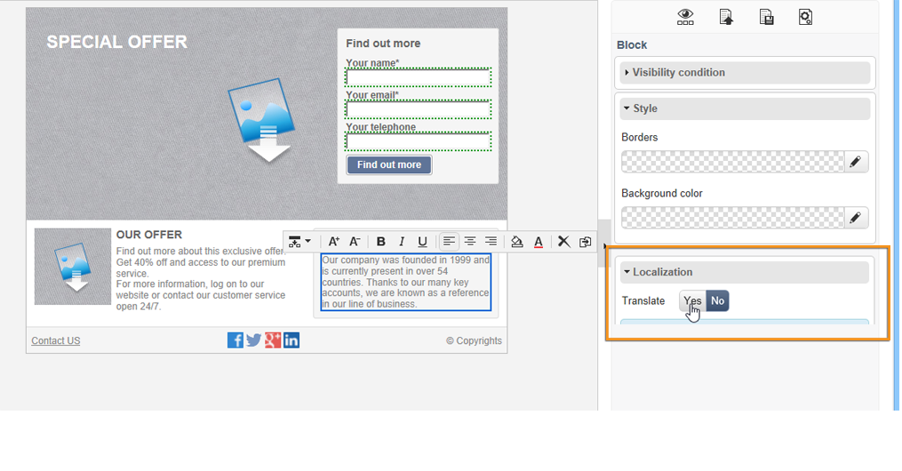
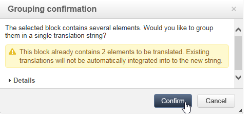
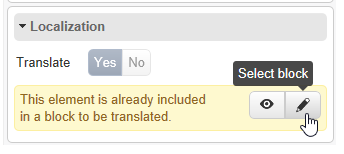

# 웹 애플리케이션 번역{#translating-a-web-application}

Adobe Campaign DCE(디지털 콘텐츠 편집기)로 만든 웹 애플리케이션 페이지를 번역할 수 있습니다.

웹 응용 프로그램의 **[!UICONTROL Properties]**&#x200B;에 있는 **[!UICONTROL Localization]** 탭을 통해 하나 이상의 추가 언어를 선택하는 경우 DCE로 편집한 페이지에 HTML 콘텐츠 블록을 추가할 때 새로운 옵션을 사용할 수 있습니다.

이 옵션을 사용하여 블록 콘텐츠를 번역해야 하는지 여부를 나타낼 수 있습니다.

번역할 문자열은 응용 프로그램의 **[!UICONTROL Translations]** 탭을 통해 웹 응용 프로그램의 다른 문자열과 동일한 방식으로 수집됩니다. 자세한 정보는 이 [페이지](translating-a-web-form.md)를 참조하십시오.

번역할 문자열에 플래그를 지정하려면 다음을 수행합니다.

1. 웹 애플리케이션에서 DCE로 편집한 컨텐츠 페이지를 엽니다.

   

1. HTML 블록을 선택합니다.
1. 오른쪽의 매개 변수 블록에서 **[!UICONTROL Localization]** 옵션을 사용하면 선택한 블록의 내용에 플래그를 지정할 수 있습니다. 기본적으로 페이지 제목만 번역됩니다.

   

   >[!NOTE]
   >
   >문자열은 1023자를 초과할 수 없습니다.

   다음과 같은 세 가지 특정 경우가 있습니다.

   * 선택한 블록에 여러 문자열/블록이 포함되어 있으면 번역할 단일 문자열로 플래그가 지정됩니다. 문자열에는 가 포함되며 그 뒤에는 이 블록 내에 있는 요소의 HTML 코드가 포함됩니다.
   * 여러 문자열이 포함된 블록에 플래그를 지정하려는 경우 이러한 문자열 중 하나 이상에 이미 플래그가 지정되어 있으면 경고가 표시됩니다. 그런 다음 격리된 문자열에서 플래그를 제거하고 전체 블록을 추가할 수 있습니다.

     

   * 이미 플래그가 지정된 블록에 포함된 문자열에서 플래그를 제거하려면 문자열 번역 옵션을 직접 수정할 수 없습니다. 하지만 문자열을 포함하는 블록에 액세스하여 변경할 수 있습니다.

     

1. 문자열 플래그 지정을 마치면 웹 응용 프로그램으로 돌아가 **[!UICONTROL Translations]** 탭을 선택합니다.
1. **[!UICONTROL Collect the strings to translate]**&#x200B;을(를) 선택합니다. DCE에 플래그가 지정된 문자열이 웹 애플리케이션의 문자열에 추가됩니다.

   >[!NOTE]
   >
   >문자열이 수집되면 DCE에서 번역 플래그를 제거해도 목록에서 제거되지 않습니다. 이렇게 하면 번역 메모리에 보관할 수 있습니다.

1. 문자열을 번역하고 승인합니다.

   그런 다음 웹 응용 프로그램의 **[!UICONTROL Preview]** 탭에서 원하는 언어를 선택하여 번역을 미리 볼 수 있습니다.
