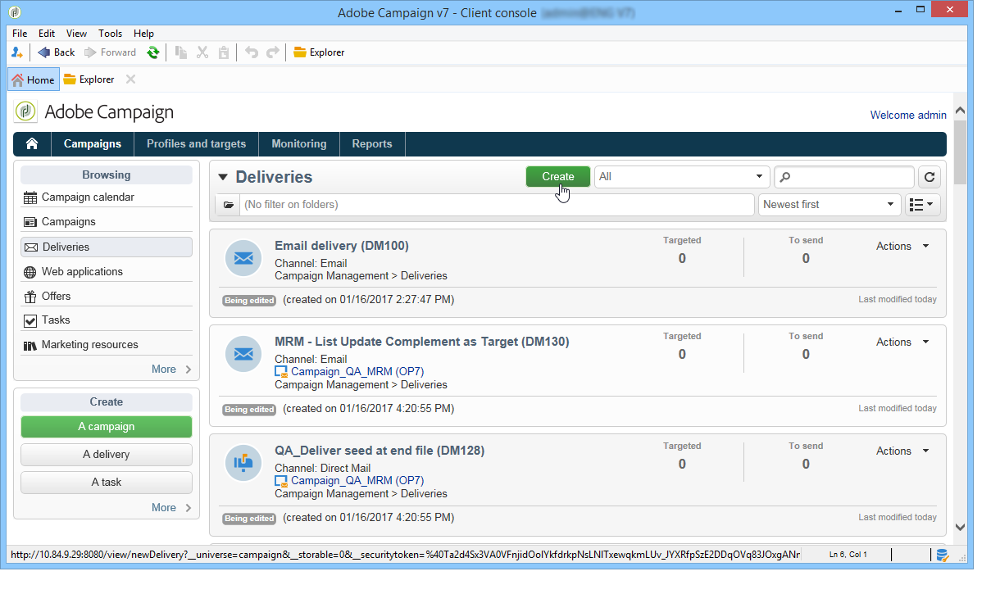
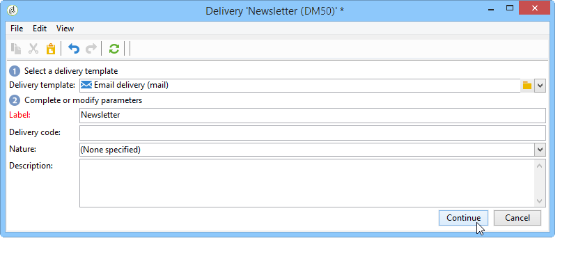
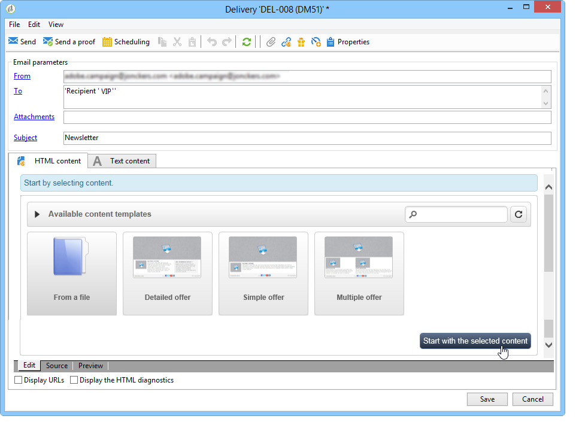
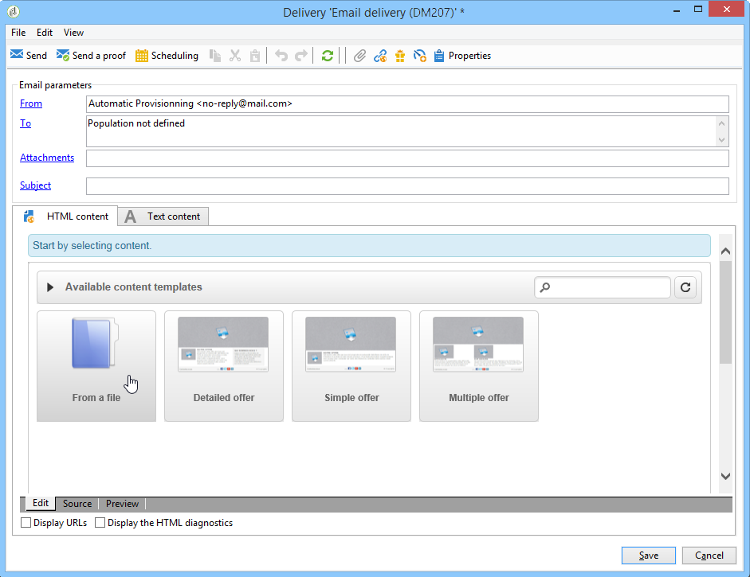
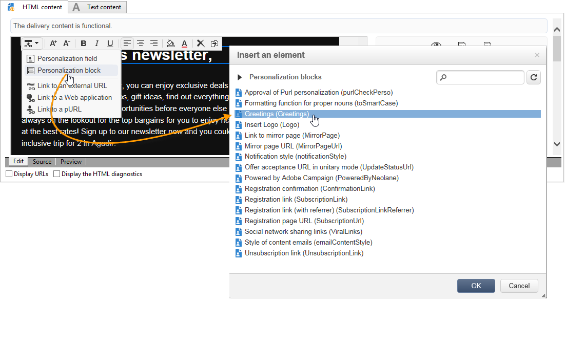
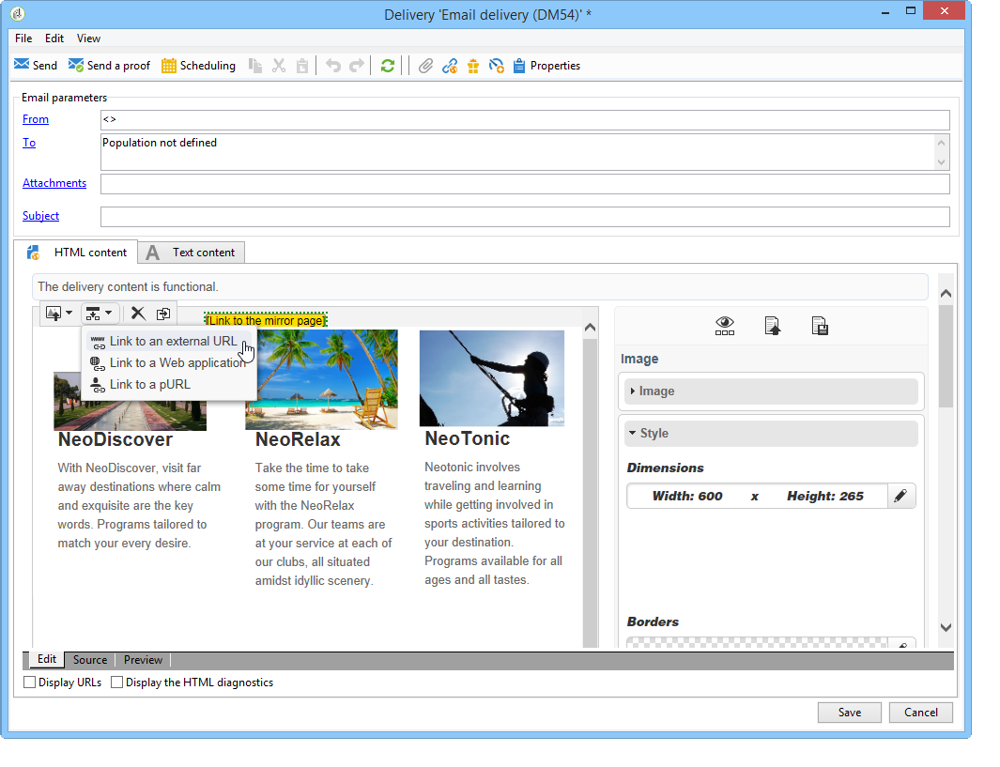
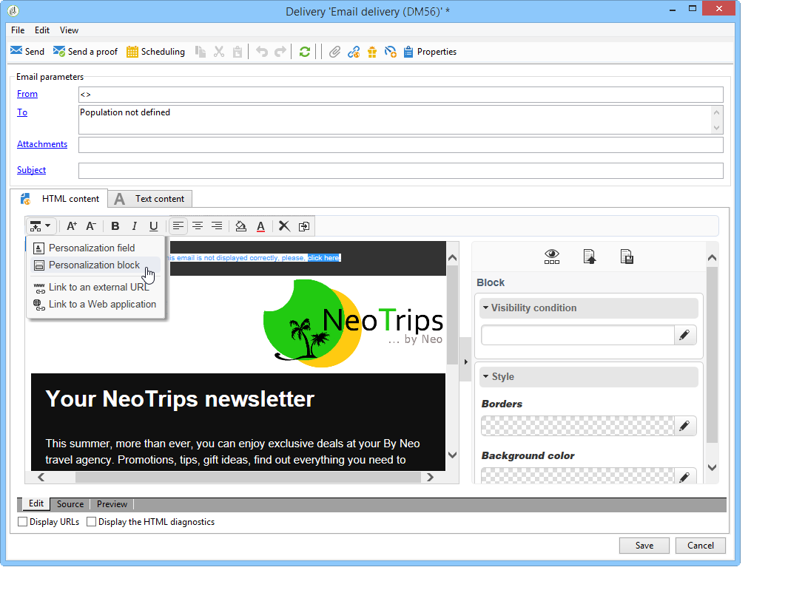
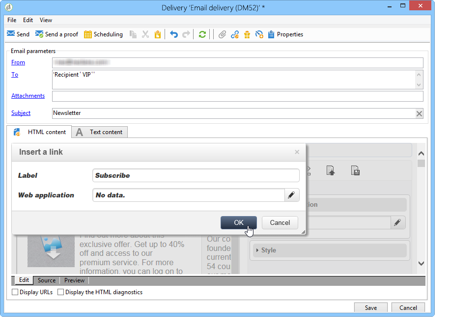

# 활용 사례: 이메일 게재 만들기{#use-case-creating-an-email-delivery}

이 사용 사례에서는 Adobe Campaign DCE(디지털 콘텐츠 편집기)를 사용하여 이메일 게재를 디자인하는 단계를 배웁니다.

최종 목표는 다음을 포함하는 개인화된 템플릿으로 게재를 만드는 것입니다.

* 수신자의 직접 주소(이름 및 이름 사용)
* 외부 URL에 대한 두 가지 링크 유형
* 미러 페이지
* 웹 애플리케이션에 대한 링크

>[!NOTE]
>
>시작하기 전에 향후 게재의 콘텐츠를 호스팅하도록 구성된 **HTML 템플릿**&#x200B;이 하나 이상 있어야 합니다.
>
>게재 **[!UICONTROL Properties]**&#x200B;에서 **[!UICONTROL Advanced]** 탭의 **[!UICONTROL Content editing mode]**&#x200B;이(가) **[!UICONTROL DCE]**(으)로 설정되어 있는지 확인하십시오. 편집기의 최적 작업을 확인하려면 [콘텐츠 편집 모범 사례](content-editing-best-practices.md)를 참조하세요.

## 1단계 - 게재 만들기 {#step-1---creating-a-delivery}

새 게재를 만들려면 **캠페인** 탭에 커서를 놓고 **게재**&#x200B;을 클릭합니다. 기존 게재 목록 위에 있는 **만들기** 단추를 클릭합니다. 게재 만들기에 대한 자세한 내용은 [이 페이지](https://experienceleague.adobe.com/en/docs/campaign-classic/using/sending-messages/about-email-channel){target="_blank"}를 참조하세요.

## 2단계 - 템플릿 선택 {#step-2---selecting-a-template}

게재 템플릿을 선택한 다음 게재 이름을 지정합니다. 이 이름은 Adobe Campaign 콘솔의 사용자만 볼 수 있고 수신자는 볼 수 없지만 이 제목은 게재 목록에 표시됩니다. **[!UICONTROL Continue]**&#x200B;을(를) 클릭합니다.

## 3단계 - 콘텐츠 선택 {#step-3---selecting-a-content}

디지털 콘텐츠 편집기에는 다양한 구조(열, 텍스트 영역 등)가 있는 다양한 기본 템플릿이 제공됩니다.

사용할 콘텐츠 템플릿을 선택한 다음 **[!UICONTROL Start with the selected content]** 단추를 클릭하여 만들어진 게재에서 템플릿을 표시합니다.

**[!UICONTROL From a file]**&#x200B;을(를) 선택하여 Adobe Campaign 외부에서 만든 HTML 콘텐츠를 가져올 수도 있습니다.

이 콘텐츠를 나중에 사용할 수 있도록 템플릿으로 저장할 수 있습니다. 개인화된 콘텐츠 템플릿이 생성되면 템플릿 목록에서 미리 볼 수 있습니다. 자세한 내용은 [템플릿 관리](template-management.md)를 참조하세요.

>[!CAUTION]
>
>**Adobe Campaign 웹 인터페이스**&#x200B;를 사용하는 경우 HTML 콘텐츠 및 관련 이미지가 포함된 .zip 파일을 가져와야 합니다.

## 4단계 - 메시지 디자인 {#step-4---designing-the-message}

* 수신자의 이름 및 이름 표시

  수신자의 첫 번째 이름과 두 번째 이름을 게재의 텍스트 필드에 삽입하려면 선택한 텍스트 필드를 클릭한 다음, 표시할 위치에 커서를 놓습니다. 팝업 도구 모음에서 첫 번째 아이콘을 클릭한 다음 **[!UICONTROL Personalization block]**&#x200B;을(를) 클릭합니다. **[!UICONTROL Greetings]**&#x200B;을(를) 선택한 다음 **[!UICONTROL OK]**&#x200B;을(를) 클릭합니다.

  

* 이미지에 링크 삽입

  이미지를 통해 게재 수신자를 외부 주소로 보내려면 관련 이미지를 클릭하여 팝업 도구 모음을 표시하고 첫 번째 아이콘에 커서를 놓은 다음 **[!UICONTROL Link to an external URL]**&#x200B;을(를) 클릭합니다. 자세한 내용은 [링크 추가](editing-content.md#adding-a-link)를 참조하세요.

  

  **https://www.myURL.com** 형식을 사용하여 **URL** 필드에 링크의 URL을 입력한 다음 확인하십시오.

  창의 오른쪽에 있는 섹션을 사용하여 언제든지 링크를 변경할 수 있습니다.

* 텍스트에 링크 삽입

  외부 링크를 게재의 텍스트에 통합하려면 일부 텍스트 또는 텍스트 블록을 선택한 다음 팝업 도구 모음에서 첫 번째 아이콘을 클릭합니다. **[!UICONTROL Link to an external URL]**&#x200B;을(를) 클릭하고 **[!UICONTROL URL]** 필드에 링크 주소를 입력합니다. 자세한 내용은 [링크 추가](editing-content.md#adding-a-link)를 참조하세요.

  창의 오른쪽에 있는 섹션을 사용하여 언제든지 링크를 변경할 수 있습니다.

  >[!CAUTION]
  >
  >**[!UICONTROL Label]** 필드에 입력한 텍스트가 원래 텍스트를 대체합니다.

* 미러 페이지 추가

  수신자가 웹 브라우저에서 게재 콘텐츠를 볼 수 있도록 하기 위해 미러 페이지에 대한 링크를 게재에 통합할 수 있습니다.

  게시된 링크를 볼 텍스트 필드를 클릭합니다. 팝업 도구 모음에서 첫 번째 아이콘을 클릭하고 **[!UICONTROL Personalization block]**&#x200B;을(를) 선택한 다음 **[!UICONTROL Link to Mirror Page (MirrorPage)]**&#x200B;을(를) 선택합니다. **[!UICONTROL Save]**&#x200B;을(를) 클릭하여 확인합니다.

  

  >[!CAUTION]
  >
  >개인화 블록 레이블은 게재의 원래 텍스트를 자동으로 대체합니다.

* 웹 애플리케이션에 링크 통합

  디지털 콘텐츠 편집기를 사용하면 Adobe Campaign 콘솔에서 웹 애플리케이션(예: 랜딩 페이지 또는 양식 페이지)에 대한 링크를 통합할 수 있습니다. 자세한 내용은 [웹 응용 프로그램에 연결](editing-content.md#link-to-a-web-application)을 참조하세요.

  웹 애플리케이션 링크에 대한 텍스트 필드를 선택한 다음 첫 번째 아이콘을 클릭합니다. **[!UICONTROL Link to a Web application]**&#x200B;을(를) 선택한 다음 **웹 응용 프로그램** 필드의 끝에 있는 아이콘을 클릭하여 원하는 응용 프로그램을 선택합니다.

  

  **저장**&#x200B;을 클릭하여 확인합니다.

  >[!NOTE]
  >
  >이 단계를 수행하려면 먼저 하나 이상의 웹 애플리케이션을 저장해야 합니다. 콘솔의 **[!UICONTROL Campaigns > Web applications]** 탭에서 찾을 수 있습니다.

## 5단계 - 게재 저장 {#step-5---saving-the-delivery}

콘텐츠가 통합되면 **저장**&#x200B;을 클릭하여 게재를 저장합니다. 이제 **[!UICONTROL Campaigns > Deliveries]** 탭에 있는 게재 목록에 표시됩니다.
