# 사용 사례: 개요 페이지 만들기{#use-cases-creating-overviews}


다음 예제에서는 데이터베이스의 모든 웹 응용 프로그램을 표시하는 개요 형식의 웹 응용 프로그램을 만듭니다. 다음 요소를 구성합니다.

* 폴더의 필터([폴더에 필터 추가](#adding-a-filter-on-a-folder) 참조),
* 새 웹 응용 프로그램을 만들기 위한 단추([새 웹 응용 프로그램을 구성하기 위한 단추 추가](#adding-a-button-to-configure-a-new-web-application) 참조),
* 목록의 각 항목에 대한 세부 정보가 표시됩니다([목록에 세부 정보 추가](#adding-detail-to-a-list) 참조).
* 링크 편집 도구당 하나의 필터([링크 편집기를 사용하여 필터 만들기](#creating-a-filter-using-a-link-editor) 참조),
* 새로 고침 링크([새로 고침 링크 만들기](#creating-a-refresh-link) 참조).

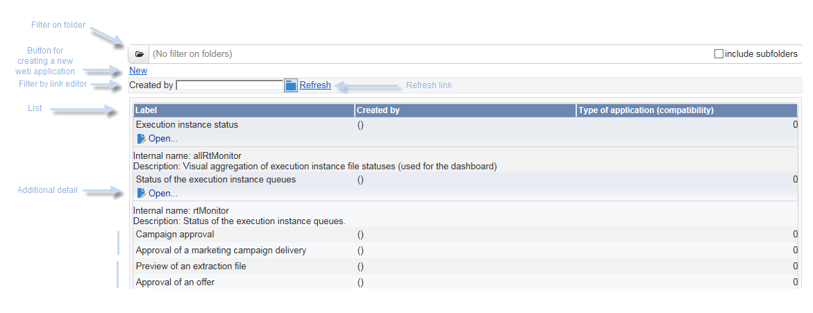

## 단일 페이지 웹 애플리케이션 만들기 {#creating-a-single-page-web-application}

1. 단일 **[!UICONTROL Page]** 웹 응용 프로그램을 만들고 아웃바운드 전환 및 다음 페이지로의 전환을 사용하지 않도록 설정합니다.

   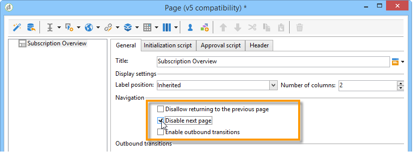

1. 페이지 제목 변경.

   이 제목은 개요 헤더와 웹 애플리케이션 개요에 표시됩니다.

1. 웹 응용 프로그램 속성에서 **[!UICONTROL Single-page Web application]** 템플릿을 선택하여 응용 프로그램의 렌더링을 수정합니다.

   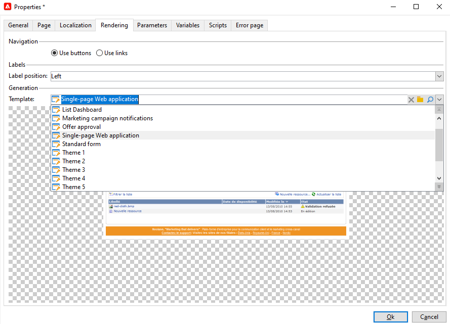

1. 웹 응용 프로그램의 **[!UICONTROL Page]** 활동을 열고 목록(**[!UICONTROL Static element > List]**)을 엽니다.
1. 목록의 **[!UICONTROL Data]** 탭에서 **[!UICONTROL Web applications]** 문서 유형과 **[!UICONTROL Label]**, **[!UICONTROL Creation date]** 및 **[!UICONTROL Type of application]** 출력 열을 선택합니다.
1. **[!UICONTROL Filter]** 하위 탭에서 웹 응용 프로그램만 표시하고 템플릿은 보기에서 제외하기 위해 아래 표시된 대로 다음 필터를 만듭니다.

   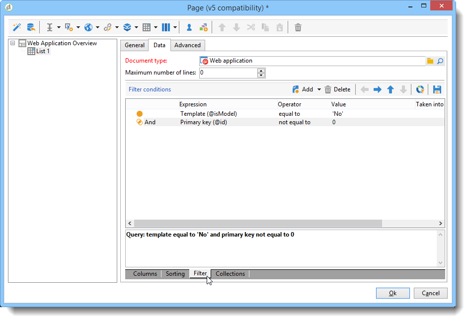

1. 페이지의 구성 창을 닫고 **[!UICONTROL Preview]**&#x200B;을(를) 클릭합니다.

   데이터베이스에서 사용할 수 있는 웹 응용 프로그램 목록이 표시됩니다.

   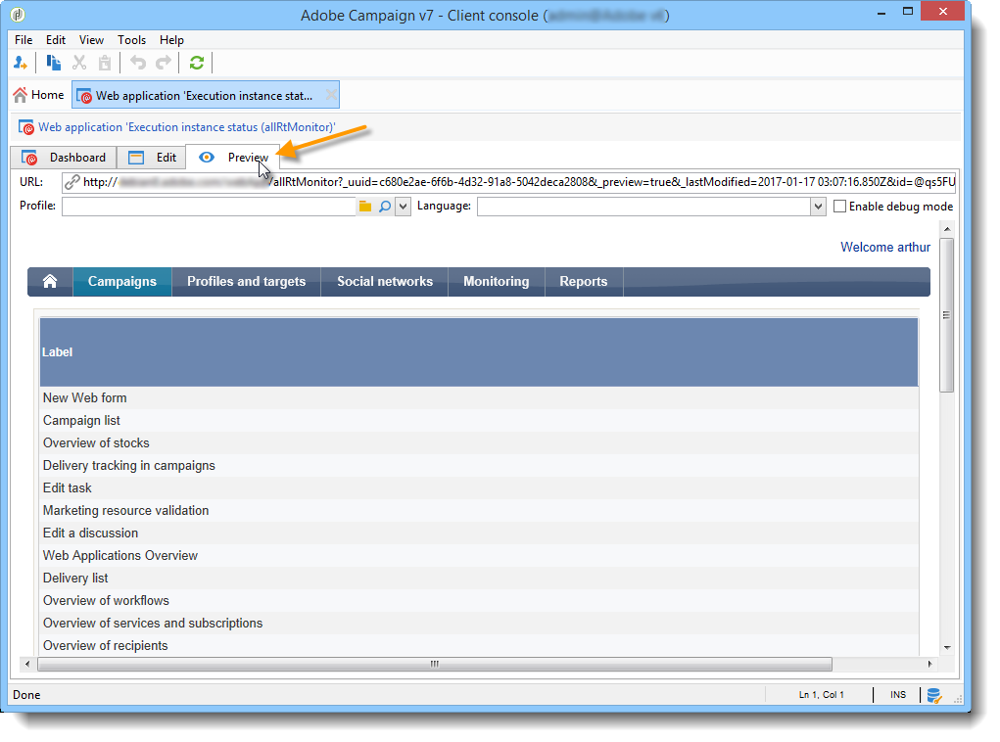

## 폴더에 필터 추가 {#adding-a-filter-on-a-folder}

개요에서는 Adobe Campaign 트리에서의 위치에 따라 데이터에 액세스하도록 선택할 수 있습니다. 폴더에 대한 필터입니다. 다음 프로세스를 적용하여 개요에 추가합니다.

1. 웹 응용 프로그램의 **[!UICONTROL Page]** 노드에 커서를 놓고 **[!UICONTROL Select folder]** 요소(**[!UICONTROL Advanced controls > Select folder]**)를 추가합니다.
1. 표시되는 **[!UICONTROL Storage]** 창에서 **[!UICONTROL Edit variables]** 링크를 클릭합니다.
1. 필요에 따라 변수 레이블을 변경합니다.
1. 변수 이름을 **folder** 값으로 변경합니다.

   >[!NOTE]
   >
   >변수 이름은 폴더(스키마에 정의됨)에 연결된 요소의 이름(이 경우 **folder**)과 일치해야 합니다. 표를 참조할 때 이 이름을 다시 사용해야 합니다.

1. 변수에 **[!UICONTROL XML]** 형식을 적용합니다.

   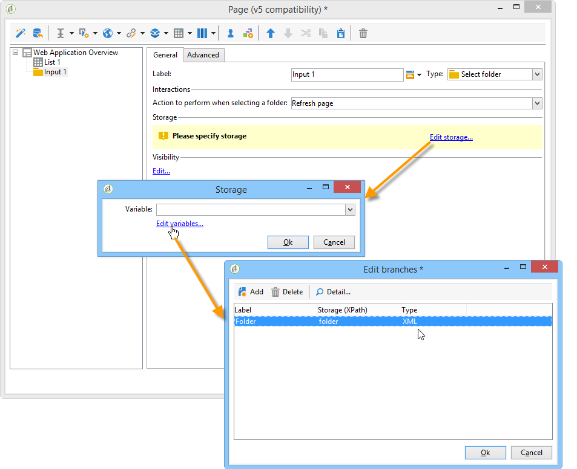

1. **[!UICONTROL Refresh page]** 상호 작용을 선택합니다.

   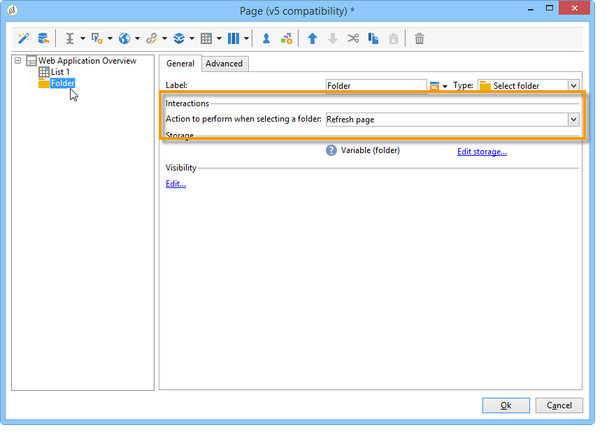

1. 커서를 목록에 놓고 **[!UICONTROL Advanced]** 탭에서 목록의 **[!UICONTROL Folder filter XPath]** 탭에서 이전에 만든 변수를 참조합니다. 폴더 링크와 관련된 요소의 이름(예: **folder**)을 사용해야 합니다.

   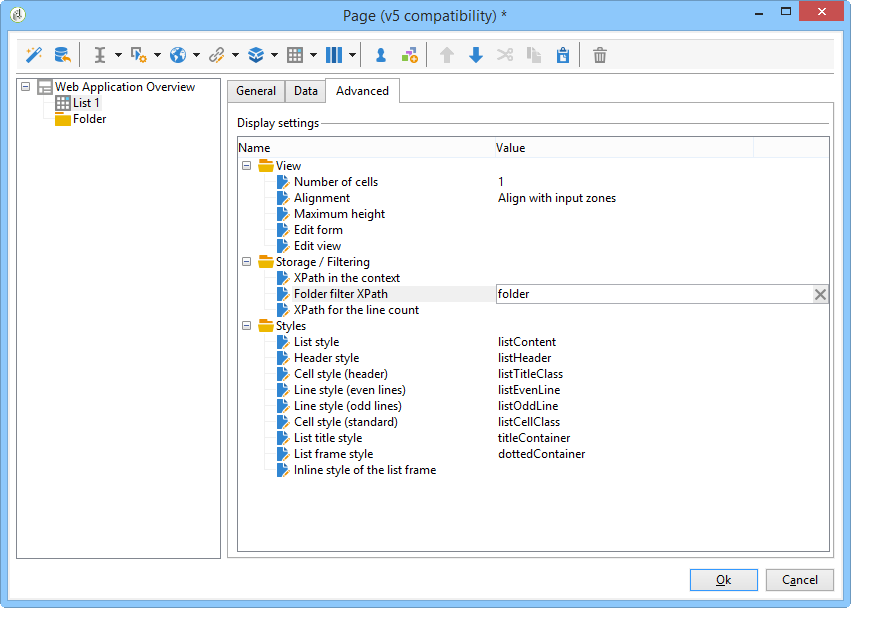

   >[!NOTE]
   >
   >이 단계에서 웹 애플리케이션은 해당 애플리케이션 컨텍스트에 없으므로 폴더에서 필터를 테스트할 수 없습니다.

## 새 웹 애플리케이션 구성을 위한 버튼 추가 {#adding-a-button-to-configure-a-new-web-application}

1. **[!UICONTROL Page]** 요소에 커서를 놓고 링크(**[!UICONTROL Static elements > Link]**)를 추가합니다.
1. 링크 레이블은 개요의 버튼에 표시되므로 수정합니다.

   이 예제에서 레이블은 **New**&#x200B;입니다.

1. URL 필드에 다음 URL을 삽입합니다. **xtk://open/?schema=nms:webApp&amp;form=nms:newWebApp**.

   >[!NOTE]
   >
   >**nms:webApp**&#x200B;이(가) 웹 응용 프로그램 스키마와 일치합니다.
   >
   >**nms:newWebApp**&#x200B;이(가) 새 웹 응용 프로그램 만들기 도우미와 일치합니다.

1. 동일한 창에 URL을 표시하도록 선택합니다.
1. 이미지 필드에 웹 응용 프로그램 아이콘을 추가합니다. **/nms/img/webApp.png**.

   이 아이콘은 **[!UICONTROL New]** 단추에 나타납니다.

1. **[!UICONTROL Style]** 필드에 **button**&#x200B;을 입력합니다.

   이 스타일은 이전에 선택한 **[!UICONTROL Single-page Web application]** 템플릿에서 참조됩니다.

   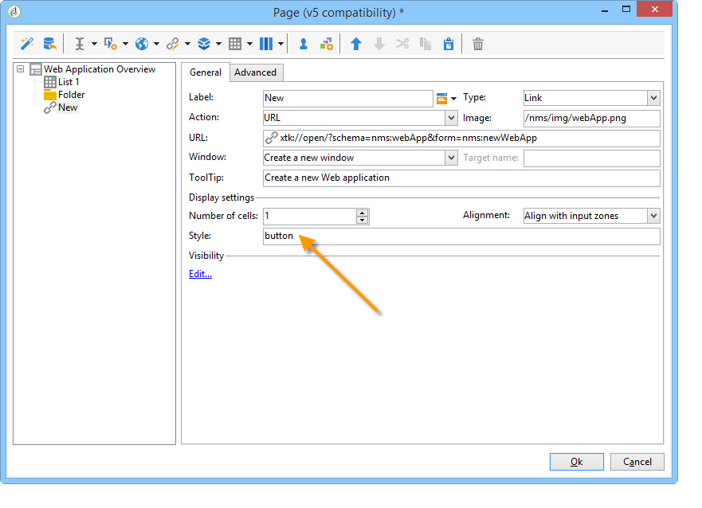

## 목록에 세부 사항 추가 {#adding-detail-to-a-list}

개요에서 목록을 구성할 때 목록의 각 항목에 대한 추가 세부 정보를 표시하도록 선택할 수 있습니다.

1. 이전에 만든 목록 요소 위에 커서를 놓습니다.
1. **[!UICONTROL General]** 탭의 드롭다운 목록에서 **[!UICONTROL Columns and additional detail]** 표시 모드를 선택합니다.

   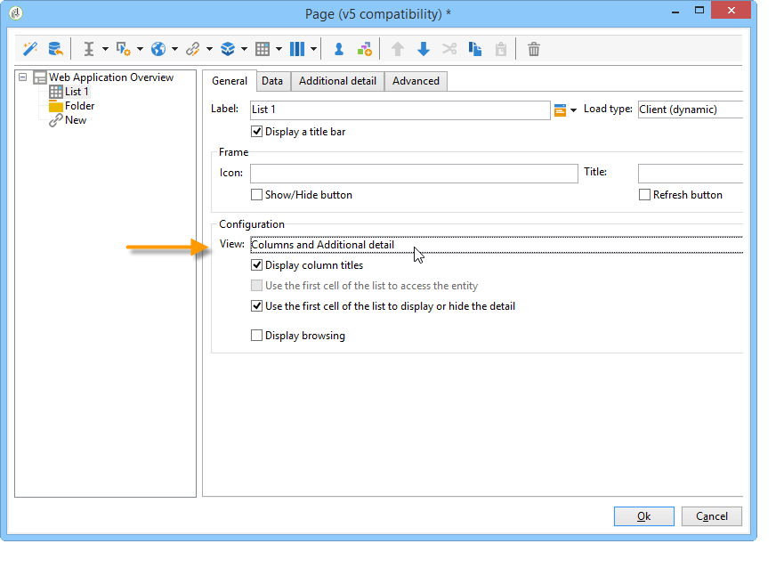

1. **[!UICONTROL Data]** 탭에서 **[!UICONTROL Primary key]** , **[!UICONTROL Internal name]** 및 **[!UICONTROL Description]** 열을 추가하고 각 열에 대해 **[!UICONTROL Hidden field]** 옵션을 선택합니다.

   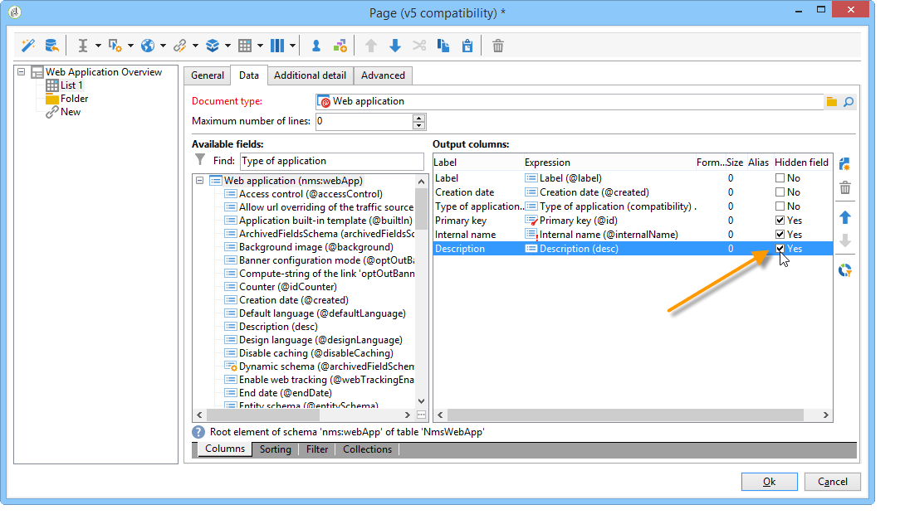

   이렇게 하면 각 항목의 세부 사항에서만 이 정보를 볼 수 있습니다.

1. **[!UICONTROL Additional detail]** 탭에서 다음 코드를 추가합니다.

   ```
   <div class="detailBox">
     <div class="actionBox">
       <span class="action"><a title="Open" class="linkAction" href="xtk://open/?schema=nms:webApp&form=nms:webApp&pk=
       <%=webApp.id%>">Open...</a></span>
       <% 
       if( webApp.@appType == 1 ) { //survey
       %>
       <span class="action"><a target="_blank" title="Reports" class="linkAction" href="/xtk/report.jssp?_context=selection&
         _schema=nms:webApp&_selection=<%=webApp.@id%>
         &__sessiontoken=<%=document.controller.getSessionToken()%>">Reports</a></span>
       <% 
       } 
       %>
     </div>
     <div>
       Internal name: <%= webApp.@internalName %>
     </div>
     <%
     if( webApp.desc != "" )
     {
     %>
     <div>
       Description: <%= webApp.desc %>
     </div>
     <% 
     } 
     %>
   </div>
   ```

>[!NOTE]
>
>JavaScript 라이브러리는 서버에서 새로 고치는 데 5분이 소요됩니다. 이 지연을 기다리지 않도록 서버를 다시 시작할 수 있습니다.

## 목록 필터링 및 업데이트 {#filtering-and-updating-the-list}

이 단원에서는 특정 연산자가 만든 웹 응용 프로그램의 개요를 표시하는 필터를 만듭니다. 이 필터는 링크 편집기로 만듭니다. 연산자를 선택하고 나면 목록을 새로 고쳐 필터를 적용합니다. 이렇게 하려면 새로 고침 링크를 만들어야 합니다.

이 두 요소는 개요에서 그래픽으로 그룹화하기 위해 동일한 컨테이너로 그룹화됩니다.

1. **[!UICONTROL Page]** 요소에 커서를 놓고 **[!UICONTROL Container > Standard]**&#x200B;을(를) 선택합니다.
1. 링크 편집기와 링크가 서로 옆에 있도록 열의 수를 **2**(으)로 설정하십시오.

   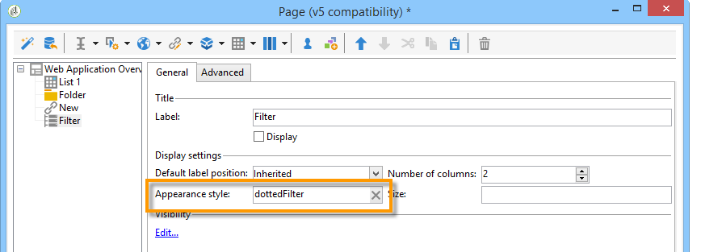

   요소 레이아웃에 대한 자세한 내용은 [이 섹션](about-web-forms.md)을 참조하세요.

1. **dottedFilter**&#x200B;을(를) 적용합니다.

   이 스타일은 이전에 선택한 **[!UICONTROL Single-page Web application]** 템플릿에서 참조됩니다.

   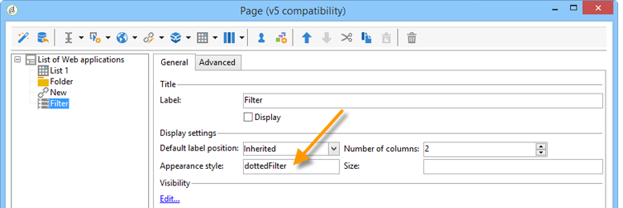

### 링크 편집기를 사용하여 필터 만들기 {#creating-a-filter-using-a-link-editor}

1. 이전 단계에서 만든 컨테이너에 커서를 놓고 **[!UICONTROL Advanced controls]** 메뉴를 통해 링크 편집기를 삽입합니다.
1. 자동으로 열리는 저장소 창에서 **[!UICONTROL Variables]** 옵션을 선택한 다음 **[!UICONTROL Edit variables]** 링크를 클릭하고 데이터 필터링을 위한 XML 변수를 만듭니다.

   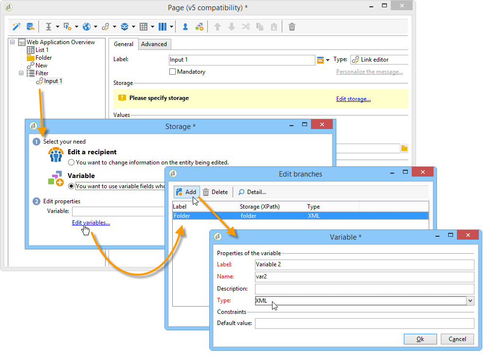

1. 레이블을 수정합니다.

   개요에서 **[!UICONTROL Filter]** 필드 옆에 표시됩니다.

1. 연산자 테이블을 응용 프로그램 스키마로 선택합니다.

   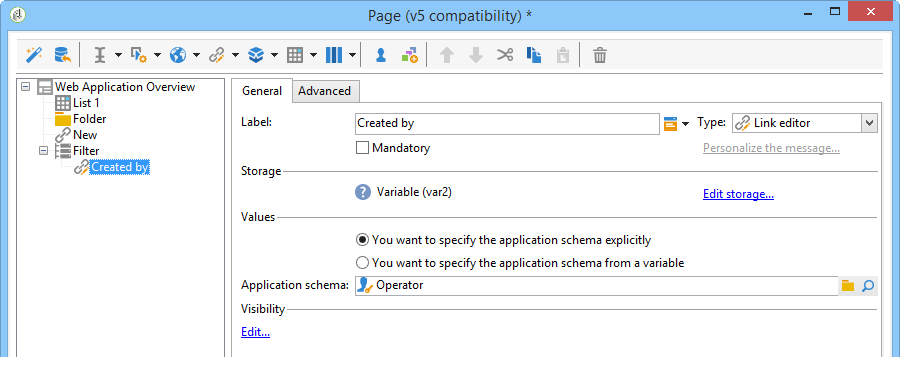

1. 커서를 목록 요소에 놓고 **[!UICONTROL Data > Filter]** 탭을 통해 필터를 만듭니다.

   * &#39;작성자&#39; 링크의 **식:** 외래 키
   * **연산자:**&#x200B;이(가) 다음과 같음
   * **값:** 변수(변수)
   * **다음 경우 고려:** &#39;$(var2/@id)&#39;!=&#39;&#39;

   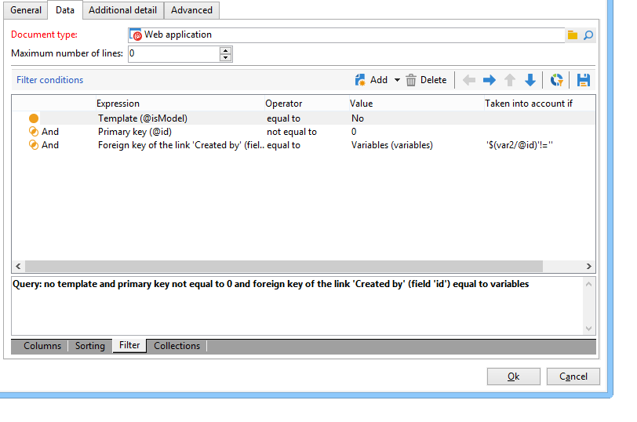

>[!CAUTION]
>
>웹 애플리케이션 사용자는 정보에 액세스할 수 있는 적절한 Adobe Campaign 권한이 있는 식별된 운영자여야 합니다. 익명 웹 응용 프로그램에서는 이 유형의 구성이 작동하지 않습니다.

### 새로 고침 링크 만들기 {#creating-a-refresh-link}

1. 컨테이너에 커서를 놓고 **[!UICONTROL Static elements]** 메뉴를 통해 **[!UICONTROL Link]**&#x200B;을(를) 삽입합니다.
1. 레이블을 수정합니다.
1. **[!UICONTROL Refresh data in a list]**&#x200B;을(를) 선택합니다.
1. 이전에 만든 목록을 추가합니다.

   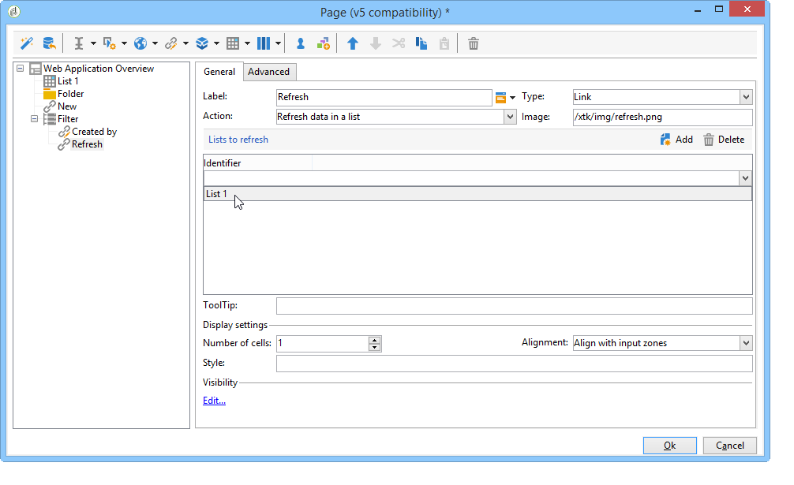

1. **[!UICONTROL Image]** 필드에 새로 고침 아이콘을 추가합니다. **/xtk/img/refresh.png**.
1. 정렬 순서 화살표를 사용하여 아래와 같이 웹 응용 프로그램의 다양한 요소를 다시 구성합니다.

   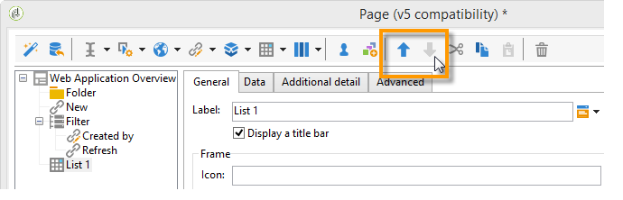

이제 웹 응용 프로그램이 구성되었습니다. **[!UICONTROL Preview]** 탭을 클릭하여 미리 볼 수 있습니다.

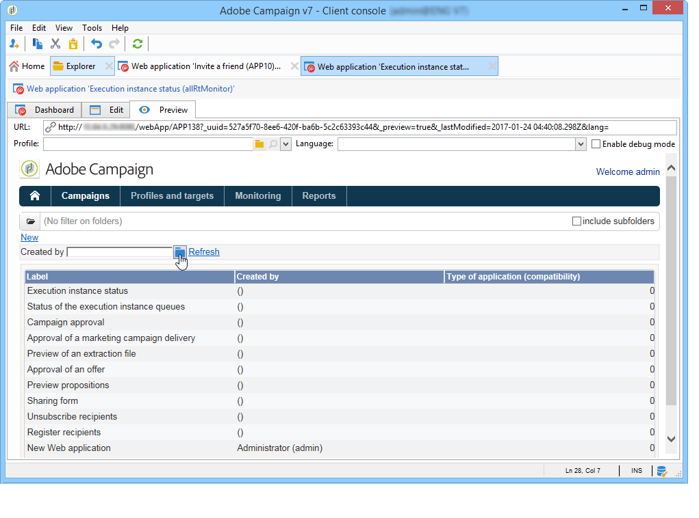
