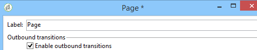
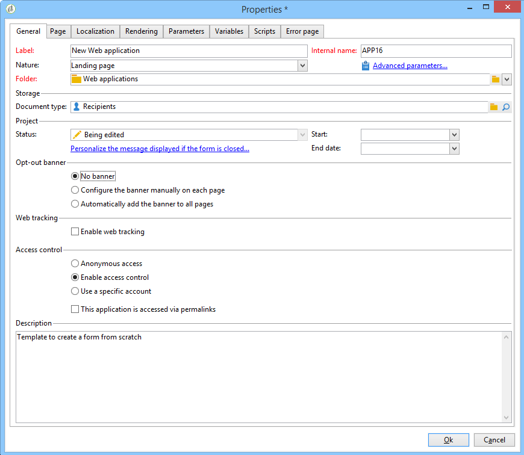

# 웹 애플리케이션 추적 옵트아웃{#web-application-tracking-opt-out}


Adobe Campaign을 사용하면 쿠키 또는 웹 비콘을 통해 행동 추적을 옵트아웃하는 최종 사용자의 웹 행동 추적을 중지할 수 있습니다. 기능에는 최종 사용자에게 해당 옵션을 제공하는 배너를 표시하는 기능이 포함됩니다. 이러한 배너를 웹 애플리케이션이나 랜딩 페이지에 추가할 수 있습니다.

최종 사용자가 쿠키 또는 웹 비콘을 통해 행동 추적을 옵트아웃하면 해당 정보가 JavaScript API를 통해 Adobe Campaign 추적 서버로 전송됩니다. 일부 관할권에서는 옵트아웃이 제공되기 전에 옵트인을 보유한 최종 사용자를 고객에게 요청하도록 할 수 있으며(또는 기타 법적 요구 사항이 있음), 이는 적용 가능한 법을 준수하는 것이 고객의 책임입니다.

>[!NOTE]
>
>스크립팅할 때는 항상 [보안 및 개인 정보 확인 목록](https://helpx.adobe.com/campaign/kb/acc-security.html#dev)에 설명된 지침을 따릅니다.

## 배너 구성 {#configuring-the-banner-}

웹 애플리케이션이나 랜딩 페이지 내에 표시하려면 배너를 구성해야 합니다.

Adobe Campaign에는 요구 사항에 맞게 조정해야 하는 샘플 배너가 포함되어 있습니다. 이 배너 버전은 콘텐츠 모델 폴더에 있는 개인화 블록으로 표시됩니다. [Campaign v8 설명서](https://experienceleague.adobe.com/docs/campaign/campaign-v8/send/personalize/personalization-blocks.html){target="_blank"}를 참조하세요.

>[!IMPORTANT]
>
>나만의 배너를 만들려면 기본 제공 배너를 개인화해야 합니다.

배너를 활성화하려면 웹 애플리케이션 속성을 구성해야 합니다. [웹 응용 프로그램 디자인](designing-a-web-application.md) 섹션을 참조하십시오.

웹 추적이 활성화되면 다음 중 하나를 수행할 수 있습니다.

* 배너 없음.
* 각 페이지에서 수동으로 배너 구성: 이 옵션을 선택하고 페이지 속성의 각 페이지에서 배너를 선택합니다.

  

* 모든 페이지에 배너를 자동으로 추가: 웹 애플리케이션 속성에서 직접 배너를 선택합니다.

  

>[!NOTE]
>
>호환성 모드는 v5 웹 애플리케이션에서 동일한 동작을 사용할 수 있습니다.

기본 배너에는 다음 구조가 있습니다.

```
<div onClick="NL.ClientWebTracking.closeOptOutBanner(this);" id="defaultOptOutBanner">
  <p>Please insert your message here
   <a onClick="NL.ClientWebTracking.allow();" class="optout-accept">Accept</a>
   <a onClick="NL.ClientWebTracking.forbid();" class="optout-decline">Refuse</a>
  </p>
</div>
      
```

**여기에 메시지를 삽입하세요**. 추적 정보가 포함된 블록으로 바꿉니다. 이 대체는 옵트아웃 배너와 관련된 새 개인화 블록에서 실행해야 합니다.

배너는 특정 CSS와 함께 제공됩니다. 그러나 웹 페이지를 만들고 구성할 때 스타일을 덮어쓸 수 있습니다. [이 페이지](content-editor-interface.md)를 참조하십시오.

## API를 사용하여 옵트아웃 쿠키 설정 {#setting-the-opt-out-cookie-using-api}

Adobe Campaign은 쿠키 값을 관리하고 사용자 환경 설정을 검색할 수 있는 API와 함께 제공됩니다.

쿠키 이름은 **acoptout**&#x200B;입니다. 일반적인 값은 다음과 같습니다.

* 0: 사용자가 웹 추적을 허용함(기본값)
* 1: 사용자가 웹 추적을 금지했습니다.
* null: 사용자가 선택되지 않았지만 웹 추적은 기본값이므로 허용됩니다.

배너를 사용자 지정하는 데 사용할 수 있는 클라이언트측 API는 다음과 같습니다.

* **NL.ClientWebTracking.allow()**: 옵트아웃 쿠키 값을 설정하여 웹 추적을 허용합니다. 웹 추적은 기본적으로 허용됩니다.
* **NL.ClientWebTracking.forbid()**: 웹 추적을 금지하도록 옵트아웃 쿠키 값을 설정합니다. 웹 추적을 금지하려면 사용자 입력이 필요합니다.
* **NL.ClientWebTracking.closeOptOutBanner(bannerDomElt)**: 사용자가 수락 또는 거부 단추를 클릭한 후 옵트아웃 쿠키 배너를 닫습니다. (클릭 이벤트 버블링 단계 동안)

  bannerDomElt {DOMElement} 제거해야 하는 쿠키 배너의 루트 DOM 요소

* **NL.ClientWebTracking.hasUserPrefs()**: 사용자가 웹 추적에 대한 기본 설정을 선택한 경우 true를 반환합니다.
* **NL.ClientWebTracking.getUserPrefs()**: 사용자의 환경 설정을 정의하는 옵트아웃 쿠키 값을 반환합니다.

JSSP를 작성해야 하는 경우 서버측 API를 사용할 수 있습니다.

* **NL.ServerWebTracking.generateOptOutBanner(escapeJs)**: JSSP 페이지에 삽입할 옵트아웃 배너에 대한 태그를 생성합니다

  **escapeJs{Boolean}**: JavaScript 내에서 사용하려면 생성된 태그를 이스케이프해야 하는 경우 true입니다.

  페이지에 인쇄해야 하는 옵트아웃 배너 마크업의 HTML을 반환합니다.

* **NL.ServerWebTracking._displayOptOutBanner()**

  관리자가 옵트아웃 배너를 선택한 후 옵트아웃 배너를 표시해야 하는 경우 &quot;true&quot;를 반환합니다.

  이 코드는 관리자가 이미 웹 추적 옵트아웃 배너를 사용하도록 선택한 경우에 호출됩니다.

  사용자가 아직 추적 여부를 선택하지 않은 경우 배너가 표시되어야 합니다.

* **NL.ServerWebTracking.renderOptOutBanner(escapeJs)**

  옵트아웃 배너를 JSSP 페이지에 삽입하여 마크업을 렌더링합니다. Jssp에서 &lt;% %> 사이의 그대로 호출됩니다.

  **escapeJs{Boolean}**: JavaScript 내에서 사용하려면 생성된 태그를 이스케이프해야 하는 경우 true

JSSP 예:

```
<%@ page import="/nl/core/shared/nl.js" %>
<!doctype html>
<%
NL.require('/nl/core/shared/webTracking.js');
NL.client.require('/nl/core/shared/webTracking.js');
%>
<html>
<head>
<%==NL.client.deps()%>
</head>

<body>

<!-- TEST USING SERVER API IN JSSP -->
<% 
var webTracking = new NL.ServerWebTracking(request, 'optOutBanner');
webTracking.renderOptOutBanner();
%>

<!-- TEST USING SERVER API IN A SCRIPT -->
<!--
<% 
var webTracking = new NL.ServerWebTracking(request, 'optOutBanner');
%>
<script>var el = document.createElement('div'); el.innerHTML =  "<% webTracking.renderOptOutBanner(true); %>";document.body.appendChild(el);</script>
-->

<!-- TEST OF THE CLIENT API -->
<!--
<div onClick="NL.ClientWebTracking.closeOptOutBanner(this);" id="defaultOptOutBanner">
  <p>Please insert your message here
   <a onClick="NL.ClientWebTracking.allow();" class="optout-accept">Accept</a>
   <a onClick="NL.ClientWebTracking.forbid();" class="optout-decline">Refuse</a>
  </p>
</div>
-->
</body>
</html>
```
