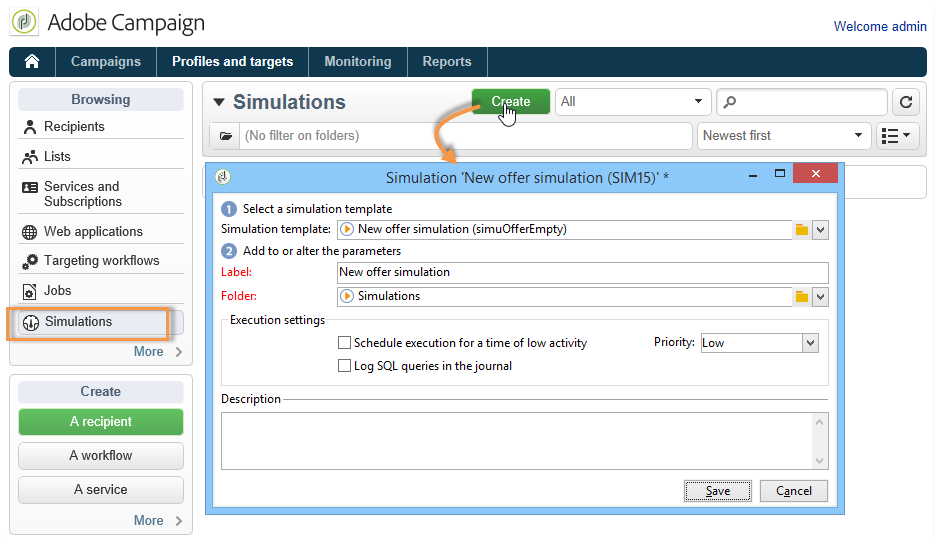
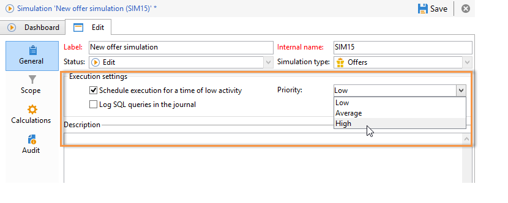
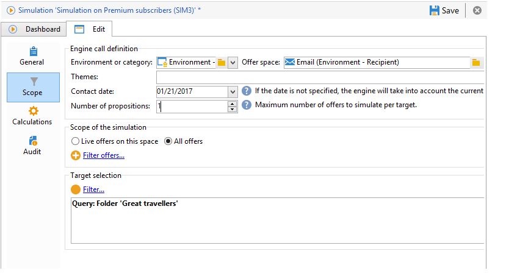
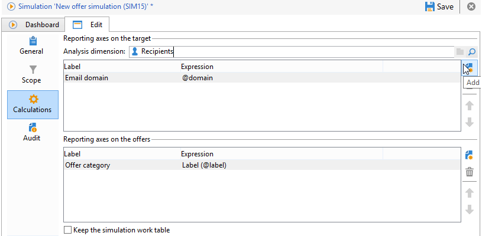
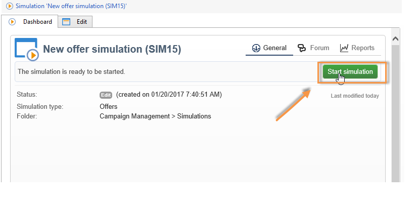
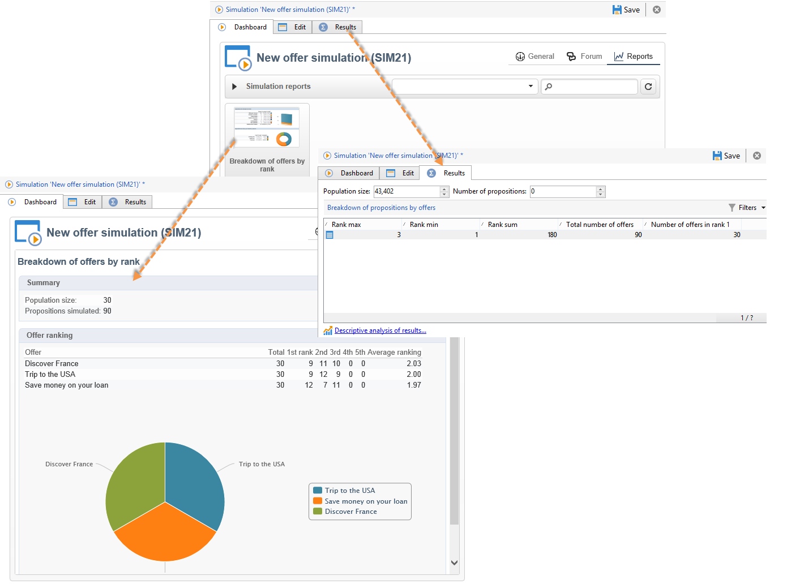

# 오퍼 시뮬레이션 정보{#about-offers-simulation}

**시뮬레이션** 모듈을 사용하면 제안을 수신자에게 보내기 전에 카테고리 또는 환경에 속한 오퍼의 배포를 테스트할 수 있습니다.

시뮬레이션은 오퍼에 이전에 적용된 컨텍스트 및 자격 규칙([오퍼 카탈로그 개요](https://experienceleague.adobe.com/ko/docs/campaign/campaign-v8/offers/interaction-offer-catalog){target="_blank"}(Campaign v8 설명서) 참조)과 프레젠테이션 규칙([오퍼 프레젠테이션 관리](managing-offer-presentation.md) 참조)을 고려합니다. 시뮬레이션은 타겟팅된 수신자에게 영향을 주지 않으므로 실제로 오퍼를 사용하지 않거나 대상을 초과/요청하지 않고 오퍼 제안의 다양한 버전을 테스트하고 세분화할 수 있습니다.

오퍼를 시뮬레이션하는 방법을 알아보려면 아래 단계를 참조하십시오.

 이 [비디오](https://helpx.adobe.com/campaign/classic/how-to/simulate-offer-in-acv6.html?playlist=/ccx/v1/collection/product/campaign/classic/segment/digital-marketers/explevel/intermediate/applaunch/introduction/collection.ccx.js&ref=helpx.adobe.com)도 볼 수 있습니다.

## 시뮬레이션을 만드는 주요 단계 {#main-steps-for-creating-a-simulation}

오퍼의 시뮬레이션을 실행하려면 다음 단계를 적용합니다.

1. **[!UICONTROL Profiles and Targets]** 탭에서 **[!UICONTROL Simulations]** 링크를 클릭한 다음 **[!UICONTROL Create]** 단추를 클릭합니다.

   

1. 방금 만든 시뮬레이션을 저장하고 편집합니다.
1. **[!UICONTROL Edit]** 탭으로 이동하여 실행 설정을 지정하십시오.

   자세한 내용은 [실행 설정](execution-settings.md)을 참조하세요.

   

   >[!NOTE]
   >
   >실행 설정은 Campaign과 상호 작용을 사용하는 경우에만 사용할 수 있습니다.

1. 시뮬레이션 범위를 지정합니다.

   자세한 내용은 [범위의 정의](simulation-scope.md#definition-of-the-scope)를 참조하세요.

   

1. 보고 축을 추가하여 **[!UICONTROL Offer distribution by rank]** 보고서를 개선하십시오(선택 사항).

   자세한 내용은 [보고 축 추가](simulation-scope.md#adding-reporting-axes)를 참조하세요.

   

1. 시뮬레이션 설정을 기록하려면 **[!UICONTROL Save]**&#x200B;을(를) 클릭하십시오.
1. 대시보드를 통해 시뮬레이션을 시작합니다.

   

1. 시뮬레이션 결과를 확인하고 분석 보고서를 표시합니다.

   자세한 내용은 [시뮬레이션 추적](simulation-tracking.md)을 참조하세요.

   
