# 오퍼 승인 및 활성화{#approving-and-activating-an-offer}

오퍼 컨텐츠가 완료되면 라이브 환경에 복제하여 게재되도록 승인해야 합니다. 승인은 오퍼 콘텐츠 및 해당 자격과 관련이 있습니다.

오퍼 대시보드의 배너는 오퍼가 승인 주기를 거쳐야 하는지 여부를 알려줍니다.

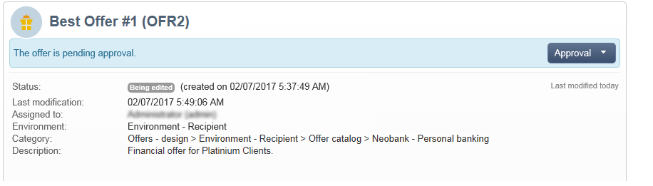

## 오퍼 콘텐츠 승인 {#approving-offer-content}

오퍼 콘텐츠 승인은 라이브 환경에서 사용할 수 있도록 하려는 표현을 선택하는 것을 의미합니다.

오퍼 콘텐츠에는 스페이스당 하나의 표현이 있습니다. 각 오퍼 공간은 자체 구조와 자체 렌더링 기능을 가지므로 오퍼 표현은 달라질 수 있습니다.

사용 가능한 특정 스페이스에서 오퍼 콘텐츠를 승인하고 다른 스페이스에서 거부하도록 선택할 수 있습니다.

>[!IMPORTANT]
>
>오퍼의 콘텐츠 및 자격이 승인되면 게시 워크플로(오퍼 알림)가 자동으로 실행되고 오퍼가 라이브로 만들어지며 활성화된 모든 공간에서 사용할 수 있습니다.

오퍼 콘텐츠를 승인하려면 다음 단계를 적용합니다.

1. **[!UICONTROL Approval]** 단추를 클릭하고 **[!UICONTROL Approve content]**&#x200B;을(를) 팝업으로 선택합니다.

   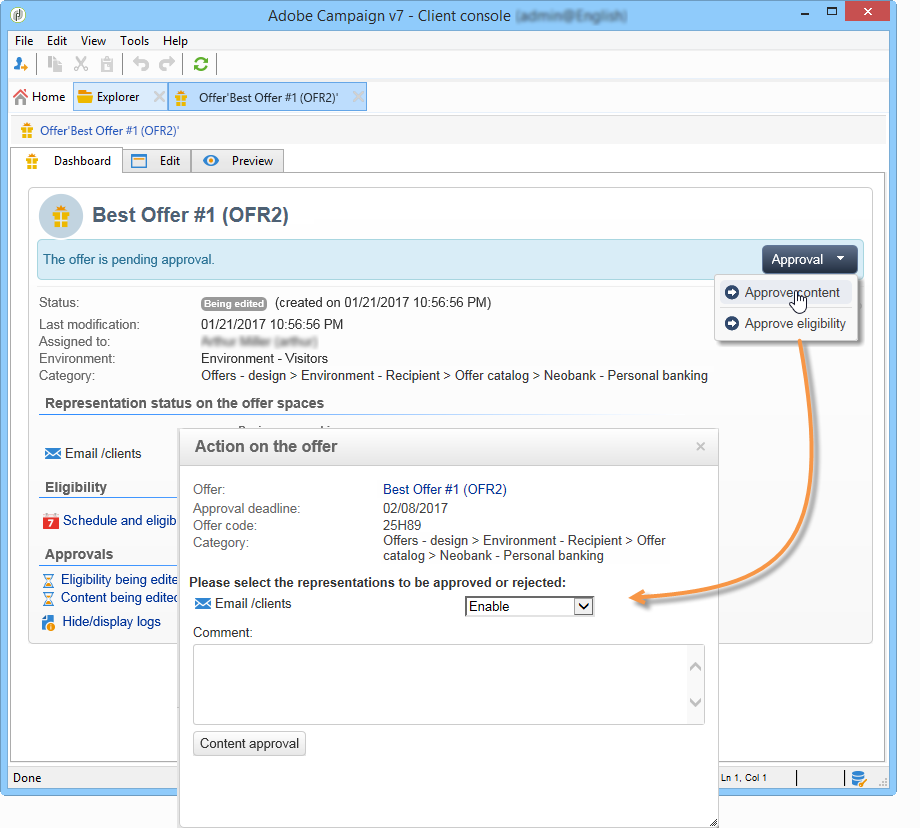

1. 드롭다운 목록을 사용하여 편집을 유지할 표현이나 라이브 환경에 게시할 표현을 선택한 다음 **[!UICONTROL Content approval]**&#x200B;을(를) 클릭합니다.

   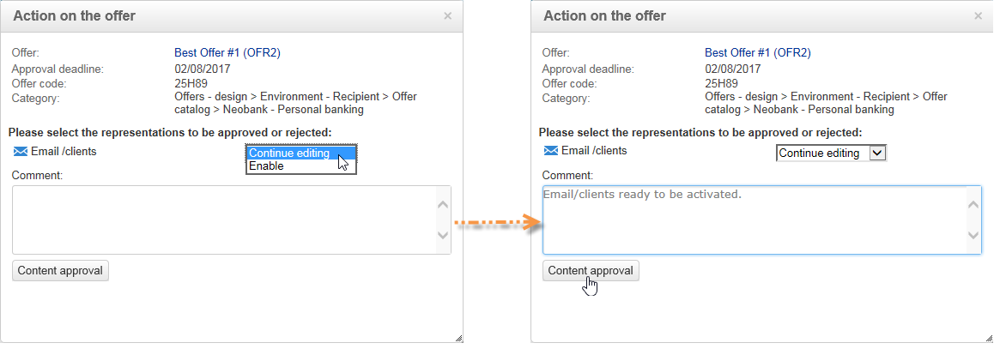

   오퍼 콘텐츠가 승인되면 오퍼 대시보드 표에 정보가 업데이트됩니다.

   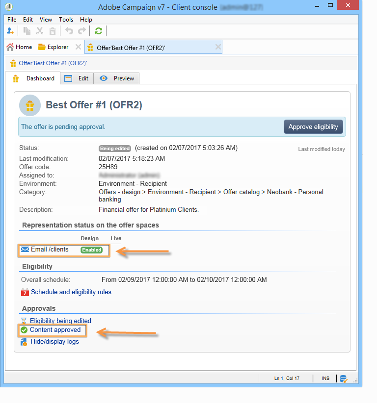

   >[!NOTE]
   >
   >**[!UICONTROL Content approved]** 언급은 모든 오퍼 표시를 사용 및 승인했음을 의미하지 않습니다. 모든 오퍼가 활성화/승인되었는지 여부에 상관없이 콘텐츠 승인 프로세스가 달성되었음을 나타냅니다.

## 오퍼 자격 승인 {#approving-offer-eligibility}

오퍼 자격 승인은 오퍼 가중치와 오퍼에 구성되어 있거나 상위 범주에서 만든 규칙에서 상속된 자격 규칙을 수락하거나 거부하는 것을 의미합니다.

>[!IMPORTANT]
>
>오퍼의 콘텐츠 및 자격이 승인되면 게시 워크플로(오퍼 알림)가 자동으로 실행되고 오퍼가 라이브로 만들어지며 활성화된 모든 공간에서 사용할 수 있습니다.

* **[!UICONTROL Schedule and eligibility rules]**&#x200B;을(를) 클릭하여 전체 규칙 목록을 볼 수 있습니다.

  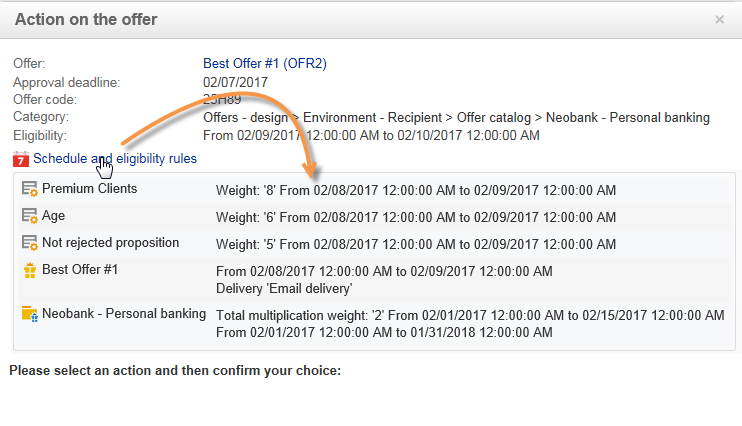

* 자격 규칙을 변경하려면 **[!UICONTROL Reject]**&#x200B;을(를) 클릭한 다음 **[!UICONTROL Eligibility approval]**&#x200B;을(를) 클릭합니다.

  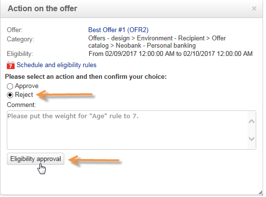

  오퍼 대시보드에서 다양한 상태가 업데이트됩니다.

  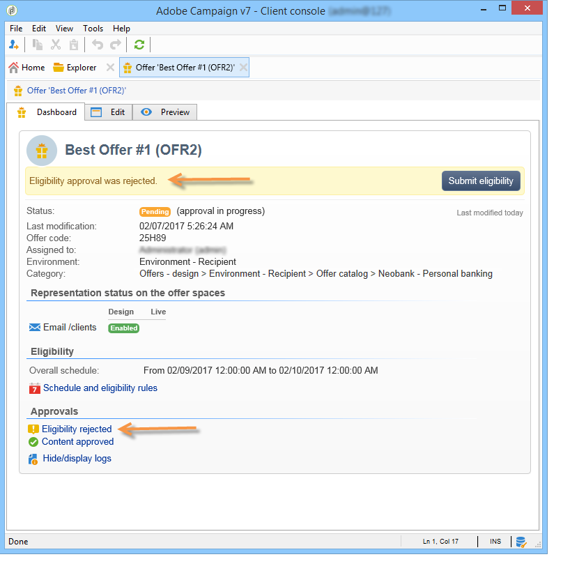

* 오퍼 자격 조건을 수락하려면 **[!UICONTROL Approve eligibility]**&#x200B;을(를) 클릭하십시오.

  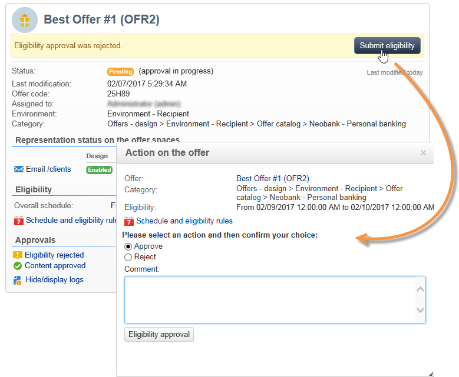

  자격 조건을 승인하고 필요한 경우 댓글을 추가한 다음 **[!UICONTROL Eligibility approval]**&#x200B;을(를) 클릭합니다.

  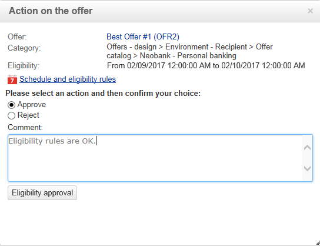

  오퍼 대시보드에서 다양한 상태가 업데이트됩니다.

  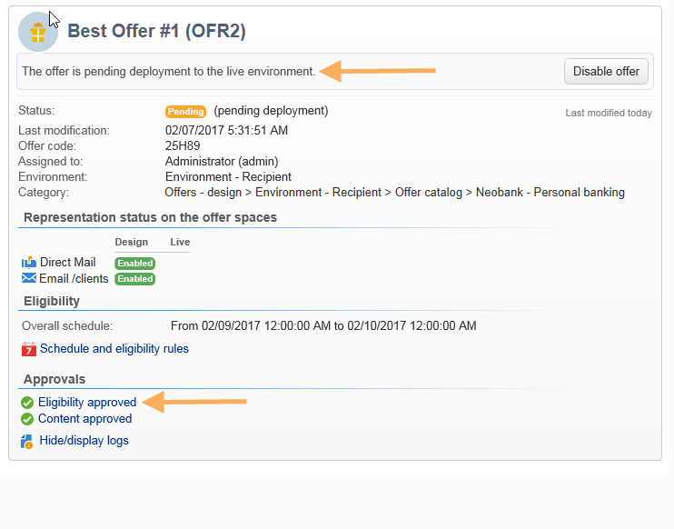

## 승인 추적 {#approval-tracking}

승인 추적은 오퍼 대시보드에서 사용할 수 있습니다. 액세스하려면 **[!UICONTROL Hide/display logs]**&#x200B;을(를) 클릭하십시오.

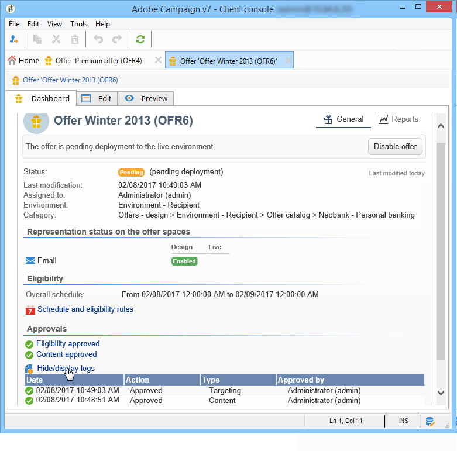

>[!NOTE]
>
>검토자 댓글에 대한 세부 정보와 함께 오퍼의 **[!UICONTROL Audit]** 탭에서도 추적을 사용할 수 있습니다.

## 승인 다시 시작 {#restart-the-approval}

승인이 실행되면 다시 실행할 수 있습니다. 이렇게 하려면 다음 지침을 따르십시오.

1. 오퍼 대시보드에서 **[!UICONTROL Content approved]**&#x200B;을(를) 클릭합니다.
1. **[!UICONTROL Edit]** 창이 나타나면 다시 시작할 승인을 선택한 다음 **[!UICONTROL Re-initialize approval to submit it again]**&#x200B;을(를) 클릭합니다.
1. **[!UICONTROL Ok]**&#x200B;을(를) 클릭하여 확인합니다.

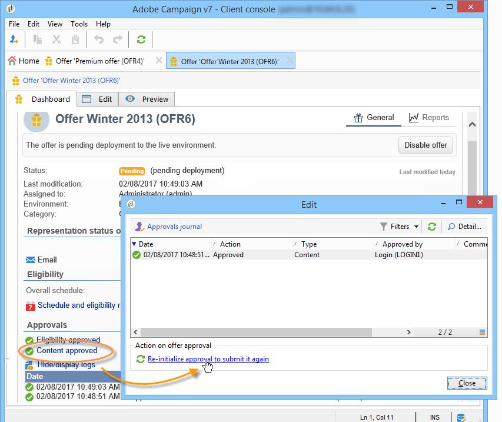

## 오퍼 게시 {#publishing-the-offer}

오퍼의 콘텐츠와 자격이 모두 승인되면, 승인 주기가 완료된 각 오퍼에 대해 자동으로 실행되는 워크플로우에서 오퍼를 게시합니다. 또한 **[!UICONTROL Offer notification]** 워크플로는 디자인 환경에서 라이브 환경으로 오퍼 카탈로그에 포함된 공간과 범주를 동기화하기 위해(필요한 경우) 매시간마다 실행됩니다.

디자인 환경에서 사용할 수 있는 오퍼의 대시보드에는 라이브 환경에서 일치하는 오퍼의 이름을 포함하여 게시에 대한 정보가 포함되어 있습니다.

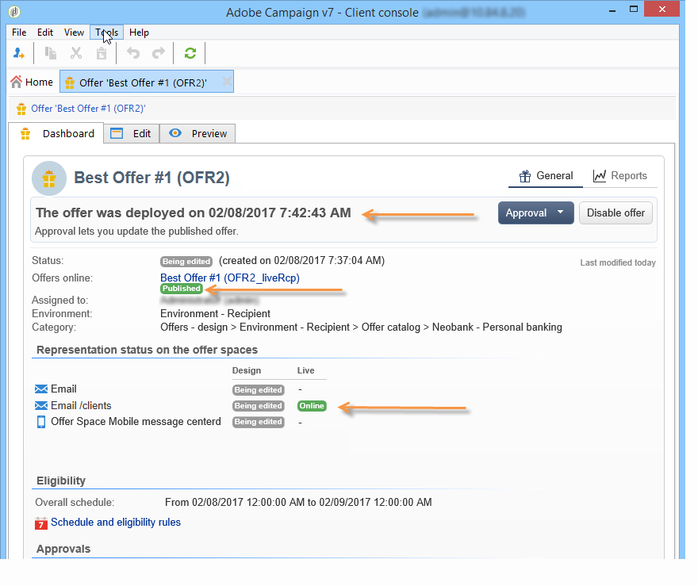

라이브 환경에서 사용할 수 있는 오퍼를 표시하려면 오퍼 레이블을 클릭합니다. 라이브 오퍼에는 모든 관련 정보가 포함된 대시보드가 있습니다.

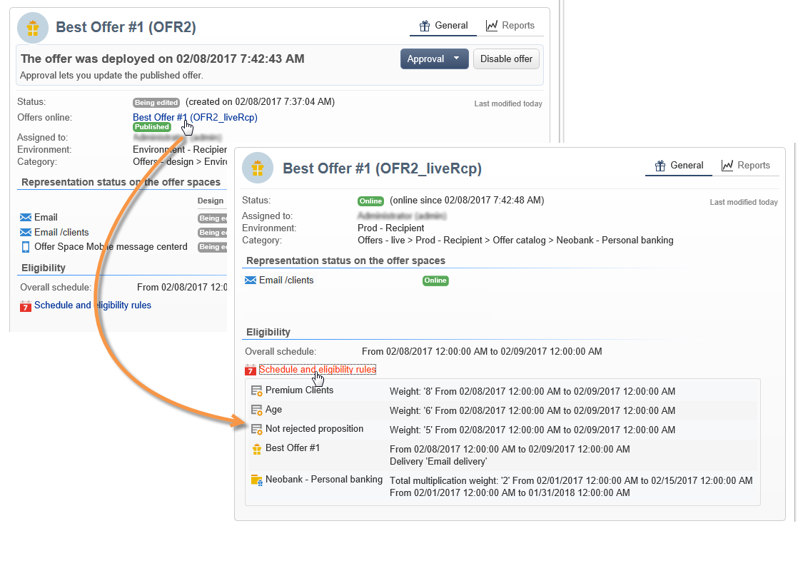

## 오퍼 비활성화 {#disabling-an-offer}

오퍼가 승인되면 비활성화할 수 있습니다.

이렇게 하려면 온라인 오퍼 또는 온라인 대기 중인 오퍼에 대한 대시보드로 이동한 다음 **[!UICONTROL Disable offer]**&#x200B;을(를) 클릭합니다.

**[!UICONTROL Eligibility]** 탭으로 이동하여 **[!UICONTROL Enabled]** 상자를 선택하여 범주를 직접 비활성화할 수도 있습니다.

>[!NOTE]
>
>오퍼가 디자인 환경에서 삭제되면 연결된 온라인 환경에서 자동으로 비활성화됩니다. 제안 유지 기간 후에 비활성화된 오퍼는 온라인 환경에서 삭제됩니다.

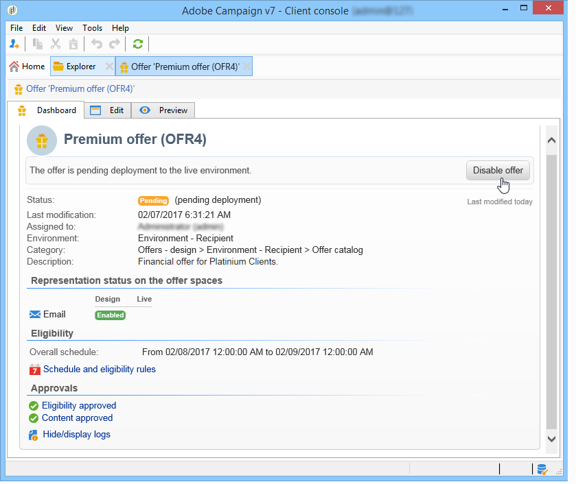
