# 인바운드 채널에 대한 오퍼{#offers-on-an-inbound-channel}


## 익명 방문자에게 오퍼 제공 {#presenting-an-offer-to-an-anonymous-visitor}

Neobank 사이트에서는 페이지를 검색하는 식별되지 않은 방문자를 대상으로 한 오퍼를 웹 사이트에 표시하려고 합니다.

이 상호 작용을 설정하려면 다음을 수행합니다.

1. [익명 환경 만들기](#creating-an-anonymous-environment)
1. [익명 오퍼 공간 만들기](#creating-anonymous-offer-spaces)
1. [오퍼 카테고리 및 테마 만들기](#creating-an-offer-category-and-a-theme)
1. [익명 오퍼를 만듭니다.](#creating-anonymous-offers)
1. [웹 사이트에서 웹 오퍼 공간 구성](#configure-the-web-offer-space-on-the-website)

### 익명 환경 만들기 {#creating-an-anonymous-environment}

[오퍼 환경 만들기](https://experienceleague.adobe.com/ko/docs/campaign/campaign-v8/offers/interaction-settings/interaction-env#create-an-offer-environment){target="_blank"}(Campaign v8 설명서)에 설명된 절차에 따라 **방문자** 차원을 기반으로 익명 환경을 만듭니다.

새 환경이 포함된 트리 구조를 가져옵니다.

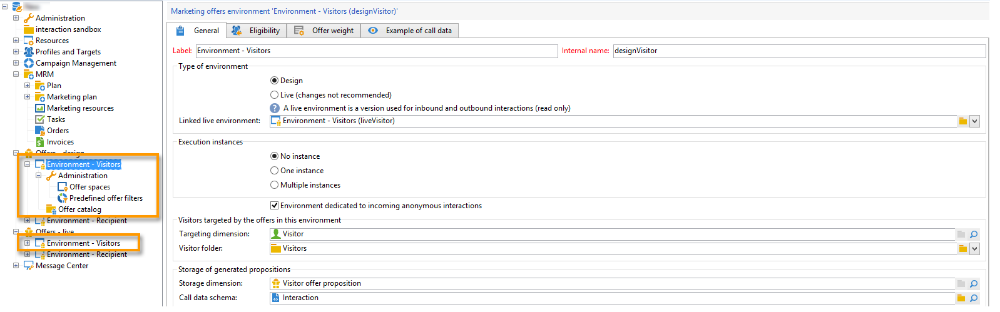

### 익명 오퍼 공간 만들기 {#creating-anonymous-offer-spaces}

1. 익명 환경(**방문자**)에서 **[!UICONTROL Administration]** > **[!UICONTROL Spaces]** 노드로 이동합니다.
1. 호출 채널을 만들려면 **[!UICONTROL New]**&#x200B;을(를) 클릭하십시오.

   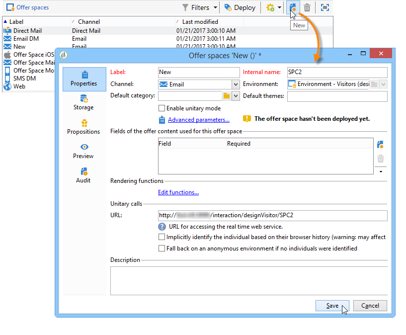

   >[!NOTE]
   >
   >공백은 익명 환경에 자동으로 연결됩니다.

1. 레이블을 변경하고 **[!UICONTROL Inbound Web]** 채널을 선택하세요. **[!UICONTROL Enable unitary mode]** 상자도 확인해야 합니다.

   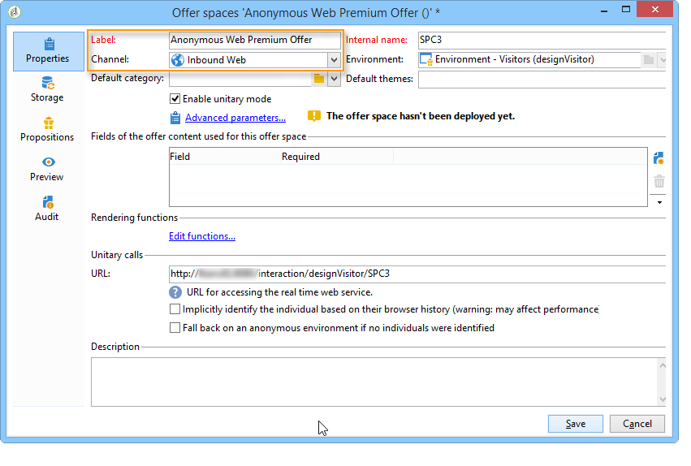

1. 공간에 사용되는 오퍼 콘텐츠 필드를 선택하고 관련 상자를 선택하여 필요에 따라 지정합니다.

   이러한 방식으로, 다음 요소 중 하나가 누락된 오퍼는 이 공간에 적합하지 않습니다.

   * 제목
   * HTML 콘텐츠
   * 이미지 URL
   * 대상 URL

   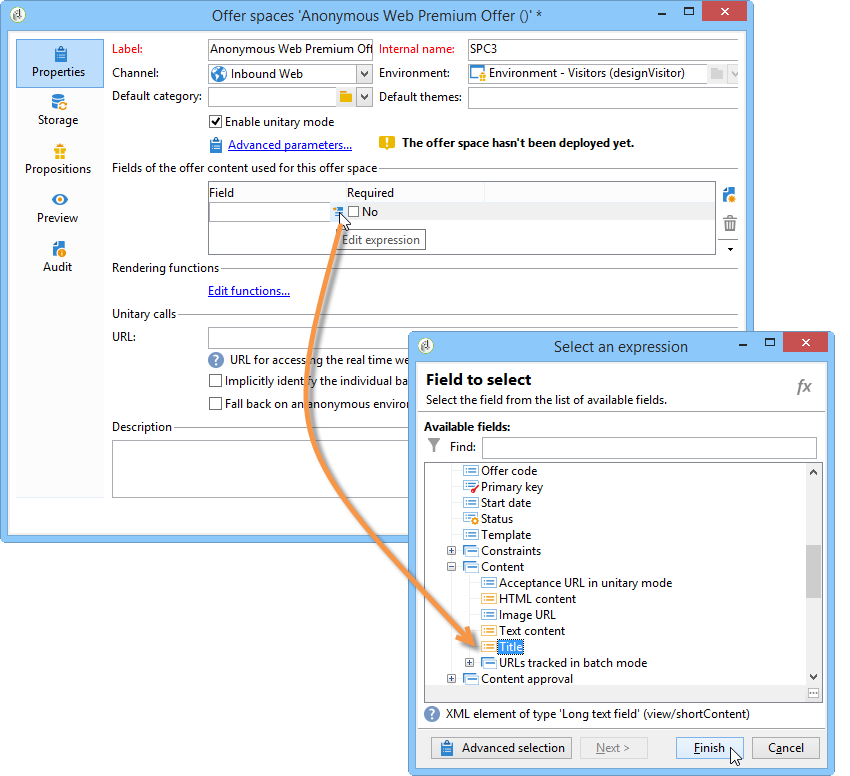

1. HTML 렌더링 함수를 편집합니다. 예를 들면 다음과 같습니다.

   ```
   function (imageUrl, targetUrl, shortContent, htmlSource){
         var html = "<p><b>" + shortContent + "</b></p>";
         html += "<p>" + htmlSource + "</p>";
         html += "<a _urlType='11' href='" + targetUrl + "'></a>";
         return html;
       }   
   ```

   >[!IMPORTANT]
   >
   >렌더링 함수는 오퍼가 올바르게 표시되도록 스페이스에 사용된 필드의 이름을 이전에 선택한 순서대로 지정해야 합니다.

   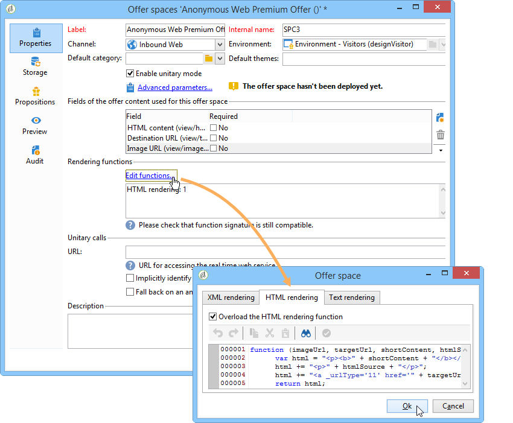

1. 오퍼 공간을 저장합니다.

### 오퍼 카테고리 및 테마 만들기 {#creating-an-offer-category-and-a-theme}

1. 방금 만든 환경 내의 **[!UICONTROL Offer catalog]** 노드로 이동합니다.
1. **[!UICONTROL Offer catalog]** 노드를 마우스 오른쪽 단추로 클릭하고 **[!UICONTROL Create a new 'Offer category' folder]**&#x200B;을(를) 선택합니다.

   새 범주의 이름을 지정합니다(예: **금융 상품**).

1. 범주의 **[!UICONTROL Eligibility]** 탭으로 이동하여 **융자**&#x200B;를 테마로 입력한 다음 변경 내용을 저장합니다.

   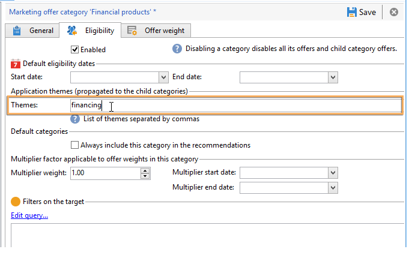

### 익명 오퍼 만들기 {#creating-anonymous-offers}

1. 방금 만든 카테고리로 이동합니다.
1. **[!UICONTROL New]**&#x200B;을(를) 클릭합니다.

   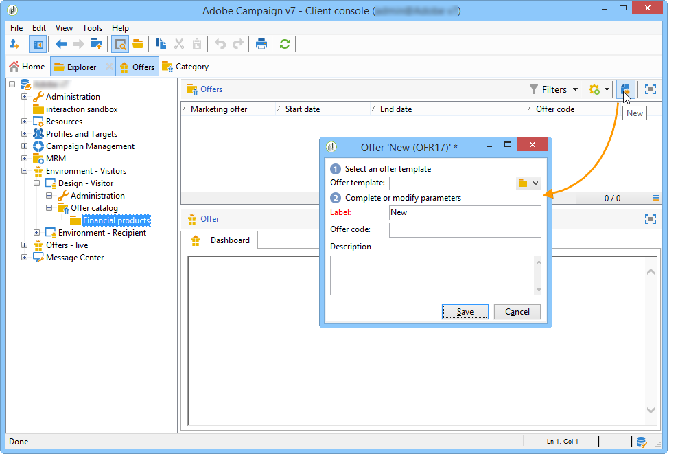

1. 기본 제공 익명 오퍼 템플릿 또는 이전에 만든 템플릿을 선택합니다.

   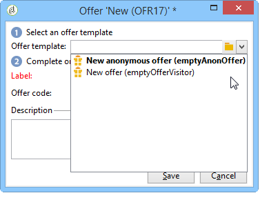

1. 레이블을 변경하고 오퍼를 저장합니다.

   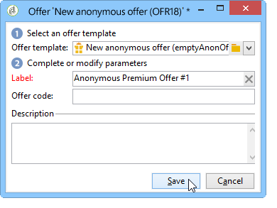

1. **[!UICONTROL Eligibility]** 탭으로 이동하여 해당 응용 프로그램 컨텍스트에 따라 오퍼의 가중치를 지정하십시오.

   이 예에서는 오퍼가 연말까지 우선 순위로 사이트의 홈 페이지에 표시되도록 구성됩니다.

   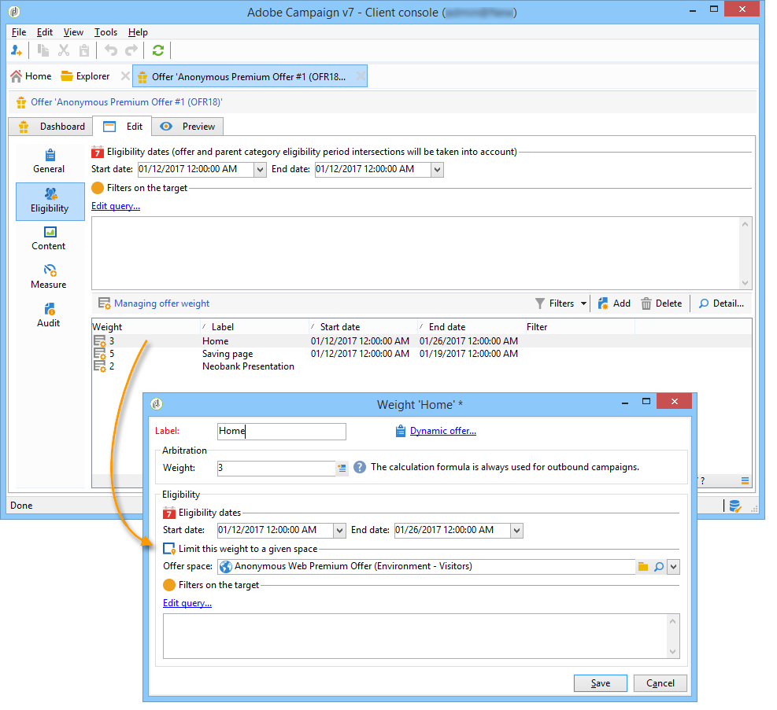

1. **[!UICONTROL Content]** 탭으로 이동하여 오퍼의 콘텐츠를 정의합니다.

   >[!NOTE]
   >
   >**[!UICONTROL Content definitions]**&#x200B;을(를) 선택하여 웹 공간에 필요한 요소 목록을 표시할 수 있습니다.

   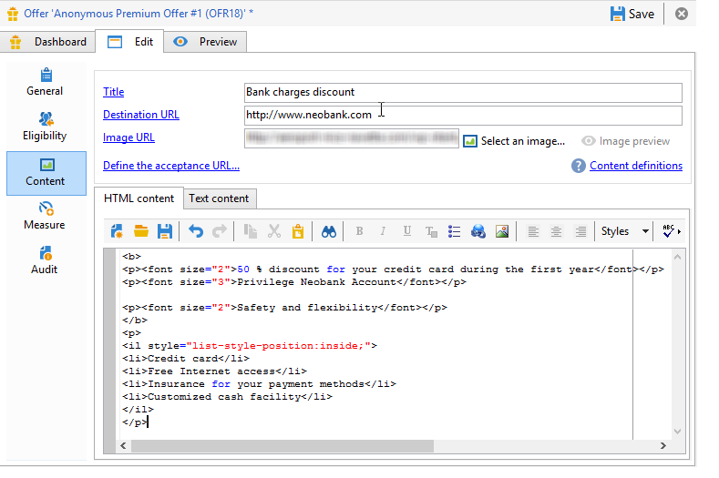

1. 두 번째 오퍼를 만듭니다.

   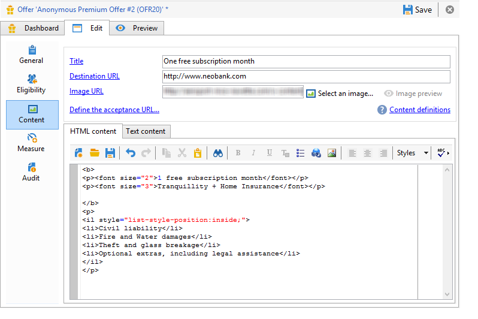

1. **[!UICONTROL Eligibility]** 탭으로 이동하여 첫 번째 오퍼와 동일한 가중치를 적용합니다.
1. 각 오퍼와 승인된 오퍼 공간을 온라인 환경에서 사용할 수 있도록 하려면 각 오퍼에 대한 승인 주기를 실행합니다.

### 웹 사이트에서 웹 오퍼 공간 구성 {#configure-the-web-offer-space-on-the-website}

방금 구성한 오퍼가 웹 사이트에 표시되도록 하려면 사이트의 HTML 페이지에 JavaScript 코드를 삽입하여 상호 작용 엔진을 호출합니다(자세한 내용은 [인바운드 채널 정보](https://experienceleague.adobe.com/ko/docs/campaign/campaign-v8/offers/inbound/interaction-present-offers){target="_blank"}(Campaign v8 설명서).

1. HTML 페이지로 이동하여 이전에 만든 익명 오퍼 공간의 내부 이름과 일치하는 값이 있는 @id 특성을 삽입합니다([익명 오퍼 공간 만들기](#creating-anonymous-offer-spaces) 참조). 앞에 **i_**&#x200B;이(가) 있습니다.

   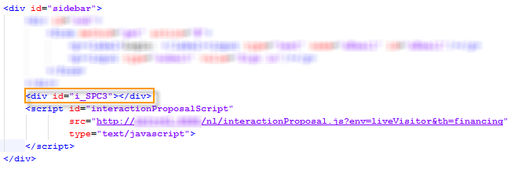

1. 호출 URL을 삽입합니다.

   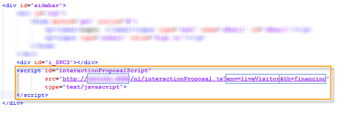

   위의 파란색 URL 상자는 인스턴스 이름, 환경의 내부 이름([익명 환경 만들기](#creating-an-anonymous-environment) 참조) 및 범주에 연결된 테마([오퍼 범주 및 테마 만들기](#creating-an-offer-category-and-a-theme))에 해당합니다. 후자는 선택 사항입니다.

방문자가 웹 사이트의 홈 페이지에 액세스하면 **재무** 테마를 사용하는 오퍼가 HTML 페이지에 구성된 대로 표시됩니다.

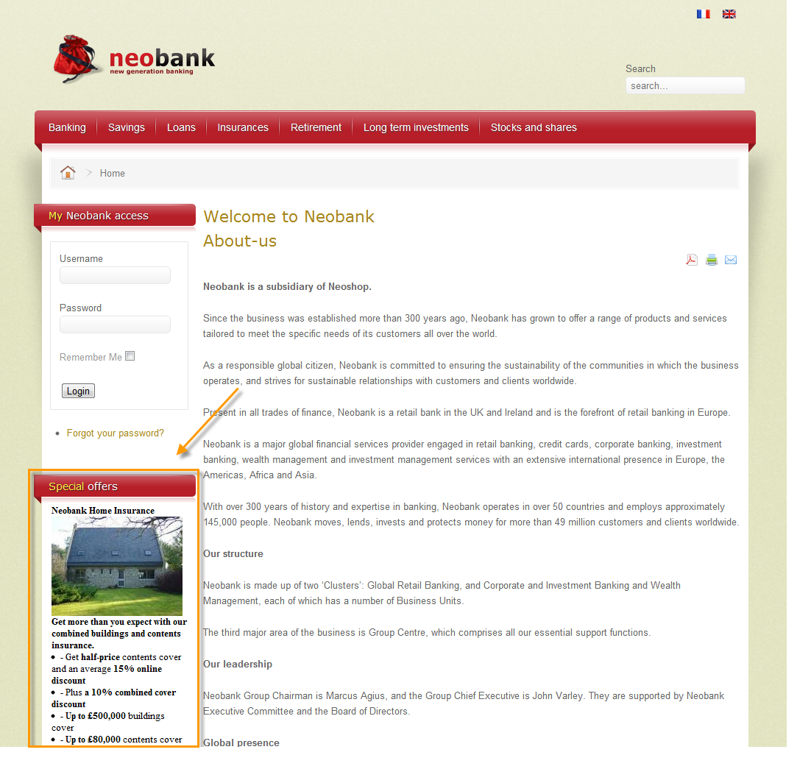

페이지를 여러 번 방문하는 사용자는 둘 다 동일한 가중치가 할당되었으므로 카테고리에 있는 하나 또는 다른 오퍼를 보게 됩니다.

## 연락처가 확인되지 않은 경우 익명 환경으로 전환 {#switching-to-an-anonymous-environment-in-case-of-unidentified-contacts}

Neobank 회사는 두 개의 다른 타겟에 대한 마케팅 오퍼를 생성하려고 합니다. 익명 웹 사이트 브라우저에 대한 일반 오퍼를 표시하려고 합니다. 이 사용자 중 한 명이 Neobank에서 제공한 식별자를 가진 고객으로 밝혀지면 회사는 그들이 로그온하는 즉시 개인화된 오퍼를 받기를 원합니다.

이 사례 연구는 다음 시나리오를 기반으로 합니다.

1. 방문자가 로그온하지 않고 Neobank 웹 사이트를 탐색합니다.

   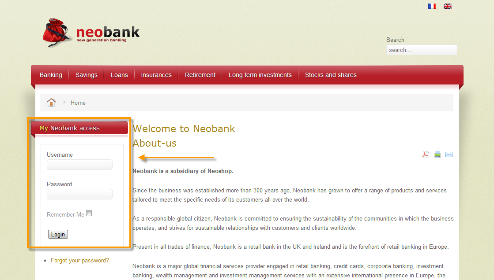

   세 개의 익명 오퍼가 페이지에 표시됩니다. Neobank 제품에 대한 두 개의 **최상의 오퍼** 오퍼와 Neobank 파트너의 오퍼.

   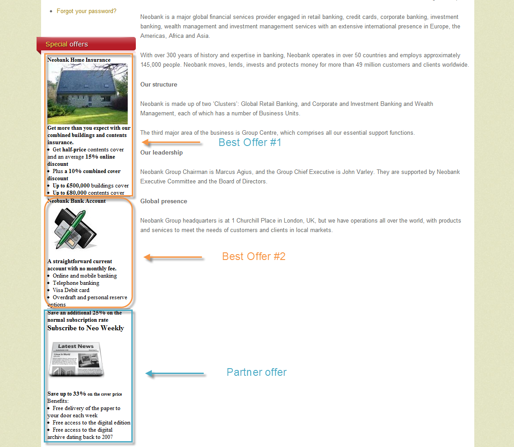

1. Neobank 고객인 사용자는 자격 증명으로 로그온합니다.

   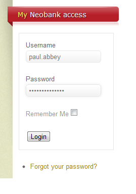

   세 가지 개인화된 오퍼가 표시됩니다.

   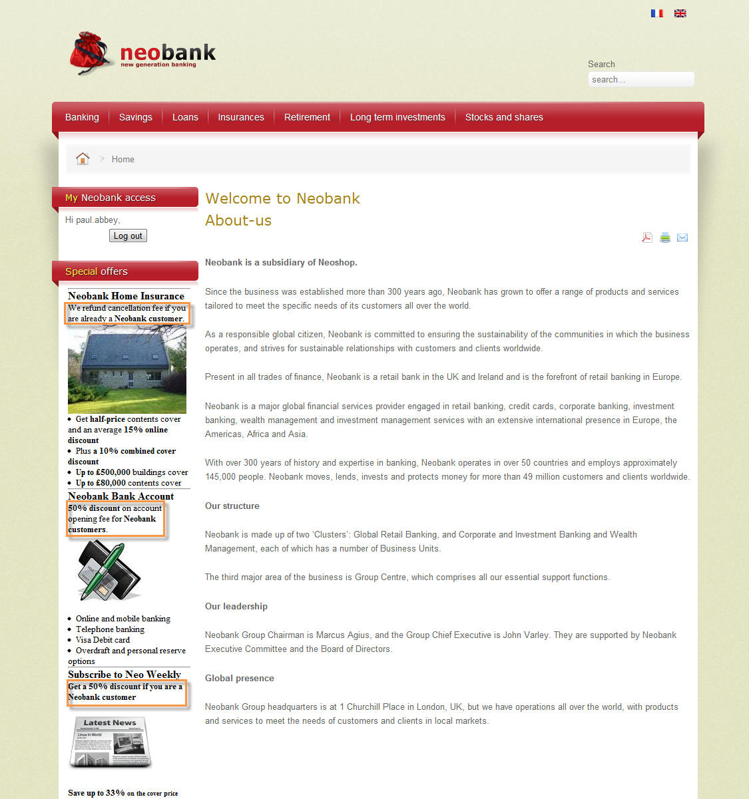

이 사례 연구를 구현하려면 익명 상호 작용용 및 특히 식별된 연락처에 대해 구성된 오퍼가 있는 두 개의 오퍼 환경이 있어야 합니다. 연락처가 로그온되지 않아 식별되지 않으면 식별된 오퍼 환경이 자동으로 익명 오퍼 환경으로 전환되도록 구성됩니다.

다음 단계를 적용합니다.

* 다음 단계를 사용하여 익명 인바운드 상호 작용과 관련된 오퍼 카탈로그를 만듭니다.

  1. [익명 연락처를 위한 환경 만들기](#creating-an-environment-for-anonymous-contacts)
  1. [익명 환경에 대한 오퍼 공간 구성](#configuring-offer-spaces-for-the-anonymous-environment)
  1. [익명 환경에서 오퍼 카테고리 만들기](#creating-offer-categories-in-an-anonymous-environment)
  1. [익명 방문자를 위한 오퍼 만들기](#creating-offers-for-anonymous-visitors)

* 다음 단계를 사용하여 식별된 인바운드 상호 작용과 관련된 오퍼 카탈로그를 만듭니다.

  1. [식별된 환경에서 오퍼 공간 구성](#configure-the-offer-spaces-in-the-identified-environment)
  1. [식별된 환경에서 오퍼 카테고리 만들기](#creating-offer-categories-in-an-identified-environment)
  1. [개인화된 오퍼 만들기](#creating-personalized-offers)

* 오퍼 엔진에 대한 호출을 구성합니다.

  1. [웹 페이지에서 오퍼 공간 구성](#configuring-offer-spaces-on-the-web-page)
  1. [식별된 오퍼 공간의 고급 설정 지정](#specifying-the-advanced-settings-of-the-identified-offer-spaces)

### 익명 연락처를 위한 환경 만들기 {#creating-an-environment-for-anonymous-contacts}

1. 게재 매핑 도우미(**방문자** 매핑)를 통해 익명 인바운드 상호 작용을 위한 오퍼 환경을 만듭니다. 자세한 내용은 [오퍼 환경 만들기](https://experienceleague.adobe.com/ko/docs/campaign/campaign-v8/offers/interaction-settings/interaction-env#create-an-offer-environment){target="_blank"}(Campaign v8 설명서)를 참조하세요.

   

### 익명 환경에 대한 오퍼 공간 구성 {#configuring-offer-spaces-for-the-anonymous-environment}

웹 사이트에 제공해야 하는 오퍼가 **최상의 오퍼** 및 **파트너** 범주 중 두 개에 속합니다. 이 예제에서는 각 카테고리에 대한 특정 오퍼 공간을 만듭니다.

**최상의 오퍼** 범주와 일치하는 오퍼 공간을 만들려면 다음 프로세스를 적용하세요.

1. Adobe Campaign 트리에서 방금 만든 익명 환경으로 이동하여 오퍼 공간을 추가합니다.

   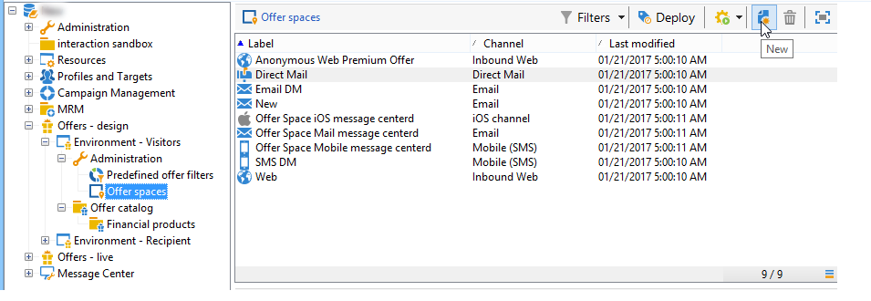

1. 새 **[!UICONTROL Inbound web]** 형식 공간을 만듭니다.

   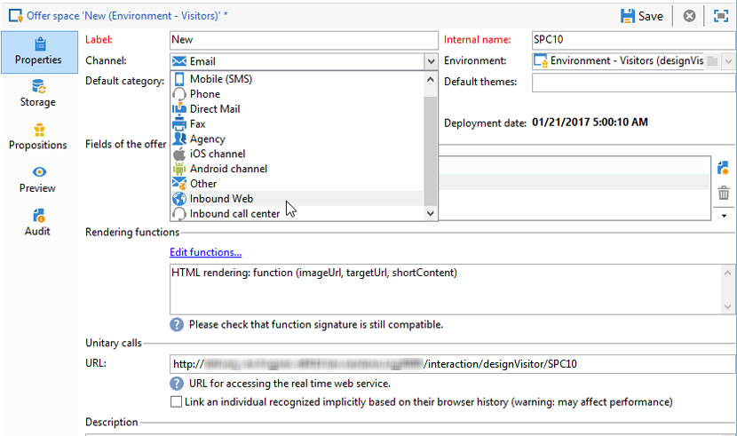

1. 레이블을 입력하십시오. **웹 최고 익명 오퍼**.
1. 이 오퍼 공간에 사용되는 오퍼 콘텐츠 필드를 추가하고 렌더링 기능을 구성합니다.

   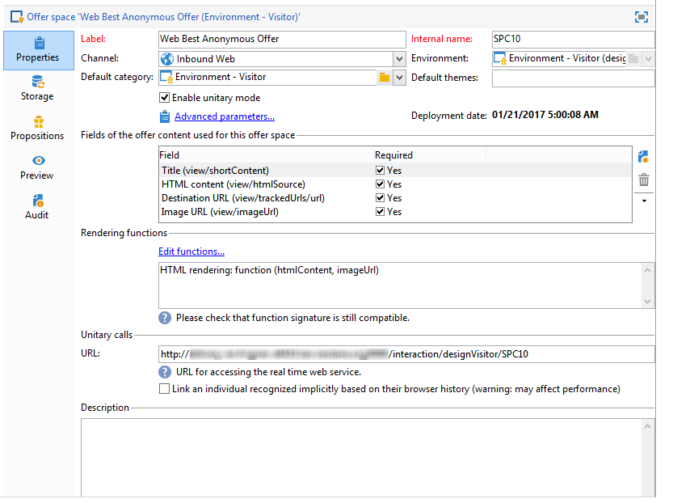

   >[!IMPORTANT]
   >
   >렌더링 함수는 오퍼가 올바르게 표시되도록 스페이스에 사용된 필드의 이름을 이전에 선택한 순서대로 지정해야 합니다.

1. 동일한 프로세스를 사용하여 **Partner** 범주와 일치하는 인바운드 웹 채널 오퍼 공간을 만드십시오.

   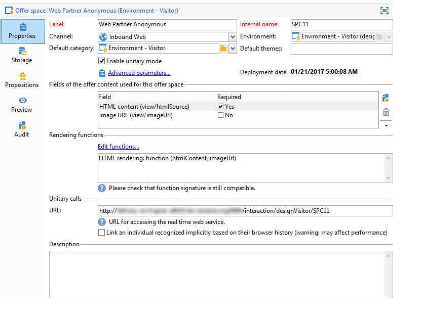

### 익명 환경에서 오퍼 카테고리 만들기 {#creating-offer-categories-in-an-anonymous-environment}

두 개의 오퍼 범주로 시작합니다. **최상의 오퍼** 범주와 **파트너** 범주. 각 카테고리에는 익명 연락처에 대한 두 개의 오퍼가 포함됩니다.

1. 방금 만든 익명 환경의 **[!UICONTROL Offer catalog]**(으)로 이동합니다.
1. **최상의 오퍼**&#x200B;를 레이블로 사용하는 **[!UICONTROL Offer category]** 폴더를 추가하십시오.

   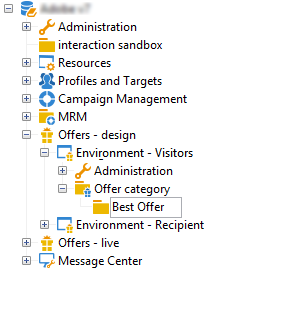

1. **Partner**&#x200B;을(를) 레이블로 사용하는 두 번째 범주를 만듭니다.

   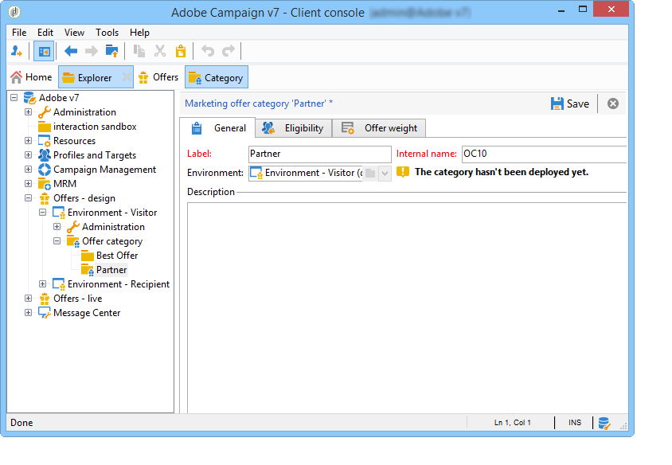

### 익명 방문자를 위한 오퍼 만들기 {#creating-offers-for-anonymous-visitors}

이제 위에서 만든 각 범주에서 두 개의 오퍼를 만듭니다.

1. **최상의 오퍼** 범주로 이동하여 익명 오퍼를 만드십시오.

   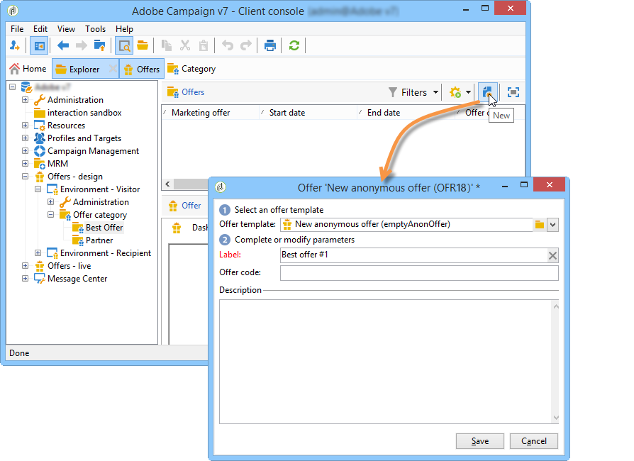

1. **[!UICONTROL Eligibility]** 탭으로 이동하여 해당 응용 프로그램 컨텍스트에 따라 오퍼의 가중치를 지정하십시오.

   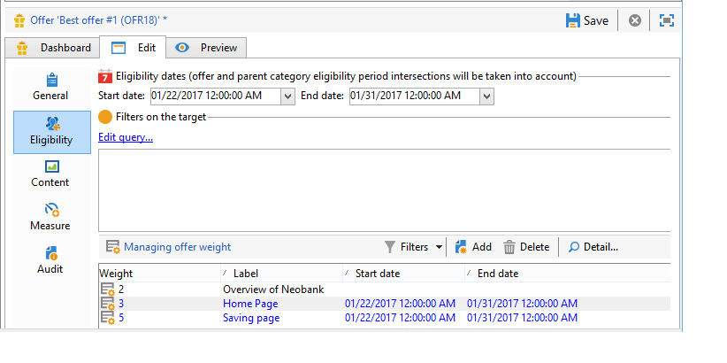

1. **[!UICONTROL Content]** 탭으로 이동하여 오퍼의 콘텐츠를 정의합니다.

   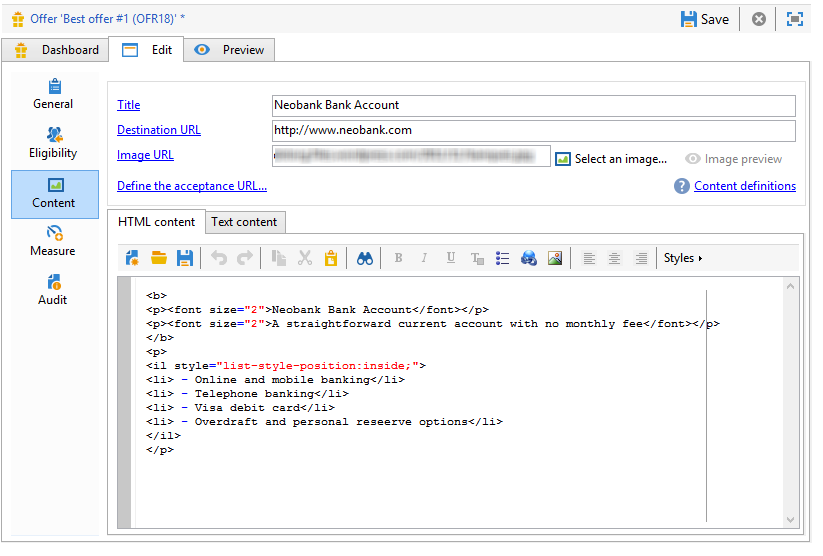

1. **최상의 오퍼** 범주에서 두 번째 오퍼를 만듭니다.

   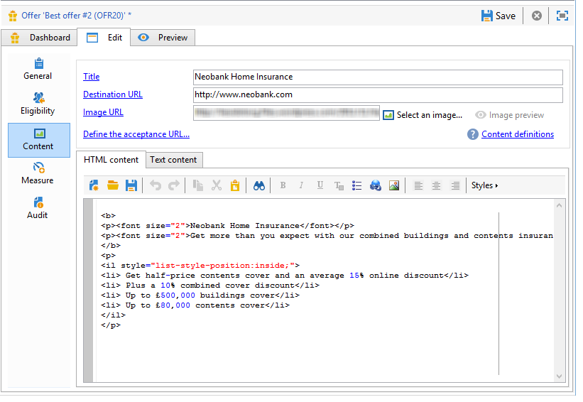

1. **Partner** 범주로 이동하여 익명 오퍼를 만드십시오.
1. **[!UICONTROL Content]** 탭으로 이동하여 오퍼의 콘텐츠를 정의합니다.

   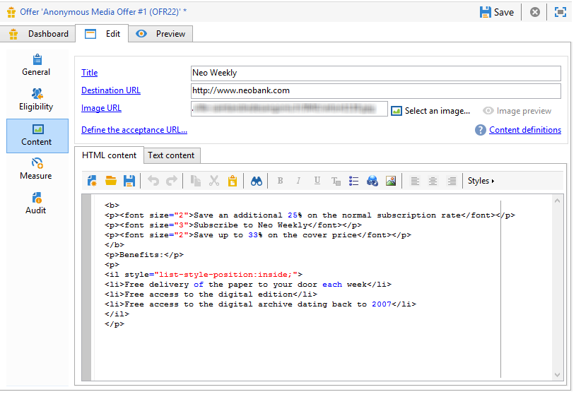

1. **[!UICONTROL Eligibility]** 탭으로 이동하여 해당 응용 프로그램 컨텍스트에 따라 오퍼의 가중치를 지정하십시오.

   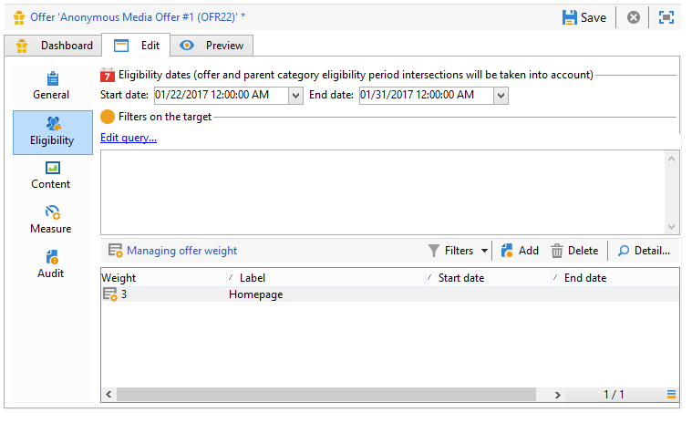

1. **Partner** 범주에 대한 두 번째 오퍼를 만듭니다.

   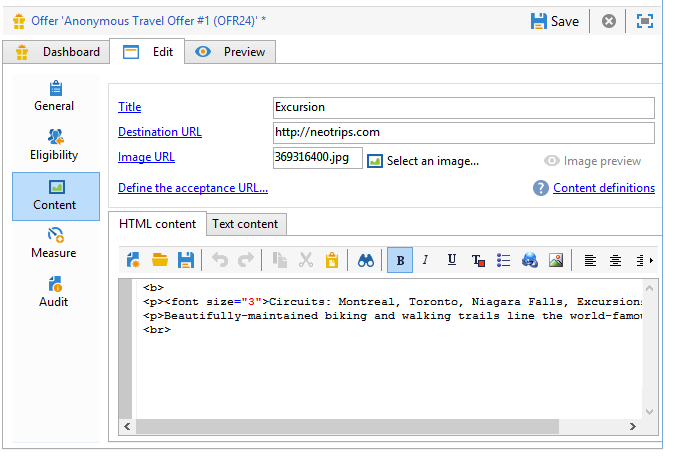

1. **[!UICONTROL Eligibility]** 탭으로 이동하여 이 범주의 첫 번째 오퍼에 적용한 것과 동일한 가중치를 적용하여 오퍼가 웹 사이트에 연속적으로 표시되도록 합니다.

   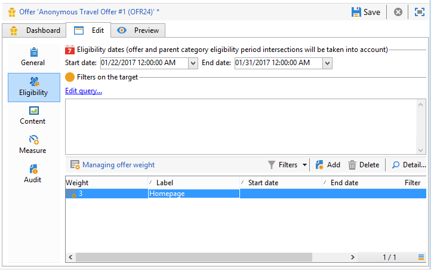

1. 각 오퍼에 대한 승인 주기를 실행하여 실행을 시작합니다. 콘텐츠를 승인할 때는 오퍼에 따라 **파트너** 또는 **최상의 오퍼** 오퍼 공간을 활성화하십시오.

### 식별된 환경에서 오퍼 공간 구성 {#configure-the-offer-spaces-in-the-identified-environment}

웹 사이트에 제공할 오퍼는 **최상의 오퍼** 및 **파트너** 범주에서 가져옵니다. 이 예제에서는 각 카테고리에 대해 특정 공간을 만들려고 합니다.

두 개의 오퍼 공간을 만들려면 익명 오퍼 공간에 대해 와 동일한 절차를 적용합니다. [익명 환경에 대한 오퍼 공간 구성](#configuring-offer-spaces-for-the-anonymous-environment)을 참조하세요.

1. Adobe Campaign 트리에서 방금 만든 환경으로 이동하여 **최상의 오퍼** 및 **파트너** 오퍼 공간을 추가합니다.
1. [익명 환경에 대한 오퍼 공간 구성](#configuring-offer-spaces-for-the-anonymous-environment)에 설명된 프로세스를 적용합니다.

   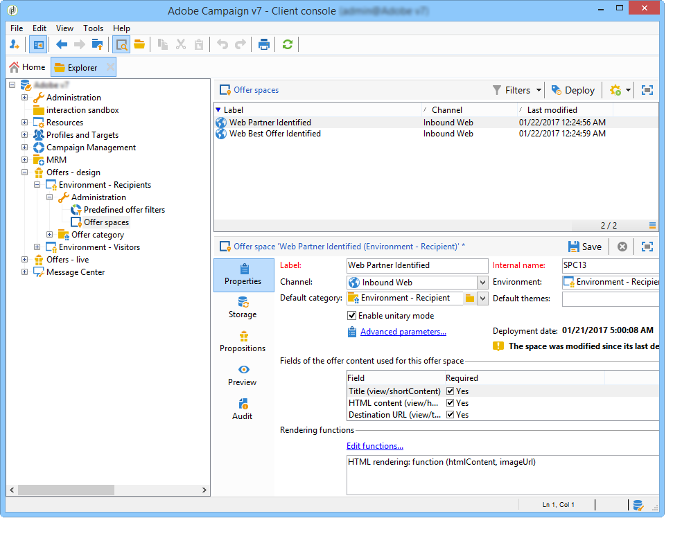

1. **[!UICONTROL Fall back on an anonymous environment if no individuals were identified]** 옵션을 선택합니다.

   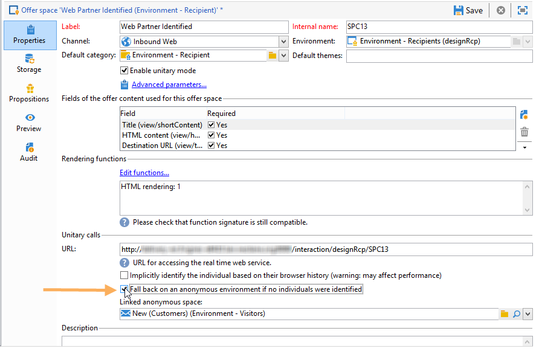

1. 드롭다운 목록을 사용하여 이전에 만든 익명 웹 오퍼 공간을 선택합니다([익명 환경에 대한 오퍼 공간 구성](#configuring-offer-spaces-for-the-anonymous-environment) 참조).

   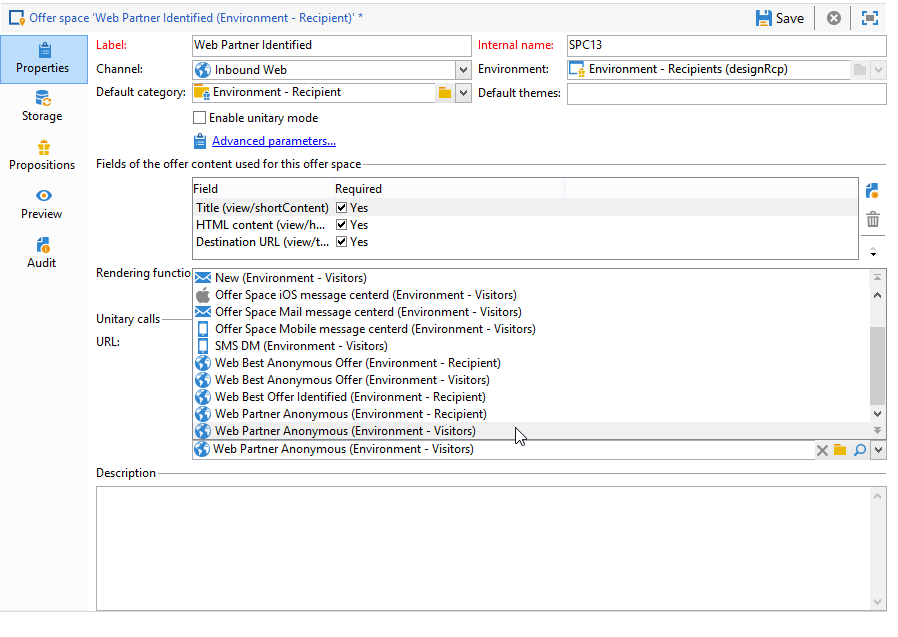

### 식별된 오퍼 공간의 고급 설정 지정 {#specifying-the-advanced-settings-of-the-identified-offer-spaces}

이 예제에서 연락처 식별은 Adobe Campaign 데이터베이스의 이메일 주소 덕분에 발생합니다. 스페이스에 수신자 이메일을 추가하려면 다음 프로세스를 적용합니다.

1. 식별된 환경에서 오퍼 공간 폴더로 이동합니다.
1. **최상의 오퍼** 오퍼 공간을 선택하고 **[!UICONTROL Advanced parameters]**&#x200B;을(를) 클릭합니다.

   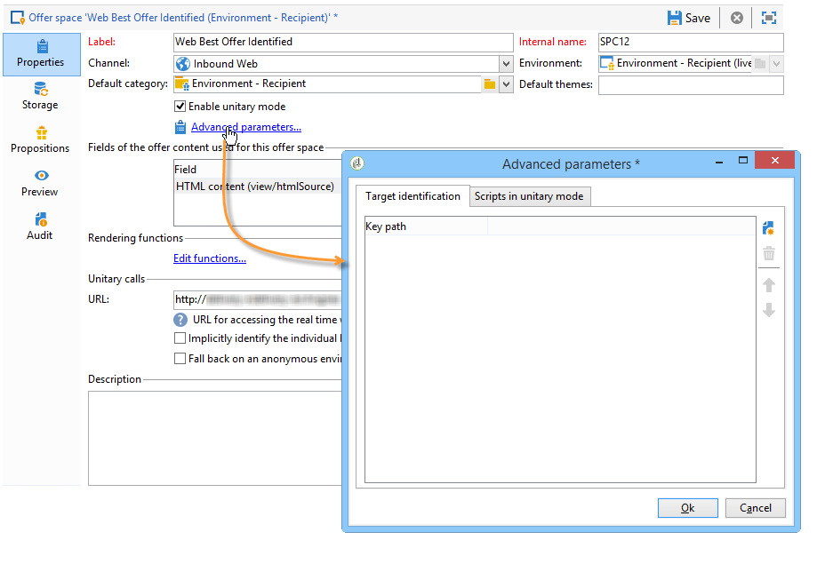

1. **[!UICONTROL Target identification]** 탭에서 **[!UICONTROL Add]**&#x200B;을(를) 클릭합니다 .

   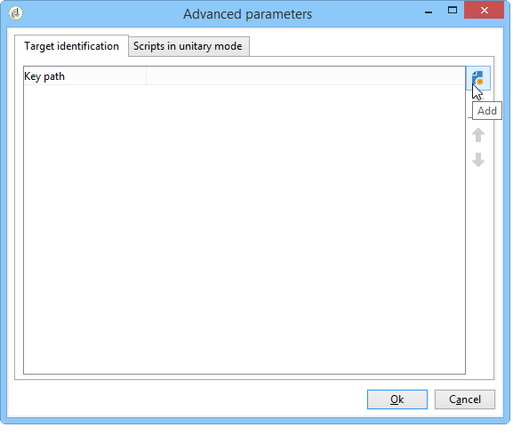

1. **[!UICONTROL Edit expression]**&#x200B;을(를) 클릭하고 수신자 테이블로 이동한 다음 **[!UICONTROL Email]** 필드를 선택합니다.

   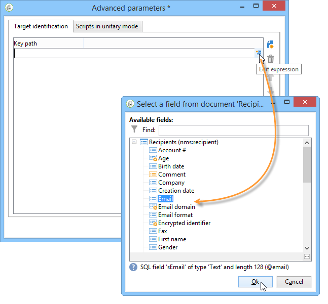

1. **[!UICONTROL OK]**&#x200B;을(를) 클릭하여 **[!UICONTROL Advanced parameters]** 창을 닫고 **최상의 오퍼** 오퍼 공간 구성을 완료합니다.
1. **파트너** 오퍼 공간에 동일한 프로세스를 적용합니다.

   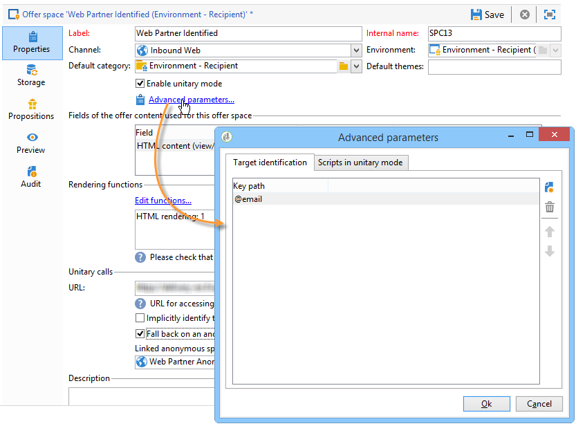

### 식별된 환경에서 오퍼 카테고리 만들기 {#creating-offer-categories-in-an-identified-environment}

두 개의 개별 카테고리인 **최상의 오퍼** 카테고리와 **파트너** 카테고리를 만들려고 합니다. 각각 두 개의 개인화된 오퍼가 있습니다.

1. 식별된 환경의 **[!UICONTROL Offer catalogs]** 노드로 이동합니다.
1. 익명 환경에서처럼 **최상의 오퍼** 및 **파트너**&#x200B;를 레이블로 사용하는 두 개의 **[!UICONTROL Offer category]** 폴더를 추가하십시오.

   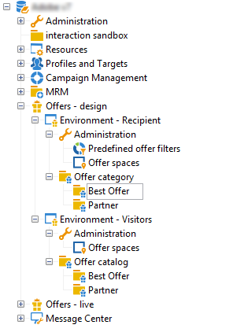

### 개인화된 오퍼 만들기 {#creating-personalized-offers}

각 카테고리에 대해 두 개의 개인화된 오퍼, 즉 네 개의 오퍼를 만들려고 합니다.

1. **최상의 오퍼** 범주로 이동하여 첫 번째 맞춤형 오퍼를 만드십시오.

   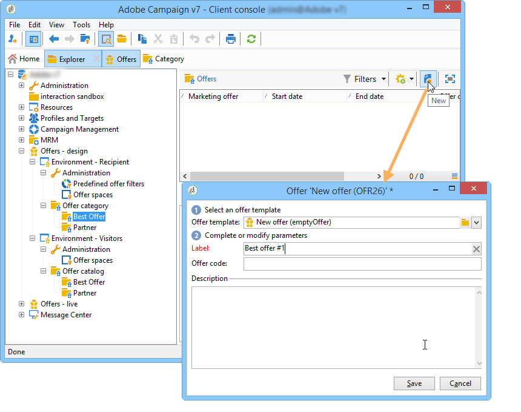

1. **[!UICONTROL Eligibility]** 탭으로 이동하여 해당 응용 프로그램 컨텍스트에 따라 오퍼의 가중치를 지정하십시오.

   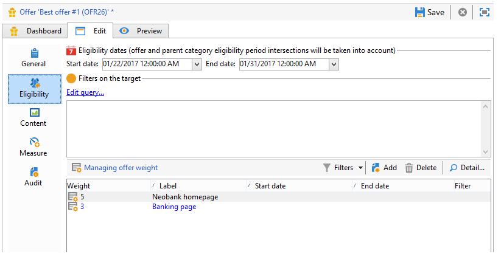

1. **[!UICONTROL Content]** 탭으로 이동하여 오퍼의 콘텐츠를 정의합니다.

   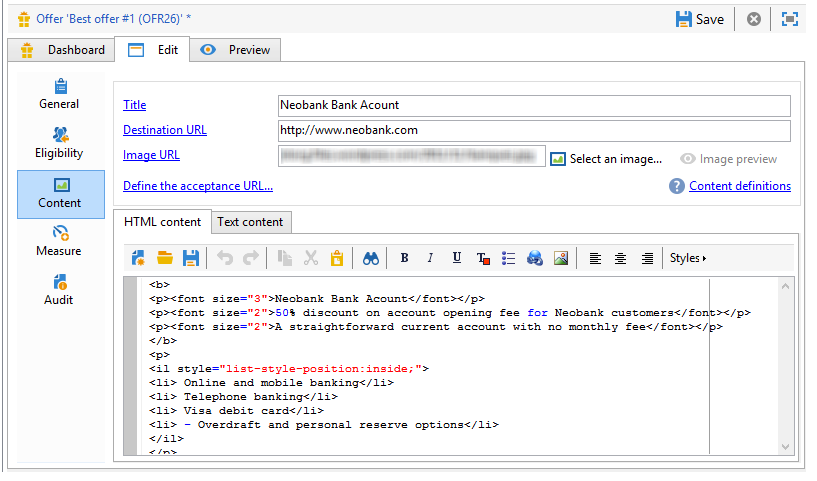

1. **최상의 오퍼** 범주에서 두 번째 오퍼를 만듭니다.

   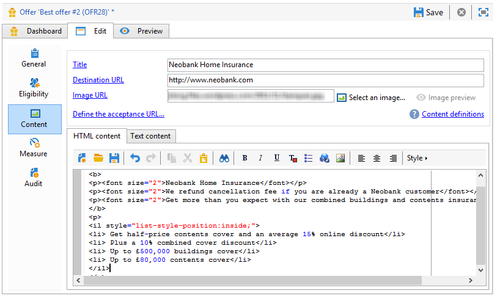

1. **파트너** 범주로 이동하여 개인 맞춤화된 오퍼를 만드십시오.

   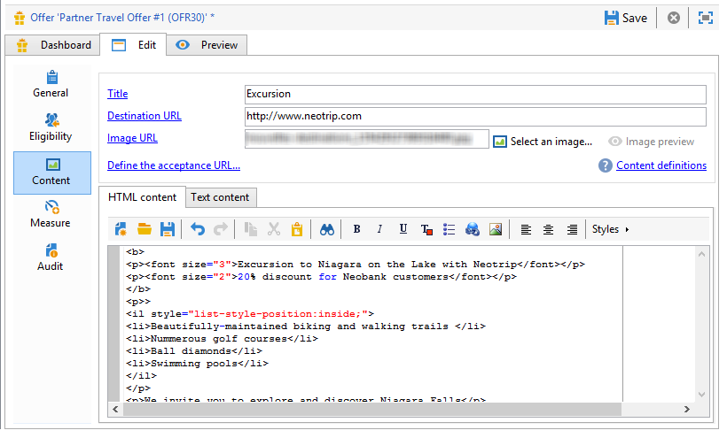

1. **[!UICONTROL Eligibility]** 탭으로 이동하여 해당 응용 프로그램 컨텍스트에 따라 오퍼의 가중치를 지정하십시오.

   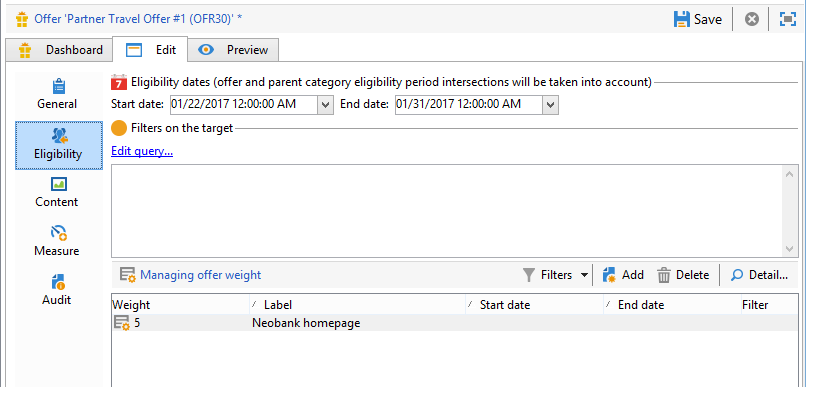

1. **Partner** 범주에 대한 두 번째 오퍼를 만듭니다.

   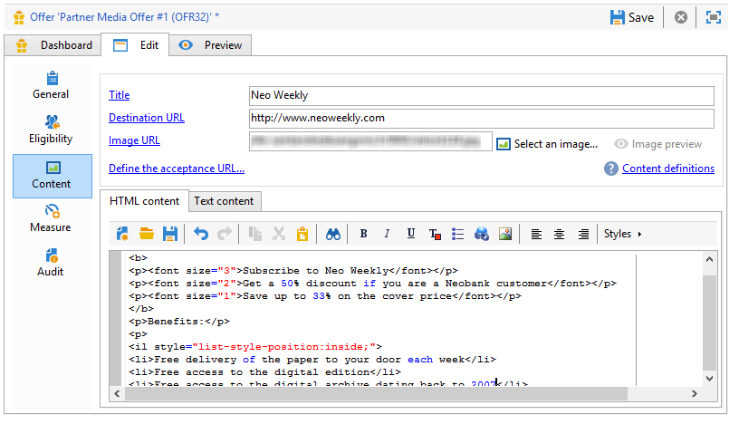

1. **[!UICONTROL Eligibility]** 탭으로 이동하여 이 범주의 첫 번째 오퍼에 적용한 것과 동일한 가중치를 적용하여 오퍼가 웹 사이트에 연속적으로 표시되도록 합니다.
1. 각 오퍼에 대한 승인 주기를 실행하여 업데이트를 시작합니다. 콘텐츠를 승인하는 동안 **파트너** 또는 **최상의 오퍼** 오퍼 공간을 활성화하십시오.

### 웹 페이지에서 오퍼 공간 구성 {#configuring-offer-spaces-on-the-web-page}

Neobank 회사의 웹 사이트에는 **최상의 오퍼** 범주의 은행 관련 오퍼에 대해 2개, **파트너** 범주의 오퍼에 대해 1개, 이렇게 3개의 오퍼 공간이 있습니다.

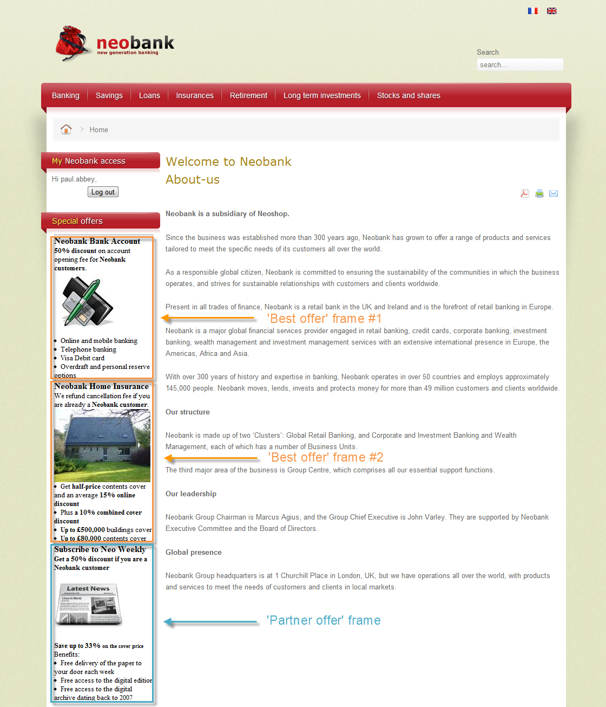

웹 사이트의 HTML 페이지에서 이러한 오퍼 공간을 구성하려면 다음 프로세스를 적용합니다.

1. HTML 페이지의 콘텐츠에 3을 삽입합니다.

   값이 웹 사이트의 다양한 오퍼 공간에서 오퍼를 호출할 수 있도록 해 주는 @id 속성을 가진 요소입니다.

   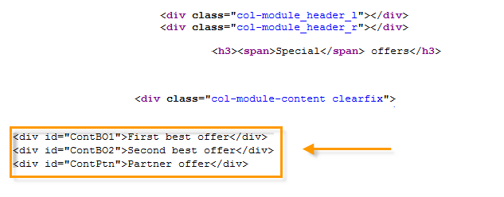

1. 그런 다음 속성 값을 정의하는 스크립트를 삽입합니다.

   

   이 예에서 **ContBO1** 및 **ContBO2**&#x200B;은(는) 값 **OsWebBestOfferIdentified**, 즉 식별된 환경에서 이전에 만든 **Best Offer** 오퍼 공간의 내부 이름을 받습니다. **CatBestOffer** 및 **CatBestOfferAnonym** 값은 익명 및 식별된 환경의 **Best Offer** 범주의 내부 이름과 일치합니다.

   

   마찬가지로 **ContPtn**&#x200B;은(는) 식별된 환경에서 만든 **Partner** 오퍼 공간의 내부 이름과 일치하는 **OSWebPartnerIdentified** 값을 받습니다. **CatPartner** 및 **CatPartnerAnonym**&#x200B;이(가) 익명 및 식별된 환경의 **Partner** 범주의 내부 이름과 일치합니다.

   

1. **interactionTarget** 변수에 Neobank 사이트에 로그온하는 사용자를 식별할 수 있는 정보를 할당하십시오.

   

   개인의 식별은 브라우저 쿠키, URL의 읽기 매개 변수, 이메일 또는 개인의 식별자를 기반으로 할 수 있습니다. 기본 키 이외의 받는 사람 테이블의 필드를 사용하는 경우 공간의 고급 매개 변수에서 정의해야 합니다([식별된 오퍼 공간의 고급 설정 지정](#specifying-the-advanced-settings-of-the-identified-offer-spaces) 참조).

1. 호출 URL을 삽입합니다.

   

   URL에 식별된 환경의 내부 이름인 **EnvNeobankRecip**&#x200B;이(가) 포함되어 있습니다.

웹 페이지를 열면 스크립트를 사용하여 상호 작용 엔진을 호출하여 웹 페이지의 관련 공간에 오퍼 콘텐츠를 표시할 수 있습니다. Adobe Campaign 서버에 대한 단일 호출에서 엔진은 선택할 환경, 오퍼 공간 및 범주를 결정합니다.

이 예에서 엔진은 식별된 환경(**EnvNeobankIdnRecip**)을 인식합니다. 웹 페이지의 첫 번째 및 두 번째 오퍼 공간에 대한 오퍼 공간(**OSWebBestOfferIdentified**) 및 **최상의 오퍼** 카테고리(**CatBestOffer**)와 사이트의 세 번째 오퍼 공간에 대한 오퍼 공간(**OSWebPartnerIdentified**) 및 **파트너** 카테고리(**CatPartner**)를 식별합니다.

엔진에서 수신자를 식별할 수 없으면 식별된 오퍼 공간에서 참조된 익명 오퍼 공간으로 전환하고 스크립트에 지정된 익명 범주(**CatPartner** 및 **CatPartnerAnonym**)로 전환합니다.
