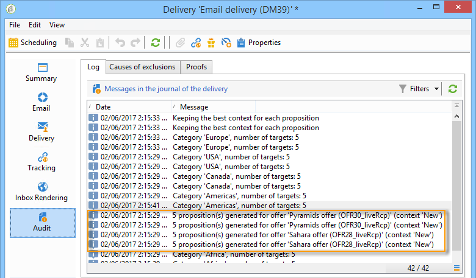
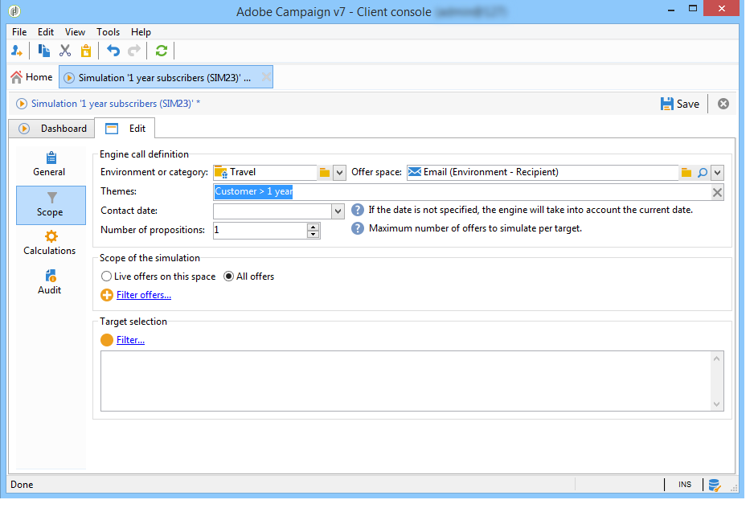
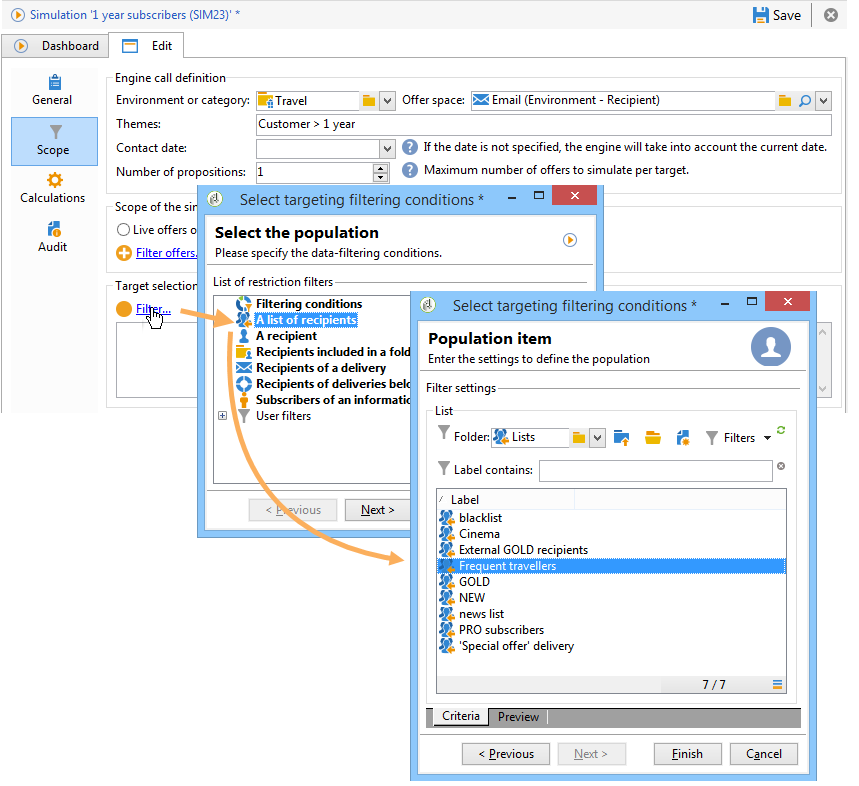

# 아웃바운드 채널에 대한 오퍼{#offers-on-an-outbound-channel}

## 이메일 오퍼 게재 {#email-offer-delivery}

저희 데이터베이스에 아프리카 여행 상품 분류가 있습니다. 각 오퍼의 자격, 컨텍스트 및 표시가 구성되었습니다. 이제 이메일을 통해 오퍼를 제공하는 캠페인을 만들려고 합니다.

1. 마케팅 캠페인 및 타겟팅 워크플로우를 만듭니다.

   

1. 전자 메일 게재를 편집하고 **[!UICONTROL Offers]** 아이콘을 클릭합니다.

   )

1. 공휴일과 일치하는 오퍼 환경의 이메일 공간을 선택합니다.

   

1. 아프리카 여행 상품을 포함하는 범주를 선택하세요.

   

1. 게재에서 오퍼 수를 2로 설정합니다.

   (으)로 설정된 오퍼 관리 창

1. 오퍼 관리 창을 닫고 게재 콘텐츠를 만듭니다.

   

1. 메뉴를 사용하여 첫 번째 오퍼 제안을 삽입하고 HTML 렌더링 함수를 선택합니다.

   

1. 두 번째 오퍼 제안을 삽입합니다.

   

1. **[!UICONTROL Preview]**&#x200B;을(를) 클릭하여 게재에서 오퍼를 미리 본 다음 오퍼를 받을 받는 사람을 선택하여 오퍼를 미리 봅니다.

   

1. 게재를 저장하고 타겟팅 워크플로우를 시작합니다.
1. 게재를 열고 게재의 **[!UICONTROL Audit]** 탭을 클릭합니다. 카탈로그의 다양한 오퍼에서 만들 제안을 오퍼 엔진에서 선택했음을 확인할 수 있습니다.

   

## 오퍼 시뮬레이션 수행 {#perform-an-offer-simulation}

1. **[!UICONTROL Profiles and Targets]** 탭에서 **[!UICONTROL Simulations]** 링크를 클릭한 다음 **[!UICONTROL Create]** 단추를 클릭합니다.

   템플릿, 레이블 및 폴더가 있는 새 오퍼 시뮬레이션 대화 상자를 여는 만들기 단추가 있는 

1. 레이블을 선택하고 필요한 경우 실행 설정을 지정합니다.

   

1. 시뮬레이션을 저장합니다. 그러면 새 탭에서 열립니다.

   

1. **[!UICONTROL Edit]** 탭을 클릭한 다음 **[!UICONTROL Scope]**&#x200B;을(를) 클릭합니다.

   

1. 오퍼를 시뮬레이션할 범주를 선택합니다.

   

1. 시뮬레이션에 사용할 오퍼 공간을 선택하십시오.

   

1. 유효 일자를 입력합니다. 시작 날짜 이상을 입력해야 합니다. 이렇게 하면 오퍼 엔진이 오퍼를 필터링하고 주어진 날짜에 유효한 오퍼를 선택할 수 있습니다.
1. 필요한 경우 하나 또는 여러 테마를 지정하여 설정에 이 키워드가 포함된 오퍼로 오퍼 수를 제한합니다.

   이 예제에서는 **여행** 카테고리에 두 개의 테마가 있는 두 개의 하위 카테고리가 포함되어 있습니다. **고객>1년** 테마를 사용하는 오퍼에 대한 시뮬레이션을 실행하려고 합니다.

   

1. 타겟팅할 수신자를 선택합니다.

   

1. 각 수신자에게 보낼 오퍼 수를 구성합니다.

   이 예에서 오퍼 엔진은 각 수신자에 대해 가중치가 가장 높은 3개의 오퍼를 선택합니다.

   

1. 설정을 저장한 다음 **[!UICONTROL Dashboard]** 탭에서 **[!UICONTROL Start]**&#x200B;을(를) 클릭하여 시뮬레이션을 실행하십시오.

   

1. 시뮬레이션이 완료되면 **[!UICONTROL Results]**&#x200B;에서 오퍼당 제안에 대한 자세한 분류를 참조하십시오.

   이 예에서 오퍼 엔진은 3개의 제안에 대한 오퍼 분류를 기반으로 합니다.

   

1. 오퍼 엔진에서 선택한 오퍼 목록을 보려면 **[!UICONTROL Breakdown of offers by rank]**&#x200B;을(를) 표시하십시오.

   

1. 필요한 경우 **[!UICONTROL Start simulation]**&#x200B;을(를) 클릭하여 범위 설정을 변경하고 시뮬레이션을 다시 실행할 수 있습니다.

   

1. 시뮬레이션 데이터를 저장하려면 보고서에서 사용할 수 있는 기록 또는 내보내기 기능을 사용합니다.

   
