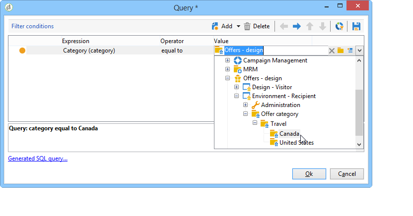
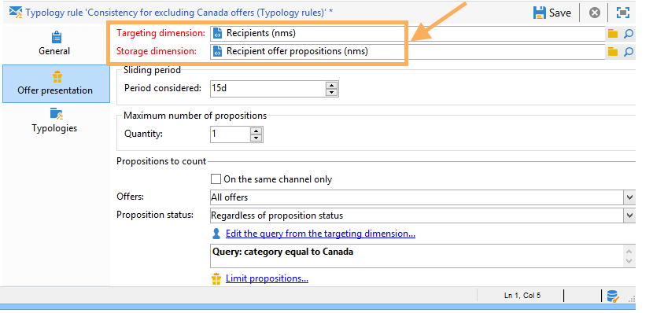
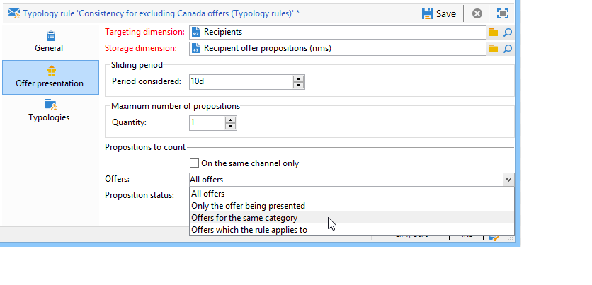
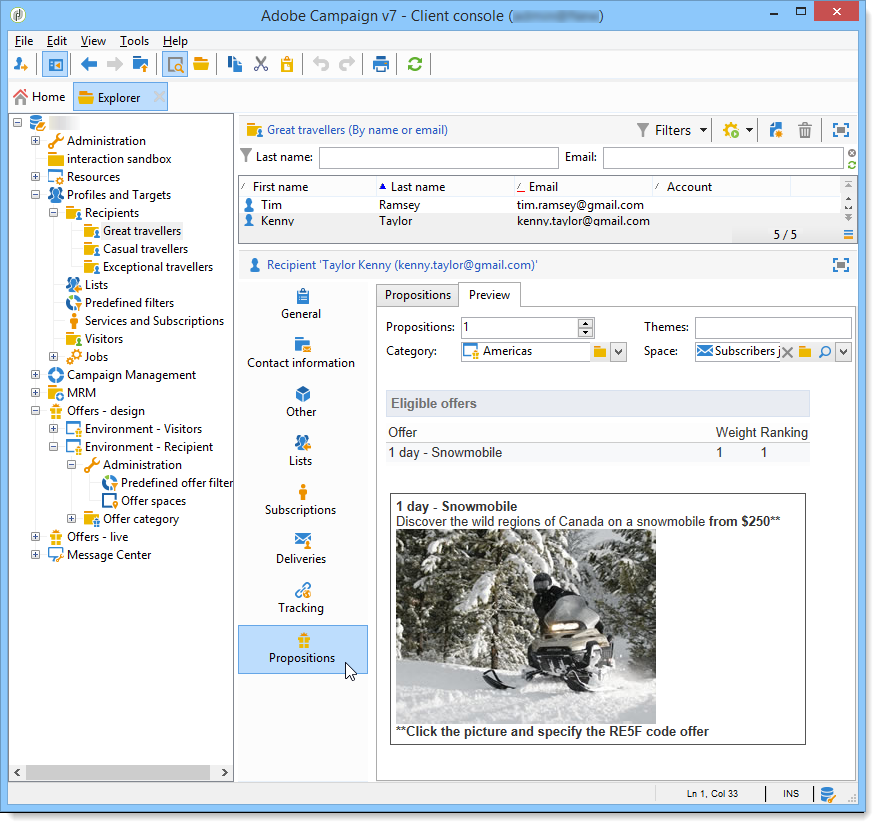

# 프레젠테이션 규칙{#presentation-rules}

## 프레젠테이션 규칙 만들기 {#creating-a-presentation-rule}

저희 데이터베이스에 유럽, 아프리카, 미국, 캐나다에 대한 몇 가지 여행 제안이 있습니다. 캐나다 여행에 대한 오퍼를 보내고 싶지만, 수신자가 이 유형의 오퍼를 거부하는 경우, 다시 보내고 싶지 않습니다.

캐나다 여행은 수신자 당 한 번만 제공되고 거부되면 다시 제공되지 않도록 규칙을 구성할 예정입니다.

1. Adobe Campaign 트리에서 **[!UICONTROL Administration]** > **[!UICONTROL Campaign management]** > **[!UICONTROL Typology management]** > **[!UICONTROL Typology rules]** 노드로 이동합니다.
1. 새 **[!UICONTROL Offer presentation]** 형식 규칙을 만듭니다.

   

1. 필요한 경우 레이블 및 설명을 변경합니다.

   레이블, 오퍼 표시 유형, 전자 메일 채널 및 설명을 입력한 

1. 규칙을 모든 채널로 확장하려면 **[!UICONTROL All channels]** 옵션을 선택하십시오.

   

1. **[!UICONTROL Edit expression]** 링크를 클릭하고 **[!UICONTROL Category]** 노드를 식으로 선택합니다.

   

1. 캐나다 여행 오퍼와 일치하는 범주를 선택하고 **[!UICONTROL OK]**&#x200B;을(를) 클릭하여 쿼리 창을 닫습니다.

   

1. **[!UICONTROL Offer presentation]** 탭에서 환경에 구성된 차원과 동일한 차원을 선택합니다.

   

1. 규칙을 적용할 기간을 지정합니다.

   

1. 이미 캐나다 여행을 거부한 수신자가 유사한 다른 오퍼를 받지 않도록 제안을 1개로 제한합니다.

   (으)로 설정된 오퍼 프레젠테이션 탭

1. **캐나다** 범주에서 모든 오퍼를 제외하려면 **[!UICONTROL Offers for the same category]** 필터를 선택하십시오.

   

1. 받는 사람이 거부한 제안만 고려하려면 **[!UICONTROL Rejected propositions]** 필터를 선택하세요.

   

1. 이 규칙을 적용할 수신자를 선택합니다.

   이 예제에서는 **자주 방문하는 사람**&#x200B;명을 선택합니다.

   

1. 오퍼 유형화에서 규칙을 참조합니다.

   선택한 오퍼 유형화를 나열하는 유형화 추가 대화 상자가 있는 규칙의 

1. 오퍼 환경(**환경 - 이 경우 수신자**)으로 이동한 다음 **[!UICONTROL Eligibility]** 탭의 드롭다운 목록을 사용하여 방금 만든 새 유형화를 참조합니다.

   

## 프레젠테이션 규칙 적용 {#applying-the-presentation-rule}

다음은 이전에 만든 유형화 규칙의 적용 예입니다.

우리는 캐나다 카테고리에 속하는 첫 번째 오퍼 제안을 보내려고 합니다. 수신자가 오퍼를 한 번 거부하면 다시 오퍼가 제공되지 않습니다.

1. **자주 찾는 여행자** 받는 사람 폴더에서 프로필 중 하나를 선택하여 해당 프로필에 해당하는 오퍼를 확인합니다. **[!UICONTROL Propositions]** 탭을 클릭한 다음 **[!UICONTROL Preview]** 탭을 클릭합니다.

   이 예제에서 **Tim Ramsey**&#x200B;은(는) **Americas** 카테고리의 일부인 오퍼에 참가할 수 있습니다.

   

1. 먼저 **자주 방문하는 사용자**&#x200B;명의 받는 사람을 대상으로 하는 전자 메일 게재를 만듭니다.
1. 오퍼 엔진 호출 매개 변수를 선택합니다.

   이 예제에서는 **캐나다** 및 **미국** 하위 범주를 포함하는 **미국 여행** 범주를 선택합니다.

   

1. 메시지 본문에 오퍼를 삽입하고 게재를 보냅니다. 자세한 내용은 [아웃바운드 채널 정보](https://experienceleague.adobe.com/en/docs/campaign/campaign-v8/offers/interaction-send-offers){target="_blank"}(Campaign v8 설명서)를 참조하세요.

   수신자가 적격한 오퍼를 수신했습니다.

1. 수용자는 제안 기록에 나타난 바와 같이 캐나다 제안을 거부하였다.

   

1. 이제 적격한 오퍼를 확인합니다.

   캐나다에 대한 오퍼가 선택되지 않았음을 알 수 있습니다.

   
