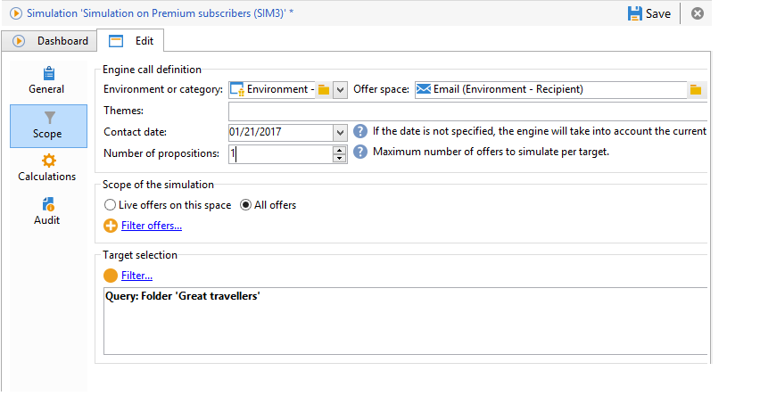
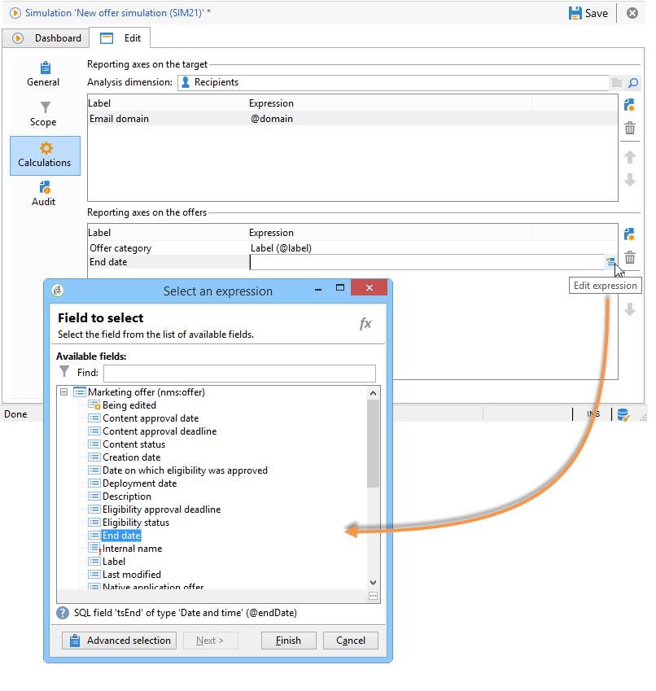

# 시뮬레이션 범위{#simulation-scope}

## 범위 정의 {#definition-of-the-scope}

설정을 선택하려면 **[!UICONTROL Scope]** 탭을 여십시오.

다음 항목은 필수입니다.

* 환경 또는 오퍼 카테고리입니다.
* 오퍼 공간.
* 연락일. 연락 날짜에 적합하지 않은 오퍼는 고려되지 않습니다.
* 대상 모집단.

  타겟에서 필터를 구성하지 않으면 전체 수신자 표가 고려됩니다.

* 대상당 시뮬레이션할 제안 수입니다.

  수신자는 이 많은 제안을 받게 됩니다. 예를 들어 5를 입력하면 각 수신자는 최대 5개의 오퍼 제안을 받습니다.

  

시뮬레이션을 위해 고려할 오퍼를 세분화하기 위해 하나 이상의 테마(카테고리에 미리 지정됨)를 추가할 수 있습니다.

모든 오퍼에서 또는 온라인 오퍼에서만 시뮬레이션을 수행하도록 선택할 수도 있습니다. 원하는 경우 일부 필터를 사용하여 선택 내용을 변경할 수 있습니다.

>[!NOTE]
>
>연락 날짜를 지정해야 합니다. 이렇게 하면 상호 작용 엔진이 선택한 환경 또는 범주의 오퍼를 정렬할 수 있습니다. 구성된 날짜가 없으면 시뮬레이션에서 오류가 발생합니다.

## 보고 축 추가 {#adding-reporting-axes}

**[!UICONTROL Calculations]** 탭을 통해 대상 또는 오퍼 자체에 대한 보고 축을 추가하여 시뮬레이션 분석을 향상시킬 수 있습니다.

이렇게 하려면 **[!UICONTROL Add]** 단추를 클릭하고 적절한 필드를 선택합니다. 축은 시뮬레이션을 계산하는 데 사용되며 분석 보고서에 표시됩니다. 자세한 내용은 [시뮬레이션 추적](simulation-tracking.md)을 참조하세요.

