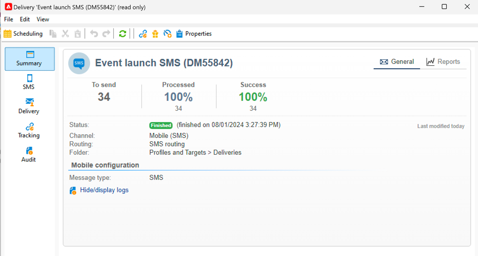
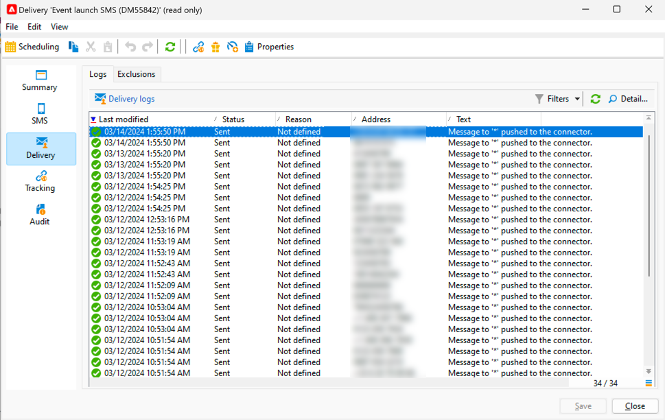
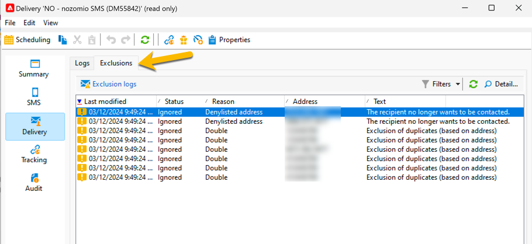
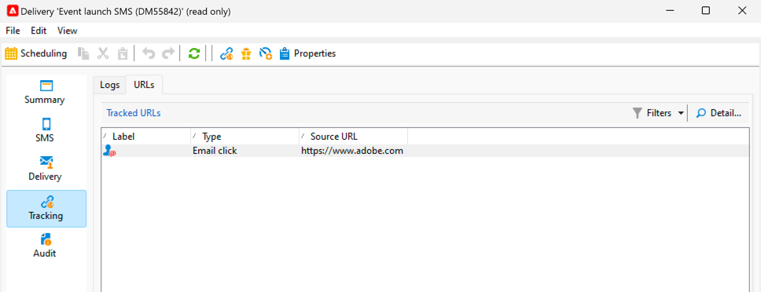
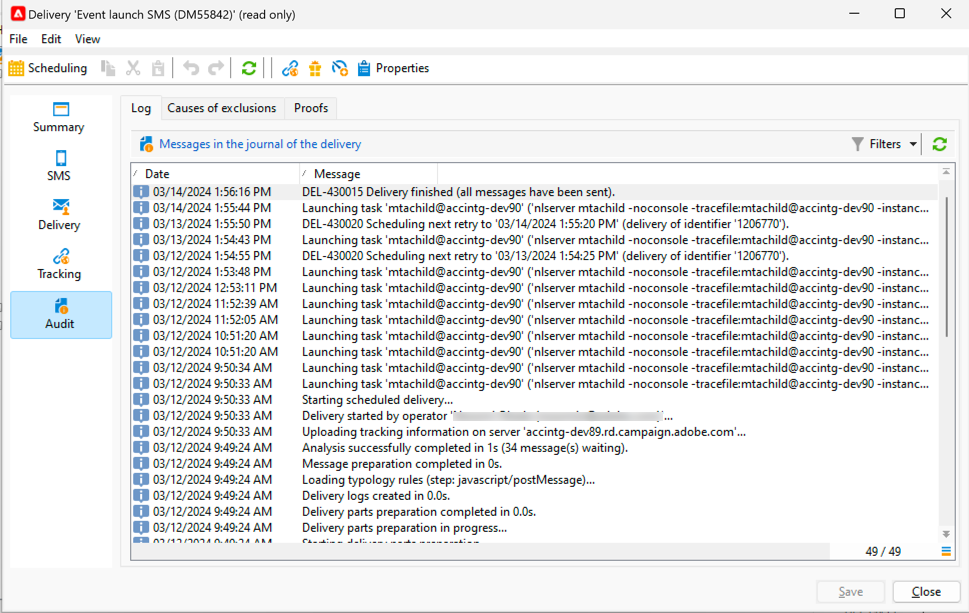

# SMS 모니터링 및 추적

마케팅 캠페인이 효율적인지 확인하려면 SMS 게재를 모니터링하는 것이 중요합니다.

다음은 게재를 보낸 후 발생하는 상황을 알고 있어야 하는 가능성입니다

## SMS 게재 대시보드 이해

게재 대시보드는 SMS에 대한 다양한 정보를 제공합니다.

대시보드에 액세스하려면 게재 목록에서 게재를 두 번 클릭합니다.

**[!UICONTROL Summary]** 탭에는 처리된 메시지 수 및 성공 횟수와 같은 기본 데이터가 있습니다.

{zoomable="yes"}

SMS를 보낸 후에는 변경 시 게재 콘텐츠에 대한 **[!UICONTROL SMS]** 탭에 더 이상 액세스할 수 없습니다.

**[!UICONTROL Delivery]** 탭에는 게재 로그에 대한 정보가 있습니다. 연락한 각 주소에 대해 SMS가 전송되었는지 여부를 확인할 수 있습니다

{zoomable="yes"}

**[!UICONTROL Exclusions]** 탭에서 일부 주소가 대상에서 제외되는 이유에 대한 자세한 내용을 볼 수 있습니다.

{zoomable="yes"}

**[!UICONTROL Tracking]** 탭은 추적에 대한 것입니다. 다음은 SMS 콘텐츠에서 추적된 URL의 예입니다.

{zoomable="yes"}

마지막으로, 게재를 시작하는 동안 모든 세부 정보가 포함된 **[!UICONTROL Audit]** 탭입니다.

{zoomable="yes"}

## SMS 오류 이해

SMS에 대한 실패 유형 및 실패 이유는 이메일과 동일합니다.

[게재 실패](../delivery-failures.md)에 대해 자세히 알아보고 특히 [SMS 격리](../delivery-failures.md#sms-quarantines)에 대해 자세히 알아보세요.
